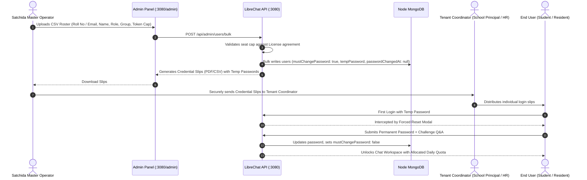
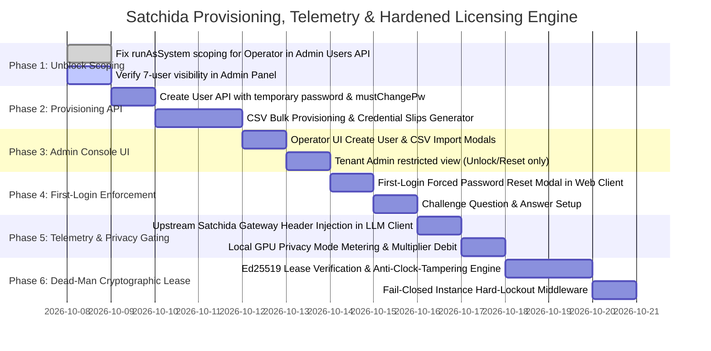

# Satchida AI Harness — Architecture

Product: a community / SMB AI harness served over Cloudflare Tunnel (HTTPS), with web and Android clients,
subscription tiers, Google-based registration, and UPI payments into an owner's UPI ID.

This document describes the **target** architecture. It is grounded in an audit of the
LibreChat tree at commit `f10b1d91` (2026-09-30) — every claim about what already exists was
verified against the source, not the README.

---

## 1. Integration audit of LibreChat-AI repositories

Six candidate repositories were evaluated. **Four require no work, one is a configuration
change, and one is obsolete.**

| Repository | License | Status in this deployment | Required action |
|---|---|---|---|
| [rag-api](https://github.com/LibreChat-AI/rag-api) | MIT | **Already integrated** | None. Optionally enable per tier. |
| [admin-panel](https://github.com/LibreChat-AI/admin-panel) | **AGPL-3.0** | **Decided against** (§3) | Remove from compose. |
| [code-interpreter](https://github.com/LibreChat-AI/code-interpreter) | Apache-2.0 | Contract-integrated, **not deployed** | Add a deployment (Phase 3). |
| [agents](https://github.com/LibreChat-AI/agents) | MIT | **Already integrated** as `@librechat/agents` | None. |
| [quickbooks-online-mcp](https://github.com/LibreChat-AI/quickbooks-online-mcp) | Apache-2.0 | Not integrated | Register as an MCP server (Phase 6). |
| [static-browser-server](https://github.com/LibreChat-AI/static-browser-server) | none | **Obsolete** | None. Do not integrate. |

Other repositories in the org were considered and excluded: `docs` (the librechat.ai
website), `librechat-config-yaml` (a YAML example collection), `spotify-mcp` (an example MCP
server), `codesandbox-client` (April 2025, paired with the dead static-browser-server),
`Starguard` and `LibreChat-DiscordBot` (Discord bots, unrelated to the product).

### 1.1 rag-api — already integrated

Evidence: `docker-compose.yml` and `deploy-compose.yml` both define a `rag_api` service
(`registry.librechat.ai/librechat-ai/librechat-rag-api-dev-lite:latest`). The API container
receives `RAG_API_URL` and `RAG_PORT`. `rag.yml` holds its configuration. RAG is optional and
only powers file-upload retrieval; it is **off** unless a RAG provider is configured.

Decision: keep wired but disabled for Standard, enabled for Pro and above. This is a
configuration change only — no code.

### 1.2 agents — not a service

`LibreChat-AI/agents` is the source of the **npm package `@librechat/agents`**, not a
deployable daemon. It is already a dependency at `^4.0.1` in both `packages/api/package.json`
and the legacy `api/package.json`. It provides LangGraph-based single- and multi-agent
orchestration, provider adapters, tool execution, and context pruning.

Decision: **do not clone it.** Upgrading means bumping the version range. There is no
container, no port, and no health check to wire.

### 1.3 code-interpreter — integrated by contract only

LibreChat reaches the Code API over HTTP using `CODE_API_KEY` plus bridge headers
(`CODE_API_BRIDGE_WORKER_HEADER`, `CODE_API_EXPECTED_PROFILE_HEADER`). See
`api/server/services/Files/Code/crud.js` and `packages/api/src/code/workspace.ts`.

**There is no `code-interpreter` service in `docker-compose.yml`.** A deployment that wants
the Run Code capability must run it separately. The repository additionally supports a newer
model described in `CONTEXT.md`: *attached code environments*, where a `librechat-code`
worker owns a sandboxed workspace on an operator- or principal-authorized machine, and the
worker is the final execution ceiling.

Decision: Phase 3 deploys the standalone Code API container for paid tiers. The attached-
worker model is the strategic path for Enterprise and is noted for later evaluation.

### 1.4 quickbooks-online-mcp — configuration only

A Cloudflare Workers MCP server (`wrangler.jsonc`) implementing OAuth 2.0 with Streamable
HTTP/SSE transport, described by its authors as drop-in compatible with LibreChat. It is
not referenced anywhere in the LibreChat tree.

Decision: it is an **MCP registration**, not a code change. Add it as an admin-level MCP
server definition (`packages/data-schemas/src/schema/mcpServer.ts`) behind a feature
permission so only Enterprise tenants see it. Note it executes on Cloudflare — outside the
Cloudflare Tunnel trust boundary — which must be disclosed to Enterprise customers.

### 1.5 static-browser-server — obsolete

Last pushed **2025-04-10**, no license, no description, 12 stars. **Zero references in the
current LibreChat tree**; the only hits are stale lockfile entries. The Static Browser
feature has been removed from LibreChat. Its companion `codesandbox-client` shares the same
vintage. Decision: do not integrate.

---

## 2. What LibreChat already gives us

The audit's most important result: **the subscription engine the product describes is
already implemented upstream.** The build is far smaller than a greenfield plan implies.

| Requirement | Existing implementation | Code needed |
|---|---|---|
| Google / Gmail registration | `GOOGLE_CLIENT_ID` / `GOOGLE_CLIENT_SECRET` in `.env.example`; `googleId` on the user schema; `packages/api/src/auth/googleRefresh.ts` for refresh | **None** — config only |
| Feature gating by tier | `packages/data-schemas/src/schema/role.ts` — RBAC with `PermissionTypes` in `packages/data-provider/src/permissions.ts`: `AGENTS`, `RUN_CODE`, `WEB_SEARCH`, `MCP_SERVERS`, `MEMORIES`, `FILE_SEARCH`, `FILE_CITATIONS`, `MARKETPLACE`, `MULTI_CONVO`, `TEMPORARY_CHAT`, `PEOPLE_PICKER`, `PROMPTS`, `BOOKMARKS`. Plus `group.ts`, `accessRole.ts`, `aclEntry.ts` | Plan→role mapping only |
| Daily / weekly / monthly token quotas | `packages/data-schemas/src/schema/balance.ts`: `tokenCredits`, `autoRefillEnabled`, `refillIntervalValue`, `refillIntervalUnit`, `refillAmount`, `lastRefill`; `REFILL_INTERVAL_UNITS` in `packages/data-provider/src/balance.ts` includes `days`, `weeks`, `months`. Concurrency-safe in-flight debiting via `reservations` / `reservedCredits` | Plan→balance config only |
| Demo / unauthorized account | Same mechanism: a role with `refillAmount` of a few hundred credits and `refillIntervalValue: 1`, `refillIntervalUnit: days` | Config only |
| Quota enforcement | `packages/api/src/middleware/checkBalance.ts` | None |
| Multi-tenancy | `tenantId` on user and balance; index on `[role, tenantId]` | Extension needed |
| Payments | **Nothing.** No Stripe, Razorpay, Cashfree, or Paytm anywhere in the tree | Full build (§5) |
| Subscription / plan records | **Nothing** | Full build (§4) |
| Native Android app | **Nothing native.** No `manifest.json`; only `client/public/assets/{favicon-16x16.png,favicon-32x32.png,logo.svg}`. No Capacitor or React Native. | Full build (§6) |
| Branding | LibreChat logo/favicons only | Full build (§7) |

`balance.enabled` is **off by default** — see `librechat.example.yaml:363` and
`packages/api/src/app/config.ts`. Enabling it forces `transactions.enabled = true`, which the
code enforces and warns about.

---

## 3. Licensing decision: admin-panel

**Decision: do not ship admin-panel. Build operator tooling on LibreChat's own admin API.**

### 3.1 Why

`admin-panel` is **AGPL-3.0**. AGPL §13 requires offering complete corresponding source to
every user who interacts with the software over a network. A paid, hosted, internet-exposed (tunnelled) AI
harness is exactly that case. Shipping admin-panel into a commercial service would oblige us
to open-source the panel to paying customers.

LibreChat itself is MIT, and every other component in this plan is MIT or Apache-2.0. Keeping
the stack uniform avoids a mixed-licensing product.

### 3.2 What admin-panel actually contains

It is a 279-file standalone React app in five areas:

- **Access** — Roles and Groups CRUD with `RolePermissionsPanel`; edits the same `role.ts`
  and `group.ts` data.
- **Configuration** — a full `librechat.yaml` editor with scope selectors, per-field
  metadata, profile values, and YAML import/reset.
- **Grants** — capability grants and an audit-log viewer with a detail drawer.
- **Users** — `UsersPage`, `CreateUserDialog`, `UserDetailDialog`.
- **Dashboard** and Help.

Critically: **the entire backend it needs is already in LibreChat.** `packages/api/src/admin/`
ships `users.ts`, `roles.ts`, `groups.ts`, `config.ts`, `grants.ts`, `auditLog.ts`,
`secrets.ts`, `skills.ts`, `code.ts`, `context.ts`, `langfuse.ts`, guarded by
`packages/api/src/middleware/admin.ts`, and exposed through `api/server/routes/admin/*.js`.
admin-panel is a **UI over APIs we already run.**

### 3.3 The decisive gap

Both admin surfaces — admin-panel's and LibreChat's native one — have **zero awareness of
token credits, subscriptions, or payments**. Verified: `UserDetailDialog.tsx` (557 lines) and
`UsersPage.tsx` (339 lines) contain no occurrence of `balance`, `credit`, `token`, `plan`,
`subscription`, `payment`, `invoice`, `usage`, `quota`, `stripe`, or `razorpay`. Likewise
`packages/api/src/admin/*.ts` contains no reference to balance or credits.

So neither surface can run the reconciliation reporting the product requires. **We build it
either way** — which means admin-panel's only remaining argument was its polished UI, and that
argument does not outweigh AGPL §13.

### 3.4 LibreChat's native admin surface

LibreChat's client-side admin is per-feature toggle dialogs rather than an operator console:
`client/src/components/Agents/MarketplaceAdminSettings.tsx`,
`client/src/components/Nav/SettingsTabs/General/AdminPanel.tsx`,
`client/src/components/SidePanel/MCPBuilder/MCPAdminSettings.tsx`,
`client/src/components/SidePanel/Memories/AdminSettings.tsx`,
`client/src/components/SidePanel/Skills/AdminSettings.tsx`,
`client/src/components/Prompts/buttons/AdminSettings.tsx`,
`client/src/components/Sharing/PeoplePickerAdminSettings.tsx`, and the shared
`client/src/components/ui/AdminSettingsDialog.tsx`.

This is adequate for feature gating. It is **not** an operator console, so Phase 2 adds one
inside our own product.

---

## 4. Subscription and quota model

### 4.1 Reuse, not reinvention

Plans map onto existing primitives. A plan is **not** a new entitlement system; it is a named
bundle of (a) an RBAC role, (b) a balance configuration, and (c) an interface feature set.

Proposed tiers:

| Tier | Role | Token quota | Key features |
|---|---|---|---|
| **Demo** (unpaid/unverified) | `USER` + restricted role | ~500 credits, refills every 24h, resets daily | Chat only. No agents, code, web search, file search, MCP, memories. |
| **Standard** | `STANDARD` | monthly refill | Chat, artifacts, file upload, prompts, bookmarks, web search |
| **Pro** | `PRO` | larger monthly refill | + Agents, MCP servers, memories, RAG/file search, code interpreter |
| **Family** | `FAMILY` | pooled monthly refill across N seats | + Everything in Pro, per-seat governance |
| **Enterprise** | `ENTERPRISE` | negotiated / pooled | + Admin console, grants, audit log, attached code environments, QuickBooks MCP, SSO, dedicated instance |

The **Demo** tier implements the "unauthorized account gets a very low limit for one day"
requirement directly through `refillIntervalValue: 1` + `refillIntervalUnit: days`.

### 4.2 What must be built

- `plan` collection: tier key, display name, price, currency, seat count, token allowance,
  refill interval, active flag.
- `subscription` collection: user/tenant, plan ref, status (`pending_payment`, `active`,
  `expired`, `revoked`), started/expires timestamps.
- Seats for Family (a plan limit enforced at invite time).
- An assignment service mapping a subscription to the correct role and balance config, applied
  as one idempotent operation.

Per `AGENTS.md`, all of this belongs in `packages/data-schemas` with plain typed objects, and
the business logic in `packages/api`.

---

## 5. Payments

### 5.1 Constraint

A personal UPI QR code is a **static image with no webhook**. Nothing in the system can detect
that money arrived. Automatic activation therefore requires a payment gateway or a bank
settlement webhook — neither of which exists yet (no Razorpay account).

Razorpay *can* be integrated from code today, but it is **untestable without credentials**:
checkout creation, signature verification, and webhook delivery all need live keys. Shipping
unverifiable payment code is worse than shipping none.

### 5.2 Decision: provider interface, manual provider live now

Implement a `PaymentProvider` interface in `packages/api` with two implementations:

1. **`ManualUpiProvider` — live now.** User selects a plan, scans the owner's static UPI QR,
   and submits a UPI reference/transaction ID plus the amount and timestamp. The record sits
   in `pending_payment`. An operator verifies it in their banking app and approves in the
   reconciliation console, which activates the subscription.
2. **`RazorpayUpiProvider` — implemented, inactive.** Same interface. Activated purely by
   supplying `RAZORPAY_KEY_ID` / `RAZORPAY_KEY_SECRET` / webhook secret and flipping a
   `configSchema` toggle. Per `AGENTS.md` every new lever ships as a `configSchema` field
   defaulting to today's behavior.

This satisfies "gateway later only if it can't be done now" without leaving a rewrite.

### 5.3 Reconciliation reporting (required regardless)

An operator page listing every account with: registration date, last authentication, selected
plan, payment status, submitted UPI reference, amount, submission timestamp, approval
timestamp and approving operator. Filterable by status and plan, exportable to CSV for
reconciliation against the bank statement.

This page is the actual deliverable for Phase 2 and is gateway-agnostic — it stays useful
after Razorpay lands.

---

## 6. Client delivery: PWA first, Capacitor second

Agreed sequencing:

1. **PWA (Phase 4)** — add a web app manifest, icons, and a service worker. Installable on
   Android phone and tablet, updates instantly, no store review, works over HTTPS. No new
   application codebase.
2. **Capacitor native wrapper (Phase 4)** — wrap the existing React client in a native
   Android shell sharing one codebase. Produces a distributable APK/AAB and unlocks push
   notifications and native file access.
3. **Full native Android (later)** — a Kotlin/Compose client against the REST and streaming
   endpoints. Deferred.

### 6.1 SPA shell serving — the loading page, the login page, and the admin page

These three surfaces are distinct and must not be conflated:

- **The mandala loading page** is the unauthenticated SPA shell. The Express fallback in
  `api/server/index.js` reads `client/dist/index.html` once at startup and serves it (with a
  per-request CSP nonce and locale) for every non-API route. The mandala animation and the login
  box both live in this single shell; the client-side router (`client/src/routes/index.tsx`)
  renders `StartupLayout` at `/` and the account form at `/login`. They are part of the **same**
  build output — there is no separate "login page" build.
- **The admin page** (`/admin*`) is the operator console (roles, plans, subscriptions, audit). It is
  the same SPA shell as above, just a different route, role-gated (`ADMIN`) on both the client and the
  server. It is **not** a separate login flow and **not** a separate build. An operator therefore
  signs in through the mandala shell and navigates to `/admin`.

**Pitfall — stale shell cache (how the loading page was "lost").** The shell is read into memory
once per process. When `client/dist` is rebuilt without the server restarting, the in-memory
`indexHTML` still references the old content-hashed bundles, which the rebuild deleted from disk, so
the browser receives HTTP 404 for `index.<oldhash>.js` and the page hangs on the mandala. The server
now re-reads `client/dist/index.html` whenever its mtime changes, so a client rebuild is served
without a restart. A PM2 restart is still required when `api/server/index.js` itself changes.

---

## 7. Rebranding

Replace LibreChat identity with Satchida assets across:

- `client/public/assets/logo.svg`, `favicon-16x16.png`, `favicon-32x32.png`
- A new app manifest and PWA icon set
- `package.json` `name` / `description` fields
- `librechat.example.yaml` and UI copy
- Localization seed strings in `client/src/locales/en/translation.json`

**Blocked:** the Satchida logo and brand assets were not available at authoring time and must
be supplied before Phase 5 can start. See `Implementation-plan.md` Phase 5.

Per `AGENTS.md`, theming uses semantic theme/Tailwind roles — the rebrand swaps theme tokens
and assets, not ad-hoc hex colors.

---

## 8. Deployment topology

Decided model: **hybrid**.

- **Shared multi-tenant deployment** — Community, Standard, Pro, Family. One LibreChat
  instance, isolated by `tenantId`. Per-tenant isolation hardening is Phase 7 work.
- **Single-tenant dedicated instance** — Enterprise. Same image, own compose stack, own
  database, reachable via the client Cloudflare Tunnel.

Shared infrastructure: MongoDB 8, Meilisearch, pgvector, Redis. Base compose already
provides MongoDB, Meilisearch, and vectordb; Redis is added for resumable streams.

Behind Cloudflare Tunnel, so TLS termination and certificate lifecycle are deployment concerns rather than
application concerns.

### 8.1 Inference hardware

**One GPU, 16 GB.** Running Qwen3-VL-4B + mmproj at 4-bit. Estimated capacity is **6–12
concurrent 8K-context streams**, realistically ~8 sustained.

That supports ~1,000 subscribers at a 2–4% concurrent peak — normal for a chat product — but
**not** 1,000 simultaneous users. Capacity planning should use the peak, not the total.

Qwen3.5-9B is not viable on 16 GB alongside serving load without heavy quantisation; it is a
future consideration if the GPU is upgraded.

### 8.2 Routing, modes and privacy — see `INFERENCE.md`

**LibreChat has no provider failover.** Verified: `packages/api/src/endpoints/config/providers.ts:40`
maps one provider name to one initialize function; the two `fallback` references in that file
are case-insensitive name normalisation, not failover; every `429` in the codebase is internal
queue pressure (`QUEUED_TURN_QUEUE_FULL`, `STEER_QUEUE_FULL`), never an upstream provider's.

So routing is ours to build, as an OpenAI-compatible proxy that LibreChat points at as a single
endpoint named `satchida`. Full design — provider registry, quota state, selection, modes,
mid-turn recovery — is in **`INFERENCE.md`**.

Three modes, selected per conversation, never exposing a model name:

| Mode | Routing | Search |
|---|---|---|
| **Chat** | free cloud → paid cloud → local | standard |
| **Work** | paid cloud preferred | standard |
| **Privacy** | local only — content never leaves our infrastructure | none, or a contracted provider |

**Three privacy properties are kept distinct** — non-retention, unlinkability, and locality are
independent, and only local vLLM provides the third. Full taxonomy and the exact customer
promise we may make are in `INFERENCE.md` §1.

### 8.3 Provider terms — what actually constrains us

**No reseller agreement is required.** Standard commercial API terms explicitly permit powering
products for our own end users. Anthropic Commercial Terms §A.1: *"Anthropic gives Customer
permission to use the Services, including to power products and services Customer makes
available to its own customers and end users."*

**What is restricted is building a competing product or reselling the provider's service** —
Anthropic §D.4, OpenRouter's ToS ("reselling API access to Models **or otherwise developing a
competing service**"). Our model-hiding design is what keeps us on the right side of that: we
never name the provider, never market by model, never offer a provider-branded mode.

| Traffic | Providers |
|---|---|
| Paid / customer-revenue | **Direct provider API keys** under standard commercial terms — our own account |
| Non-revenue — Demo, recovery, internal | Aggregators and free tiers (OpenRouter, TokenHarbor, OpenCode) |

Every provider still passes a three-check gate — competing-product use absent, multi-account
stacking absent, retention documented — before entering the routing registry. Entries with
unknown retention are barred from Privacy mode; the gate fails closed.

**Prohibited everywhere: multiple accounts used to multiply a free quota.** One personal key per
provider is ordinary use, not circumvention.

The local model remains the licence-clean core: it is the one inference path with no third-party
terms at all, and the only tier (Privacy mode) sellable without depending on any provider's
retention posture.

### 8.4 Model identity

Per decision, the identity line is **"I am Satchida, an AI assistant built by Satchida."** Not
"finetuned" — no fine-tune exists, and that would be untrue to paying customers. Held as a
config value so a future fine-tune can change it.

Model names are hidden from the UI, from message text, from API responses, and from error
text. They are **not** hidden from raw network payloads. Absolute non-disclosure is not
achievable; "no user casually encounters the model name" is, and is the achievable goal.
Admin retains full visibility.

---

## 9. Component map

```
                     ┌──────────────┐
   Android / PWA ───▶│  LibreChat   │───▶ MongoDB · Meilisearch · pgvector · Redis
   Capacitor        │  api (Node)  │
                     └──────┬───────┘
                            │  one endpoint: "satchida"
                     ┌──────▼───────┐
                     │   Router     │  queue · priority · free-first · cost accounting
                     │ (OpenAI-compat)│
                     └──┬────┬───┬──┘
                        ▼    ▼   ▼
                    vLLM   free  paid cloud
                   local   cloud  overflow

       Side paths:  Code API · rag-api · MCP servers · Payment provider (manual → Razorpay)
```

New Satchida modules:

- `packages/data-schemas/src/schema/plan.ts` — plan definitions
- `packages/data-schemas/src/schema/subscription.ts` — user/tenant subscriptions
- `packages/data-schemas/src/schema/payment.ts` — payment attempts and reconciliation
- `packages/api/src/billing/` — provider interface, manual and Razorpay implementations
- `packages/api/src/admin/reconciliation.ts` — operator reporting
- `client/src/components/Admin/console/` — operator console UI
- **Router service** — standalone, outside this repo; OpenAI-compatible

---

## 10. Summary of build scope

| # | Work item | Phase |
|---|---|---|
| 0 | Fork remote, `satchida` branch, backup script | 0 |
| 1 | Enable Google OAuth, `balance.enabled`, transactions | 1 |
| 2 | Plan / subscription schemas and assignment service | 2 |
| 3 | Demo tier enforcement (hard 24h expiry) | 2 |
| 4 | Operator reconciliation console + CSV export | 2 |
| 5 | Manual UPI provider + plan purchase flow | 2 |
| 6 | Operator admin console UI (roles, plans, subscriptions) | 2 |
| 7 | **Inference router** (queue, priority, free-first, cost) | 1 |
| 8 | Local vLLM serving Qwen3-VL-4B | 1 |
| 9 | Code API deployment, tier-gated | 3 |
| 10 | rag-api enablement, tier-gated | 3 |
| 11 | PWA manifest, icons, service worker | 4 |
| 12 | Capacitor Android wrapper | 4 |
| 13 | Satchida rebrand (ported generator) | 5 |
| 14 | QuickBooks MCP registration, Enterprise-gated | 6 |
| 15 | Razorpay provider activation — **after all build and test** | 7 |
| 16 | Multi-tenant isolation hardening | 8 |
| 17 | Attached code environment evaluation | 9 |

---

## 11. Fork and upstream strategy

Per decision: **fork + long-lived `satchida` branch**.

- `upstream` → `LibreChat-AI/LibreChat` (configured)
- `origin` → `https://github.com/techwatch4all-bit/LibreChat.git` (**added**)
- `satchida` → all product work; never force-pushed
- `main` → release branch, cut from `satchida`

Upstream updates are rebased onto `satchida` deliberately, so a bad merge is never live until a
release is cut. The full ritual — including overlap detection and post-update verification —
is in `UPSTREAM-UPDATE-PROCEDURE.md`, adapted from the SCode fork's battle-tested version.

A backup script (`scripts/backup-satchida-librechat.ps1`) must be written in Phase 0; it does
not exist in this repo yet.

---

## 11.7 Stream resumption without Redis — corrected

**An earlier draft implied resumable streams were impossible without Redis. That was wrong.**
Verified in the repository:

`packages/api/src/stream/createStreamServices.ts:74` selects the backend —
`const useRedis = config.useRedis ?? cacheConfig.USE_REDIS_STREAMS;`

Two backends exist, both satisfying the same `IJobStoreV2` contract:

| Backend | Files | Capability |
|---|---|---|
| **In-memory** (default) | `stream/implementations/InMemoryJobStore.ts`, `InMemoryEventTransport.ts` | Resume primitives present: `claimFirstSubscriber`, `restoreClaimedSteers`, `hasSubscriberAttached`, `transitionStatusAndDrainSteers` |
| Redis | `RedisJobStore.ts`, `RedisEventTransport.ts` | Same contract, plus durability across restarts and multi-replica sharing |

**Correct position:** resumable streams work without Redis. What is lost is **durability across a
process restart or crash**, and multi-replica coordination. Client nodes are single-replica with a
long-lived process, so **in-memory is sufficient and Redis stays omitted** — for the Windows
reasons in `DEPLOYMENT.md` §6, not because resumption was impossible.

---

## 11.8 Authentication model — social login authenticates, never authorises

| Setting | Value | Effect |
|---|---|---|
| `ALLOW_SOCIAL_LOGIN` | `false` | No social buttons by default; per-client opt-in for schools |
| **`ALLOW_SOCIAL_REGISTRATION`** | **`false`** | **The authorisation gate.** OAuth may sign in an *existing* account; it can never create one |
| `ALLOW_REGISTRATION` | `false` | No self-service signup |
| `ALLOW_EMAIL_LOGIN` | `true` | Client-provisioned local accounts (`Student001`, `John Doe`) |

Source: `api/server/routes/config.js:96`; `isEnabled()` at `packages/api/src/utils/common.ts:20`
compares against the literal string `"true"`.

**Without `ALLOW_SOCIAL_REGISTRATION=false`, any Google account on earth could complete OAuth
against a client subdomain and consume a seat.** That flag is the entire gate.

**Two auth modes by client type:**

| Client | Method | Identity |
|---|---|---|
| RWA / SME | Society-provisioned local accounts | Fully pseudonymous; no external dependency |
| School | Google Workspace OIDC + pre-provisioning | Student uses their existing school login |

Redirect URI per client: `https://<subdomain>.satchida.com/google/callback`, registered against
the single OAuth project we operate. **We hold no user list** — credentials only ever verify
identity to the client's own server.

⚠️ **None of this is a security boundary on client hardware** — `.env` is a plain file the client
can edit. Real enforcement is the gateway licence. See `VULNERABILITIES.md` V2.

⚠️ **The first user registered on any fresh deployment is auto-promoted to `ADMIN`.** The
deployment runbook must create the admin, set `ALLOW_REGISTRATION=false`, and verify no further
user holds `role: ADMIN`. `VULNERABILITIES.md` V10.

---

## 11.9 Verified runtime configuration

Established by running it on 2026-10-04:

| Setting | Value | Why |
|---|---|---|
| Config schema version | `1.3.17` | `Constants.CONFIG_VERSION`, `packages/data-provider/src/config.ts:4172` |
| `RAG_API_URL` | `http://127.0.0.1:8010` | **Not 8000** — see §11.10 |
| `SCHEDULES_SINGLE_PROCESS` | `true` | Single-replica client node, no Redis |
| `PORT` | `3080` | Shell `PORT=5174` from the SCode profile overrides `.env`; Windows services do not load that profile |

`librechat.yaml` validation notes: `fileConfig.endpoints` is keyed by **endpoint name**, not
endpoint type; and there is no `disabled` field on endpoints — an unconfigured endpoint is simply
unavailable.

Launch command (do not vary):

```powershell
pm2 start fleet/ecosystem.config.cjs   # name: librechat (api/server/index.js), PORT=3080
```

> **Never launch via `npm` / `npm.cmd`.** The path `C:\Program Files\nodejs\npm.cmd` contains a
> space, so PM2 running it makes Node evaluate `npm.cmd` as JavaScript, which dies with
> `SyntaxError: Unexpected token ':'`. The fleet config runs the CJS entry directly and pins
> `PORT=3080`, `HOST=0.0.0.0`, `NODE_ENV=production` in `env`. A process restart is only required
> when `api/server/index.js` changes; `client/dist` rebuilds are picked up automatically by the
> mtime-gated shell re-read (§6.1).

---

## 11.10 Port assignments

| Port | Service | Notes |
|---|---|---|
| 3080 | LibreChat | Never exposed directly |
| 4000 | Router / autorouter | Our side. Holds provider API keys |
| 8010 | **RAG service** | **Never 8000** — see below |
| 8443 | Fleet control | Metadata only, Zero Trust Service Token |
| 5173 / 5174 | SCode / OpenHands dev servers | Not ours |

> **Port 8000 is occupied by Satchida Hands** (an OpenHands SPA on this workstation). It returns
> **HTTP 200 with `text/html` on every path**, so LibreChat's RAG health check reported
> *"RAG API is running and reachable"* against the wrong application. RAG was moved to **8010**.
> Never point `RAG_API_URL` at 8000.

---

## 12. Key custody and licensing controls

Two problems, often confused. They have different answers.

### 12.1 The API key problem — architecture, not licensing

**The MIT licence cannot protect the API keys.** A licence check is ordinary code in a fork anyone
can delete. What protects the keys is never giving the client control of them.

| Where the gateway runs | Key risk | Do we see prompts |
|---|---|---|
| Client's hardware | ❌ **Client reads the keys. Loss is unbounded and personal** | No |
| **Our server** | ✅ Keys never leave our control | Yes, in cloud modes only |

**Decision: the gateway runs on our infrastructure.** Client hardware holds the platform, the
database, and the local model — never our credentials.

Consequences, which are real and must be disclosed rather than discovered later:

1. We transit prompts in **Chat** and **Work** modes. **Privacy mode** routes locally and nothing
   leaves the client's premises at all.
2. It also gives us the three controls that actually bound loss: **per-client spend caps**,
   **scheduled key rotation**, and **immediate revocation on offboarding**.
3. Those caps — not the licence key — are the actual bound on exposure.

### 12.2 The licensing problem — two independent locks

Both live in **code we author**, never in the MIT base.

**Layer 1 — the gateway (primary, strong).** The gateway holds the credentials, so a client cannot
make the product work without it. It refuses to serve inference without a valid entitlement token.
Removing this is equivalent to removing the product.

**Layer 2 — the LibreChat fork (secondary, softer).** A licence module in our `packages/api` that
gates premium capability — Cloud/Work modes, the Privacy add-on, BYOK. **Deliberately not a hard
boot block**, so a licence fault degrades the product instead of bricking a client's users.

Two layers with different strengths is right: layer 1 is the real control, layer 2 catches the case
where someone keeps the client-side platform running without the gateway.

### 12.3 Time-based lock, and the trust constraint that shapes it

| Window | Behaviour |
|---|---|
| **Token valid** | Full service |
| **Expired, within grace (14 days)** | Full service. Banner warns the Client |
| **Grace expired, AMC unpaid** | Cloud/Work modes and premium features disabled. **Local Privacy mode and basic chat keep working** |
| **Extended lapse (90+ days)** | Service suspended pending settlement |

**Design rule: we never brick a client's users because of our own outage or their IT team blocking
us.** If our Authorisation service is down, every client must keep working. Therefore:

- Long grace period — 14 days is the floor, not a target
- Tokens verified **offline against a cached public key**, so no per-request call to us
- Renewal is a single call, retried with backoff, never blocking a request
- **Fail open on infrastructure faults, fail closed on expiry.** A network error is not an
  authorisation failure — never conflate them

Signing uses Ed25519. We hold the private key; clients verify with the public key and cannot mint
a token.

### 12.4 What the licence does and does not buy

**Does:** the client loses updates, patches, tuning, support, and the Privacy add-on. Reverting to
plain upstream software is possible, and that is the honest ceiling on this control.

**Does not:** protect the API keys, prevent forking, or create any legal right over MIT-licensed
code. Frame it as continuity of service — which is what actually costs a client money — and never
as protection of secrets.

---

<!-- MERGED-DISTRIBUTED-PART -->
## Part II - Distributed Cloudflare-Tunnel edition (supersedes any VPN/Headscale/VPS wording above)

### Satchida AI Harness — Distributed Multi-Tenant Architecture

Product: A distributed edge AI platform deployed across SMEs, schools, and enterprise clients on native Windows 11 hardware, traversed securely across symmetric Jio CGNAT via Cloudflare Zero Trust, with zero cloud hosting fees ($0/month), native LanceDB RAG retrieval, and centralized licensing control.

This document describes the **target distributed architecture** for scaling from 1 to 100+ clients across India while serving local office workers from Seller Central HQ.

---

## 1. System Topology: Central Control Plane vs. Distributed Edge Nodes

In a distributed edge topology, each client receives their own autonomous, physically isolated **Edge Execution Node**, while your Windows 11 workstation acts simultaneously as the **Seller Central Fleet HQ** and a local office server.

```
+===================================================================================================+
|                                    SELLER CENTRAL HQ (YOUR WORKSTATION)                           |
|                                    Windows 11 Pro / Enterprise (Jio CGNAT)                        |
|                                                                                                   |
|  [Internal Office Services]                        [Central Control Plane (Port 8443)]            |
|  - Native LibreChat (Port 3080)                    - Master Fleet Manager (Node.js/FastAPI)       |
|  - Native RAG Service (rag-service)                - Master Licensing Engine & Seat Ledger        |
|  - MongoDB (Internal Office Users)                 - Master Key Vault (Zero-Knowledge injection)  |
|                                                    - Remote Policy & Seat Dispatcher              |
|                                                                                                   |
|  [Master Ingress Daemon]                                                                          |
|  - cloudflared.exe Windows Service                                                                |
|    ├── office.yourdomain.com   -> 127.0.0.1:3080 (For your office workers)                        |
|    └── control.yourdomain.com  -> 127.0.0.1:8443 (For remote node heartbeat sync)                 |
+=================================================▲=================================================+
                                                  │ Outbound HTTPS/QUIC
                                                  ▼
+===================================================================================================+
|                                CLOUDFLARE ZERO TRUST GLOBAL EDGE FABRIC                           |
|  - Wildcard Dynamic Ingress: *.yourdomain.com -> Routed dynamically to individual Tunnel IDs      |
|  - Automated TLS 1.3 Termination, Free Edge SSL, Edge DDoS & Rate Limiting Shield                |
|  - Zero Inbound Ports Required: Completely bypasses Jio / Airtel Symmetric CGNAT                  |
+===================================================================================================+
            ▲                                      ▲                                      ▲
            │ Outbound Egress                      │ Outbound Egress                      │ Outbound Egress
            │ (Tunnel Token: client-001)           │ (Tunnel Token: client-002)           │ (Tunnel Token: client-100)
            │                                      │                                      │
+-----------┴--------------------------+ +---------┴--------------------------+ +---------┴--------------------------+
| CLIENT 001: Mumbai High School       | | CLIENT 002: Bengaluru Tech SME     | | CLIENT 100: Delhi Training Academy |
| Windows 11 Desktop (Jio CGNAT)       | | Windows 11 Desktop (Jio CGNAT)     | | Windows 11 Desktop (Jio CGNAT)     |
| Subdomain: school-mum.yourco.com     | | Subdomain: sme-blr.yourco.com      | | Subdomain: academy-del.yourco.com  |
|                                      | |                                    | |                                    |
| [Core Services (Port 3080)]          | | [Core Services (Port 3080)]        | | [Core Services (Port 3080)]        |
| - LibreChat (Native Node.js)         | | - LibreChat (Native Node.js)       | | - LibreChat (Native Node.js)       |
| - Native RAG Service (LanceDB/FTS5)  | | - Native RAG Service (LanceDB/FTS5)| | - Native RAG Service (LanceDB/FTS5)|
| - MongoDB Engine (Local Auth & Data) | | - MongoDB Engine (Local Auth & Data)| | - MongoDB Engine (Local Auth & Data)|
| - Local AutoRouter & Metering Proxy  | | - Local AutoRouter & Metering Proxy| | - Local AutoRouter & Metering Proxy|
| - Fleet Sync Agent (Win Service)     | | - Fleet Sync Agent (Win Service)   | | - Fleet Sync Agent (Win Service)   |
| - cloudflared.exe (Windows Service)  | | - cloudflared.exe (Windows Service)| | - cloudflared.exe (Windows Service)|
+--------------------------------------+ +------------------------------------+ +--------------------------------------+
            ▲                                      ▲                                      ▲
            │ Standard Browser HTTPS / PWA         │ Standard Browser HTTPS / PWA         │ Standard Browser HTTPS / PWA
   [Students & Teachers]                  [SME Employees]                        [Remote Students]
   (Zero VPN installation needed)         (Zero VPN installation needed)         (Zero VPN installation needed)
```

---

## 2. Ingress & Tenant Isolation

### 2.1 Why Physical Edge Node Isolation
Rather than bundling 100 clients into a single multitenant database with `tenantId` partitions:
1. **Physical Data Sovereignty:** Client A's internal chats, student records, and uploaded RAG documents live exclusively in Client A's local MongoDB.
2. **DPDP Compliance (India):** Under the Digital Personal Data Protection Act, schools handling minors' data must prevent data leakage across organizational boundaries. Physical node isolation guarantees this by default.
3. **Resilience:** If an edge node suffers local ISP downtime or power failure, zero other clients are impacted.

### 2.2 Subdomain Mapping via Cloudflare
Every client machine receives a dedicated tunnel token that binds directly to their custom subdomain:
- `school1.yourdomain.com` -> Client 1's local `http://127.0.0.1:3080`
- `sme2.yourdomain.com` -> Client 2's local `http://127.0.0.1:3080`
- `office.yourdomain.com` -> Seller Central HQ's local `http://127.0.0.1:3080`

End-users access the system over standard HTTPS through Chrome, Edge, Safari, or as a native Progressive Web App (PWA) via "Add to Home Screen". **No VPNs, no Wireshark, no Headscale, and no DERP relays are required on user devices.**

---

## 3. Threat Mitigation: Zero-Knowledge Upstream Key Injection

Assume that client machines are located in physical school/office environments where local IT or users have administrative access.

### Strict Security Rule:
**Real upstream API keys (OpenAI, Anthropic, Gemini, DeepSeek) NEVER exist on the client machine.**
- Client machines hold only a local dummy proxy key and an HMAC client secret.
- The local AutoRouter forwards chat completion requests to your central gateway (`control.yourdomain.com`).
- Your central gateway validates the client's remaining token ledger, injects your master provider keys in-flight, and streams the response back.
- If a client machine is stolen or decompiled, **zero external credentials can be extracted**.

```
+----------------------------------------------------------------------------------------------------+
| CLIENT WIN 11 DESKTOP                                                                              |
|  [User Browser] -> [LibreChat] -> [Local AutoRouter (127.0.0.1:4000)]                              |
|                                         │                                                          |
|                                         │ Verifies local seat/balance limits                       |
|                                         │ Signs payload with Client HMAC Key                       |
+-----------------------------------------│----------------------------------------------------------+
                                          │ Outbound TLS Call
                                          ▼
+----------------------------------------------------------------------------------------------------+
| SELLER CENTRAL MASTER GATEWAY (control.yourdomain.com)                                             |
|  1. Verifies Client ID signature (`IN-MUM-001`)                                                    |
|  2. Confirms active license & token credit ledger in PostgreSQL/SQLite                             |
|  3. Injects unexposed upstream master key (`sk-proj-...`)                                          |
|  4. Dispatches request to LLM provider (OpenAI / Anthropic / Gemini / DeepSeek)                    |
|  5. Streams chunks back to client edge node and debits ledger                                      |
+----------------------------------------------------------------------------------------------------+
```

---

## 4. Remote Licensing & Policy Management Workflow

When a client needs changes (such as expanding student accounts or purchasing more token credits), the interaction is entirely asynchronous and resilient:

```
[Local Client Admin / Principal]
        │
        │ 1. Navigates to local Admin tab: "Request License Expansion"
        │    (Selects: "Add 25 Student Seats + 50M Token Pool")
        ▼
[Local Fleet Sync Agent]
        │
        │ 2. Writes request to local collection
        │ 3. Dispatches signed payload during next 15-second heartbeat
        ▼
[Seller Central Controller (control.yourdomain.com)]
        │
        │ 4. Displays notification on your Master Dashboard:
        │    "Mumbai High School requested 25 seats. Invoice: #IND-9021"
        │ 5. You review bank settlement and click [AUTHORIZE]
        ▼
[Central Database]
        │
        │ 6. Updates client record: `max_seats: 50 -> 75`
        │ 7. Stages `SYNC_LIMITS` command for the client node
        ▼
[Next Heartbeat Exchange (within 15-30s)]
        │
        │ 8. Client agent receives signed approval payload
        ▼
[Local Edge Node Automation]
        │
        │ 9. Sync agent automatically updates local MongoDB registration limits
        │    and updates the UI to show: "License Active: 75 Seats Available"
```

---

## 5. Inference Engine Strategy (Windows Native)

- **Cloud Models (Tiered):** Routed through Seller Central Key Vault for high-performance reasoning (Claude 3.5 Sonnet, GPT-4o, DeepSeek-V3).
- **Local Private Inference (Edge Desktop):** Powered by **llama.cpp server / Ollama** running native GGUF models (e.g. Qwen 2.5 / Llama 3.2) on the client's GPU (RTX 3060/4060).
- **vLLM Note:** Excluded from the Windows client deployment because vLLM lacks native Windows support; llama.cpp provides equal quality at 4-bit with direct Windows CUDA acceleration.

---

## 6. Native RAG Service Architecture

The file-retrieval layer runs as an independent, native TypeScript service in `rag-service/` implementing LibreChat's 4 core endpoints:
- `GET /health`
- `POST /text` (Document extraction)
- `POST /query` (Hybrid search)
- `DELETE /documents`

### Retrieval Stack:
- **Sparse Search:** SQLite FTS5 BM25 (built into Node.js runtime) for exact formulas, names, and statutory numbers.
- **Dense Search:** LanceDB with local BGE-M3 embeddings.
- **Fusion:** Reciprocal Rank Fusion (RRF) combining sparse and dense ranks.
- **Reranker:** Cross-encoder `bge-reranker-v2-m3` on CPU to ensure high answer relevance.

---

## 7. Summary Component Map

```
                  ┌──────────────────────┐
   Browser / PWA ──▶│  LibreChat (Node)    │───▶ Local MongoDB (Port 27017)
                  └──────────┬───────────┘
                             │ Local completions: Port 4000
                  ┌──────────▼───────────┐
                  │   Local AutoRouter   │───▶ Local llama.cpp (Private Mode)
                  └──────────┬───────────┘
                             │ Outbound HTTPS via cloudflared
                  ┌──────────▼───────────┐
                  │ Seller Master Gateway│───▶ Upstream Cloud LLMs (Central Key Vault)
                  └──────────────────────┘
```
---

## 8. Threat Model & Zero-Cost Cloudflare Tunnel Hardening

Because Cloudflare Named Tunnels expose `https://*.satchida.com` to the public internet, edge nodes can become targets for **credential stuffing, automated brute-force password guessing, HTTP floods, and port scanning**.

Crucially, **all required protections are 100% FREE on Cloudflare's standard Free Tier & Cloudflare Zero Trust (up to 50 users)** without paying for Enterprise WAF.

### 8.1 Multi-Layer Defense Matrix ($0 / Month)

```
                    PUBLIC INTERNET
                           │
                           ▼
+===================================================================================================+
| LAYER 1: CLOUDFLARE EDGE WAF & BOT DEFENSE (Free Tier)                                           |
|  1. Bot Fight Mode (Free): Challenges/blocks automated headless browsers & scrapers               |
|  2. Geo-Fencing WAF Rule: Allow only Country == "IN" (India) for school/SME endpoints             |
|     (Blocks 98% of international scanner noise from Russia, China, US VPS farms)                  |
|  3. Cloudflare Rate Limiting (Free Rule): Max 5 failed login attempts per IP per 5 minutes        |
|  4. Managed Challenge on /api/auth/*: Blocks credential stuffing bots before hitting client CPU  |
+===================================================================================================+
                           │ Filtered Clean Traffic
                           ▼
+===================================================================================================+
| LAYER 2: CLOUDFLARE ZERO TRUST ACCESS (Free up to 50 users per organization)                     |
|  - Applied to `control.satchida.com` (Seller Central HQ API):                                     |
|    * Service Token Authentication: Only client daemons presenting `CF-Access-Client-Id` and       |
|      `CF-Access-Client-Secret` can even reach the heartbeat listener. Unauthenticated scans get   |
|      HTTP 403 at Cloudflare Edge — ZERO packet reaches your Windows PC.                           |
|  - Applied to `office.satchida.com` (Your Internal Staff):                                        |
|    * Email One-Time Pin (OTP) or Google Workspace SSO before the LibreChat login screen opens.   |
+===================================================================================================+
                           │ Authenticated & Cleaned Egress
                           ▼
+===================================================================================================+
| LAYER 3: EDGE NODE LOCAL HARDENING (Client Windows 11 PC)                                        |
|  1. Local Rate Limiting: LibreChat `LOGIN_MAX=7` / `LOGIN_WINDOW=5` (.env)                        |
|  2. Local Loopback Binding: LibreChat binds strictly to `127.0.0.1:3080` (never `0.0.0.0`)       |
|  3. cloudflared Origin Protection: cloudflared only proxies HTTP/HTTPS to loopback; zero inbound  |
|     firewall ports open on Windows Defender.                                                      |
+===================================================================================================+
```

### 8.2 Specific Free-Tier Cloudflare Dashboard Configurations

#### 1. Geo-IP Fencing (Edge WAF Rule - 100% Free)
In Cloudflare Dashboard &rarr; **Security** &rarr; **WAF** &rarr; **Custom Rules**:
```text
Expression: (http.host contains "satchida.com" and ip.geoip.country ne "IN")
Action: Block (or Managed Challenge)
```
*Effect:* Any crawler, dictionary attack, or bot originating from outside India is immediately blocked at Cloudflare's nearest edge point without consuming any bandwidth on your or your client's Jio broadband.

#### 2. Rate Limiting on Login Endpoints (Free WAF Rate Limiting Rule)
In Cloudflare Dashboard &rarr; **Security** &rarr; **WAF** &rarr; **Rate Limiting Rules**:
```text
When incoming requests match:
  (http.request.uri.path contains "/api/auth/login" or http.request.uri.path contains "/api/auth/register")
Rate: 5 requests per 10 seconds per IP
Action: Block for 10 minutes (or Managed Challenge)
```
*Effect:* Completely neutralizes automated dictionary brute-force attacks against user accounts.

#### 3. Protecting `control.satchida.com` with Cloudflare Service Tokens ($0)
In Cloudflare Zero Trust &rarr; **Access** &rarr; **Applications**:
- Add application: `control.satchida.com`
- Policy type: **Service Auth**
- Generate a **Service Token** (`CF-Access-Client-Id` and `CF-Access-Client-Secret`).
- Provision these headers into the client node's `cloudflared` config or sync daemon.
*Effect:* The public internet cannot even ping or probe `control.satchida.com`. Any random visitor or scanner gets an instant Cloudflare 403 error at the edge.

#### 4. Turnstile Integration in LibreChat (Free Cloudflare CAPTCHA)
LibreChat has native support for **Cloudflare Turnstile** (Free invisible bot challenge):
In client `librechat.yaml` (LibreChat has NO ENABLE_TURNSTILE env vars; see `turnstile:` in librechat.example.yaml):
```yaml
turnstile:
  siteKey: "<site key>"
  options:
    size: "normal"
```
Also set `TRUST_PROXY=1` in `.env` so rate limits (LOGIN_MAX / REGISTER_MAX) apply per client IP behind the tunnel. Cloudflare free-plan rate-limit rules are few and limited in period; verify exact limits in the dashboard.
*Effect:* Adds invisible edge verification to all user logins and registrations, preventing automated account creation.

#### 5. Windows Local Process Hardening
In LibreChat `.env`:
```bash
# Bind strictly to local loopback
HOST=127.0.0.1
PORT=3080

# Application-level brute force protection
LOGIN_MAX=7
LOGIN_WINDOW=5
REGISTER_MAX=5
REGISTER_WINDOW=60
```
This ensures that even if traffic bypasses an edge rule, LibreChat's internal Express rate limiter will lock out malicious IP addresses.
---

## 9. Capacity Planning & High-Concurrency Architecture (1,000+ Users per Node)

A common point of operational concern is whether a single Windows 11 desktop running at a school or SME can support **1,000+ registered end-users**.

### 9.1 Registered Users vs. Concurrent Chat Generations

In a school (1,000 students) or an enterprise SME (1,000 employees), **registered users are not generating tokens simultaneously at the exact same millisecond**:

```
+─────────────────────────────────────────────────────────────────────────────────────────+
| 1,000 Registered User Accounts (in MongoDB)                                             |
|   └── ~100 to 200 Daily Active Users (DAU) across a work/school day                     |
|         └── ~25 to 50 Concurrently Browsing (Reading previous chats, browsing prompts) |
|               └── ~5 to 15 Actively Streaming Responses at the exact same second         |
+─────────────────────────────────────────────────────────────────────────────────────────+
```

### 9.2 Subsystem Bottleneck Analysis & How We Scale Them

| Subsystem | 1,000 Users Load Profile | Bottleneck Risk? | Solution in Our Stack |
| :--- | :--- | :--- | :--- |
| **Cloudflare Named Tunnel** | HTTP/2 & HTTP/3 multiplexing | **Zero bottleneck** | Cloudflare Edge handles TLS termination, DDoS mitigation, and connection pooling. Only lightweight SSE text streams pass through. |
| **LibreChat Web Server** | Node.js asynchronous I/O | **Low risk** | Node.js easily handles 500+ idle SSE connections. For peak loads, run 2–4 cluster workers via PM2 (`pm2 start api/server/index.js -i max`; see §11.9 for the launch command and the `npm.cmd` pitfall). |
| **Local MongoDB Community** | User auth & conversation history | **Zero bottleneck** | 1,000 user profiles and chat collections consume <500 MB RAM. WiredTiger engine handles thousands of reads/sec on NVMe SSD. |
| **Local RAG Service (LanceDB)** | File search & vector queries | **Low risk** | LanceDB is an in-process, disk-backed vector store (built in Rust). Combined with SQLite FTS5, queries complete in <15 ms. |
| **Inference Compute** | Model token generation | **HIGH BOTTLENECK IF UNMANAGED** | See §9.3 below for our routing strategy. |

---

### 9.3 The Golden Rule for Inference at 1,000-User Scale

#### 1. Cloud-Routed Models (Default for 1,000 Users)
- **Capacity:** **High but not unlimited**: bounded by provider rate limits and per-client spend caps; local llama.cpp serves an estimated 6-12 concurrent streams (unmeasured).
- Requests route through Seller Central HQ (`control.satchida.com`) to OpenAI, Anthropic, Gemini, or DeepSeek.
- Cloud providers process hundreds of concurrent streams without degrading the client desktop’s hardware. The client Windows machine acts only as a lightweight router/display terminal.

#### 2. Local GPU Inference (RTX 3060 / 4060 on Client PC)
- **Hardware Reality:** A single consumer GPU (8 GB–16 GB VRAM) running llama.cpp can comfortably sustain **6 to 12 simultaneous token-generation streams**.
- If 30 students hit "Send" on the local model at the exact same second, queue latency will spike.
- **Our Mitigation Strategy:**
  - **AutoRouter Queue & Fallback:** When local GPU concurrency exceeds 8 active streams, AutoRouter seamlessly queues requests or spills overflow queries to high-speed cloud models (e.g. `gpt-4o-mini` or `deepseek-chat`).
  - **Staggered Classroom Usage:** In schools, class periods naturally distribute queries throughout the day.

<!-- GATEWAY-DECISION -->
## Part III - Gateway, offline behaviour, spend caps, provisioning, client ops

### III.1 Gateway placement (decision)
The HQ PC sits behind CGNAT and is a single point of failure if it hosts the LLM key-injection gateway. **Recommended:** run the gateway as a **Cloudflare Worker** (free tier; verify request, CPU-time and streaming limits before committing). The HQ PC then becomes control plane only (approvals, licences, seat changes) and may be offline without stopping client chat. Provider keys live as Worker secrets and never reach client nodes. Fallback if Worker limits prove too tight: keep the gateway on HQ and accept that cloud inference stops when HQ is down.

### III.2 Offline and grace behaviour
- Each node caches the HQ licence public key and its last signed licence token (Ed25519, see section 12).
- Network faults to HQ: **fail open** for a 14-day grace window.
- Expired or revoked token (a valid signature saying so): **fail closed**.
- Heartbeats resume automatically; pending change requests queue locally.

### III.3 Per-client spend cap and kill switch
The gateway tracks usage per client token and enforces a monthly cap (KV or D1, free tier). HQ can revoke a client token instantly; a compromised node can then drain at most its own cap, never the shared provider keys.

### III.4 Tunnel provisioning
Use the Cloudflare API with a scoped token (Tunnel:Edit, DNS:Edit for satchida.com only; stored outside the repo). The provisioner script creates one named tunnel and one CNAME (<client>.satchida.com) per client and emits the tunnel credential for Deploy-EdgeNode.ps1. Not yet written; tracked in Implementation-plan.md.

### III.5 Client-desktop operations checklist
UPS for power cuts; nightly mongodump and file backup to a second disk; BitLocker (DPDP for schools); Windows Update window; remote-support path via Cloudflare Access; log retention and rotation.

<!-- WORKER-LIMITS -->
### III.6 Worker free-tier limits (checked 2026-10-04, re-verify before launch)
- 100,000 requests/day across the whole account, reset 00:00 UTC. Each chat completion is one gateway request, so budget about 100k completions/day in total across all clients.
- 10 ms CPU per invocation (I/O wait is not counted). A pass-through proxy that injects a key, checks the token and streams the body should fit; do not parse or buffer response bodies.
- 50 subrequests per invocation (we need 1-3: usage counter, provider call).
- No hard duration cap on streaming while the client stays connected.
- **Consequence:** with several 1000-user clients the 100k/day ceiling can be hit. Mitigation order: per-client daily caps, route heavy clients to local llama.cpp, then the Workers Paid plan (about 5 USD/month) as an explicit fallback that breaks the 0 USD goal. Decide once real daily volumes are measured.

---

# Part IV - Tenant Inference Topology (decided 2026-10-05)

Resolves the question: **a shipped tenant node has no inference of its own. Where does
inference come from, and should llama.cpp be hidden inside the product?**

## 1. Decision — do NOT hide the inference stack

**Rejected: bundling llama.cpp under a Satchida name on a nonstandard port, with models in a
renamed folder, on the theory that the client's IT staff will not notice.**

Four independent reasons, any one of which is disqualifying:

1. **It will be discovered.** The running process is visible in Task Manager / `netstat`
   / Task Manager's GPU pane. VRAM is consumed whether or not the folder is called
   `Satchida`. A port number is a port number. Nonstandard ports raise no barrier against
   anyone who can run `netstat`.

2. **It creates a disclosure liability precisely where it is most dangerous.** A school buys
   this product on a promise that children's data stays local. If the school's IT staff or
   an auditor later discovers a hidden inference binary contradicting that promise, the
   commercial relationship ends — and the POCSO / DPDP posture in `CHILDREN-SAFETY.md` is
   built on being able to *state plainly* what software processes a child's data. A
   safeguarding lead cannot answer a parent's question about software they were told does
   not exist.

3. **It breaches llama.cpp's licence.** MIT requires the copyright notice and licence text
   to be retained in all copies and substantial portions. Rebundling the binary as
   "Satchida Inference" and obscuring its origin is a licence violation. Shipping it as a
   *named third-party component* with its licence intact in a third-party notices file is
   fully compliant and costs nothing.

4. **It is worse support.** An obscured stack means the client's IT staff cannot help when
   the GPU driver changes, and we cannot script a repair.

**Adopted instead: transparent local inference, clearly named, documented, with the vendor
listed.** The client's IT team is a partner here, not an adversary to be evaded.

## 2. The four-instance local plan, corrected

The proposed per-node stack is sound in shape. Two corrections and a VRAM budget:

| # | Component | Runtime | Model | VRAM | Notes |
|---|---|---|---|---|---|
| 1 | Primary inference | llama.cpp | Qwen2.5-Omni-7B (Q4_K_M) | ~5.5 GB | text + vision + audio |
| 2 | Embeddings | **Ollama** (not llama.cpp) | `all-minilm:l6-v2` (23 MB) | **~0** | runs in system RAM; does NOT contend for VRAM |
| 3 | Image / short video | **not llama.cpp** | Flux / SDXL-class diffusion | 4–8 GB alone | see below |
| 4 | Child content filter | llama.cpp | ShieldGemma-2B (Q4) | ~1.5 GB | Study mode, child accounts only |

### Correction A — image generation is not a llama.cpp workload

llama.cpp serves transformer language models. Diffusion image models (SDXL, Flux) are a
different architecture with a different runtime; llama.cpp's diffusion support is
experimental and not production-ready. Instance 3 needs its own runtime — ComfyUI, or
`diffusers` under Python — and it must be declared as a separate component, not folded
into the llama.cpp story.

It is also the component most likely to be VRAM-infeasible. On a 12 GB card, Omni + Omni
embeddings + ShieldGemma leaves too little for a diffusion model to co-reside. **Decision:
image generation is a separate optional service, enabled only where VRAM allows, and
disabled by policy in school tenants regardless** (see `CHILDREN-SAFETY.md` — child image
generation requires recorded parental consent and moderation).

### Correction B — embeddings do not belong on the GPU path

`all-minilm:l6-v2` is 23 MB and runs on CPU in system RAM. Ollama keeps it resident with
zero VRAM pressure. Every measured embedding model is weak on paraphrase regardless of size,
so the larger `bge-m3` costs 1.2 GB of VRAM and buys nothing — keep embeddings off the GPU
budget entirely.

### VRAM budget (12 GB class card, e.g. RTX 5070 Ti)

```
Qwen2.5-Omni-7B Q4_K_M .............. ~5.5 GB
ShieldGemma-2B Q4 ................... ~1.5 GB
all-minilm (system RAM, not VRAM) .. ~0.0 GB
KV cache @ 8k ctx (q8_0) ............ ~0.5 GB
                                   --------
total ................................ ~7.5 GB   -> ~4.5 GB headroom
```

Headroom is what makes instance 1 usable at all: Omni needs it for vision tokens and long
audio. Sizing the card to a 100% budget is how you get OOM crashes mid-session.

### Capability tiers

The operator's console should classify a node at install time and provision only what fits:

| Tier | VRAM | Provisioned | Image gen | Notes |
|---|---|---|---|---|
| **S** | >= 8 GB | 1 + 2 | no | Privacy + Chat local; Work via HQ tunnel |
| **M** | >= 12 GB | 1 + 2 + 4 | optional | full local, Study child filtering |
| **L** | >= 24 GB | 1 + 2 + 4 + separate image svc | yes | everything local |

## 3. Remote inference — no VPN required, and why Privacy must not use it

**Direct answer to the VPN question: no dedicated always-on VPN is needed, and none should
be built.** This was settled before this document: connectivity is **outbound-only HTTPS/QUIC
over Cloudflare Named Tunnels** (`control.satchida.com`, `api.satchida.com`). The tenant node
dials out; nothing is exposed inbound; it traverses Jio/Airtel CGNAT unchanged. A VPN would
reintroduce exactly the VPS/Headscale/DERP dependency the architecture forbids.

So the operator-hosted path is technically available today with no new infrastructure:

```
tenant node  --outbound HTTPS-->  Cloudflare  --->  api.satchida.com  --->  HQ AutoRouter :4000
```

**It is still the wrong default, for one reason that is contractual rather than technical:**
it moves document and conversation content off the client's premises. `librechat.yaml`
defines Privacy as *"Local AI only — no data leaves your device"*, and `CONTROL-MODEL.md`
makes the school the Data Fiduciary for its own users. Remote inference is defensible for
**Chat and Work** (tiered providers already leave the premises by design, under licence
terms). It is **not defensible for Privacy mode**, and it must not be the fallback for it.

## 4. Routing consequence for the gateway

The gateway is where this policy is enforced, and it is the only component that may know both
the mode label and the concrete backend:

| Mode | Tier S/M | Tier L | Content leaves premises? |
|---|---|---|---|
| Chat | local, else HQ tunnel | local | only if local unavailable |
| Work | HQ tunnel | local, else tunnel | yes, by design |
| Study | local | local + ShieldGemma | no |
| Privacy | **local only, fail closed** | **local only, fail closed** | **never** |

Privacy must **fail closed**: with no local route the correct response is a 503-style
`no_local_route`, never a transparent fall-through to a cloud provider. A silent fallback
would break a promise made in writing to a school.

### 4.1 Privacy routing chain — end-to-end (verified)

A Privacy turn never leaves the node. The contract and the observed data path, in order:

1. **Spec → endpoint.** `api/server/middleware/buildEndpointOption.js` (`SPEC_TO_MODE`,
   `Satchida-Gateway → Satchida` operator remap) turns `spec:"Privacy"` into the
   `Satchida` custom endpoint with `model:"Privacy"` on the conversation.
2. **Agent init.** `packages/api/src/endpoints/custom/initialize.ts`
   `initializeCustom`: `isPrivacyMode = isSatchidaEndpoint && normalizedMode==='privacy'`
   (l.224-226). The synthetic `Satchida__Privacy___Privacy 🔒` agent has its top-level
   `agent.model` unset (it is generated, not a DB document); the Privacy label reaches the
   LLM client through `model_parameters.model` instead, *not* through `agent.model`. The
   assertion is minted via `db.getPrivacyAssertion` (l.314-321), fail-closed on
   `!user.tenantId || !satchidaSeatAlias`, on `!isPrivacyLocalReady` (l.325-331), and on a
   non-loopback baseURL (l.335-341). `apiKey = privacyAssertion` (l.343-344);
   `baseURL = CUSTOM_BASE_URL` = `librechat.yaml` `http://127.0.0.1:4099/v1`
   (l.334); `getOpenAIConfig(apiKey=privacyAssertion, finalClientOptions, endpoint)` (l.495).
   `agent.model_parameters = {...options.llmConfig}` with `configuration = options.configOptions`
   is assembled in `packages/api/src/agents/initialize.ts` (l.2256-2259).
3. **v2 Generation API.** `api/server/routes/agents/chat.js` (`router.use(buildEndpointOption)`
   l.87; POST l.126) hands off to `packages/api/src/agents/run.ts`, which builds
   `clientOptions: llmConfig` (l.2559) and dispatches to `@librechat/agents`
   `createLegacyGraph`. `api/server/controllers/agents/request.js` emits the
   `status:started` envelope (`res.json` closes the response) with the `streamId`
   (l.1811-1837); tokens are then streamed over
   `GET /api/agents/chat/stream/:streamId` (`api/server/routes/agents/index.js` l.164).
4. **ChatOpenAI → privacy router.** `ChatOpenAI(clientOptions)` sends
   `Authorization: Bearer <assertion>` + `model:"Privacy"` to `:4099/v1/chat/completions`.
   The assertion is a **two-part** `base64url(payload).base64url(Ed25519-signature)` minted by
   `fleet/src/privacy/router.mjs` `issuePrivacyAssertion` (payload `{"iss":"satchida-control",
   "tid":<tenant>, "seat":<seatAlias>, "modes":["Privacy"], ...}`), *not* a 3-part JWT.
   The router's `verifyPrivacyAssertion` rejects anything that is not exactly two parts
   (l.169-170), which is why a 3-part bearer token is logged as "assertion is malformed".
5. **Verify + rewrite.** `fleet/scripts/dev-gateway.mjs` boots the router on `:4099` with
   `upstreams.Privacy = SATCHIDA_LOCAL_URL || http://127.0.0.1:8080`, the Ed25519 public key
   loaded from `fleet/.state/signing.key.pem` (single-key fallback id `tenant-local`),
   audience `satchida-control`, tenant `satchida-master`. The router checks `body.model === 'Privacy'`
   (else `403 privacy_mode_required`) and rewrites the label (l.447) via `resolveModel`
   (`fleet/src/models.mjs`) to the tenant's local model
   **`Ternary-Bonsai-2-9B-PQ2_0-MTP-Q8_0`** — *not* `Qwen2.5-Omni-7B-Q4_K_M`, *not* the
   `Bonsai-2-27B-PQ2_0-CRACK` alias, *not* Ollama `:11434`.
6. **Local inference.** The router proxies the (rewritten) body to `:8080/v1/chat/completions`
   (llama.cpp). `:8080` is reached only over loopback (`router.mjs` `loopbackURL`
   l.225-232 rejects anything else).

**Signing-key ownership (never printed):** the operator-side key in `.env`
(`SATCHIDA_PRIVACY_SIGNING_KEY`) and the on-disk key the router uses
(`fleet/.state/signing.key.pem`) are held to be the same key by comparing their **derived
Ed25519 public-key SHA-256** only; the private key bytes are never emitted to any log.

**Live verification (satchida-master, admin privacy seat provisioned):**
- Router inbound trace: `model="Privacy" authPresent=true bearerParts=2
  bearerPrefix=eyJpc3MiOi bodyKeys=["model","stream","tools","chat_template_kwargs","messages"]`.
- Router post-rewrite trace: `forwarded to local upstream as model=Ternary-Bonsai-2-9B-PQ2_0-MTP-Q8_0`
  followed by `upstream status=200 ct=text/event-stream`.
- End-to-end probe (clean, no router instrumentation): `POST /api/agents/chat/Satchida` →
  `200` `status:started`; `GET /…/stream/<id>` → `200 text/event-stream`; the 9B streamed
  `I am ready. How can I assist you?` (`sender:"Privacy 🔒"`, `model:"Privacy"`,
  `agent_id:"Satchida__Privacy___Privacy 🔒"`) with no `upstream_model_error`.

**Secondary calls (known, non-blocking):** the summarisation / title-generation path issues
secondary `POST /v1/chat/completions` bodies with only `["messages","max_tokens"]` and no
`model`, so the router refuses them as `privacy_mode_required` (`bodyKeys:["messages","max_tokens"]`,
model `undefined`). They do not block the main Privacy turn (the turn above completed from
`:8080`), but they are the source of the "refusing non-Privacy request" noise and must not be
treated as evidence the main chain is broken.

See `INFERENCE.md` §8.2 / §3 for the mode→provider policy table that makes
Chat/Work cloud-by-design while Privacy is local-and-fail-closed.

## 5. What ships on a tenant node

```
Satchida/
  app/                      LibreChat fork (rebranded)
  runtime/                  llama.cpp + Ollama, NAMED, with licences intact
    LICENSES/               third-party notices — MIT notices retained
  models/
    Qwen2.5-Omni-7B-Q4_K_M.gguf
    ShieldGemma-2B-Q4_K_M.gguf
  config/node-profile.json  tier, ports, model paths — operator-written
```

Disclosure is handled by *documentation and disclosure*, not concealment: the install
package states what runs, the console shows it, and the licence notices are intact.

## 6. Tracking

`todo.md` §C, `Bugs.md` B8–B13, `HANDOVER.md` §16. RAG retrieval stack detail in
`ARCHITECTURE.md` §6 (note: §6 still describes LanceDB + BGE-M3 + a cross-encoder reranker —
none of which is deployed. The shipped implementation is node:sqlite + Ollama
`all-minilm:l6-v2` with cosine search and no reranker. **§6 is aspirational; treat Part IV
and `HANDOVER.md` §16.2 as the accurate description.**)

---

# Part V - Two production corpora: school library and RWA records (2026-10-05)

Part IV settles *where* inference runs. This settles *what the retrieval system is actually
for*. Two corpora, two different problems, and the Bare Acts are only a small demo of
neither.

## 1. The correction that shapes everything: vectors retrieve, text generates

**A dense embedding is a fixed-length topical summary, not a store of facts.** Vectors
cannot be handed to an LLM to write questions. Vector search answers *which pages are
relevant*; the stored **text** of those pages is what produces a test paper.

Therefore every chunk keeps its full text in the row (already true — `chunks.text`), and
page-level text is retained alongside. Two distinct jobs:

| Artifact | Purpose | Consumer |
|---|---|---|
| `chunks.text` (full, page-level) | the knowledge store | question/paper generation |
| `chunks.vector` | the retrieval index | ranking, candidate selection |

A pipeline that stores only vectors is a search engine with nothing to answer from.

## 2. School: scanned textbook library

### 2.1 Pipeline

```
upload (PDF / scanned images)
  -> job queued, per-page checkpoints          [async, resumable, visible progress]
  -> per page: OCR or VL extraction           [Qwen2.5-Omni on :8080, or dedicated OCR]
  -> store FULL PAGE TEXT + page image ref
  -> figure detection -> separate image index [CLIP/SigLIP class - NOT a text embedder]
  -> chunk (~180 words, deliberately under the 256-wordpiece truncation of all-minilm)
  -> text embedding -> vector index           [384-dim all-minilm, CPU/RAM via Ollama]
```

### 2.2 Why async and resumable is mandatory

A full Grade 4-12 library is ~30,000 scanned pages. OCR dominates; at a few pages/second this
is hours of work. Requirements:

- Per-page checkpoint so a crash at page 29,000 resumes at 29,000, not zero.
- Progress visible in the UI. An upload that appears to hang for two hours is a support call.
- Cancellation, and a visible partial state ("12,400 of 30,000 pages indexed").

### 2.3 Measured capacity

Benchmarked against the shipped store (384-dim, brute-force cosine, warm):

| Corpus | Chunks | Query | Verdict |
|---|---|---|---|
| 165 Bare Acts | 145 | instant | fine |
| School library, Grade 4-12 | ~60,000 | ~800 ms | acceptable, scope it |
| RWA society-wide | ~200,000 | **2,704 ms** | **too slow** |

Ingest is not the constraint: 200,000 chunks inserted in 5.8 s. **Retrieval is linear in row
count and that is the wall.**

## 3. RWA: one tenant, 4,000+ member accounts, two-tier corpus

### 3.1 Personal tier - works today

Every member stores their own sale deeds, receipts, quotations, allotment letters, NOC
requests and complaints **inside the same tenant**. `VectorStore` scopes every read and
write by `userId`, and this is asserted by test ("VectorStore stores, searches and scopes by
user" - one user's rows are invisible to another).

A member searching their own records touches a few hundred rows: **milliseconds, not seconds.**
No index work required.

### 3.2 Society tier - the actual scale problem

Resolutions, circulars, bye-laws and minutes are shared by all members and are what reaches
~200,000 chunks. This is the only tier needing work:

1. **Partition first.** Search the society corpus by document class (resolutions / circulars /
   minutes / registers) and recency window before any vector scan. Cheapest win by a wide
   margin and no new dependency.
2. **Hybrid keyword + vector, mandatory - not an optimisation.** SQLite FTS5 is built into
   Node; BM25 costs nothing. Every local embedding model measured 1/4-2/4 on *paraphrased*
   queries. For sale deeds and contracts, where two documents differ by a few words and a
   retrieval error produces wrong legal advice, keyword precision is a correctness
   requirement.
3. **ANN index only if still needed after scoping.** LanceDB (or hand-rolled IVF
   bucketing) once a *searchable scope* exceeds ~100,000 chunks. Scoping first may keep
   scopes below that, which is why LanceDB is deliberately not adopted yet.

### 3.3 `userId` is not `tenantId` - modelling constraint

LibreChat permits several accounts to share one Mongo `users` document via `idOnTheSource`.
**RWA members must each have a distinct `userId`** or their personal documents collide and
one member can retrieve another's records. Enforce this when family accounts are provisioned.

### 3.4 What this replaces as the product pitch

The 165 Bare Acts are a ~145-chunk demonstration of the capability, not the product. The
sellable proposition is **"your own documents, searchable, offline, on your own hardware"**:
a school's entire curriculum, a society's entire record set. The corpus then belongs to the
customer and is not reproducible by downloading a model - which is what dissolves the
"why pay you, llama.cpp is free" objection.

## 4. Tracking

`todo.md` §C4-C5, `Bugs.md` B12-B13, `HANDOVER.md` §16.2.

---

# Part VI - Connectors and document ingestion (researched 2026-10-05)

## 1. SCRIBD IS DECISION-CLOSED: do not build it

The proposed "search Scribd, show a download button, ingest the PDF" flow is **three
independent legal problems**, any one of which is disqualifying. This is not a risk to
mitigate; it is a feature not to build.

1. **Scribd ToS** prohibits automated download and reproduction of uploaded documents.
   Contract breach, account termination, injunctive relief.
2. **DMCA §1201 anti-circumvention.** Obtaining a full file by defeating preview truncation,
   watermarking or download controls is *independently* unlawful. Fair use does not save you —
   courts do not apply a fair-use defence to the underlying work when the §1201 *act* was
   circumvention. "We only download, we don't redistribute" does not rescue it.
3. **The decisive one: Indian school textbooks are copyrighted works.** CBSE and state-board
   textbooks are original copyrighted literary works owned by NCERT, state textbook societies
   and private publishers. The right to reprint and adapt is the publisher's. There is no
   educational exemption that permits commercial redistribution — **Copyright, Designs and
   Patents Act 1957 §30(3)** private-use exceptions expressly exclude this. A product that
   ingests and re-surfaces CBSE textbooks to paying customers is secondary infringement at
   scale, against institutional publishers who actively enforce. Provenance is irrelevant:
   "we got it from Scribd" is not a defence.

**Compliant alternatives, which are also a better product:**
- **The customer uploads their own licensed copies.** A private RAG over documents the school
  already lawfully owns. This is the intended deployment anyway, and it makes the school a
  participant rather than a recipient of infringing material.
- **Open-licensed curriculum** (CC-BY / GFDL / OpenStax / OER repositories).
- **Licence directly** from NCERT / CBSE / state bodies for commercial redistribution.

## 2. Document parsing — the school ingestion stack

Requirement: text + layout + tables + **math formulas as LaTeX** + **charts**, from scanned
or digital PDFs, on native Windows.

| Component | Repo | Licence (code / weights) | Verdict |
|---|---|---|---|
| **PaddleOCR + PP-FormulaNet** | `PaddlePaddle/PaddleOCR` | Apache-2.0 / **Apache-2.0 verified on HF** | **PRIMARY.** Text, layout, tables, LaTeX formulas. Native Windows wheels, strong CPU path. |
| **Docling** (Granite backend) | `docling-project/docling` | MIT / **Apache-2.0** (`ibm-granite/granite-docling-258M`) | Ingestion pipeline, layout + figures. Pin the Granite backend. |
| **Pix2Text** (`yggdrasil` backend) | `breezedeus/Pix2Text` | MIT / **unconfirmed — gated** | Formula slice. **Verify weight licence in writing before shipping.** |
| **LaTeX-OCR** | `lukas-blecher/LaTeX-OCR` | MIT | Formula-only, CPU-viable. |
| **DePlot** | `google-research/pix2struct` + `google/deplot` | Apache-2.0 / **Apache-2.0 verified** | **Chart image → data table.** |

### Avoid — licence traps that GitHub badges hide

| Component | Trap |
|---|---|
| `datalab-to/marker` | Code Apache-2.0 but **weights are modified OpenRAIL-M: free only under $5M revenue.** |
| `datalab-to/surya` | Same weights restriction. |
| `facebookresearch/nougat` | Code MIT but **weights CC-BY-NC.** Not commercial. |
| `opendatalab/MinerU` | Apache-2.0 **plus auto-termination terms** above 100M MAU / $20M per month. |
| `allenai/olmocr` | Apache-2.0 but WSL/Linux + 8GB VRAM. Conflicts with native-Windows. |

## 3. Connectors — ship / do not ship

### Ship now (official APIs, permissive licences)

| Source | Approach | Licence |
|---|---|---|
| **Google Drive / Docs** | `piotr-agier/google-drive-mcp` (MIT, active) — official API. **Do NOT use the archived `@modelcontextprotocol/server-gdrive`.** | MIT |
| **OneDrive / SharePoint** | Microsoft Graph API + `microsoft/markitdown` (MIT, official, 188k★) for parsing. No first-party SharePoint MCP exists. | MIT |
| **Notion** | `makenotion/notion-mcp-server` — **official**, MIT | MIT |
| **YouTube** | `jkawamoto/mcp-youtube-transcript` (MIT) + `jdepoix/youtube-transcript-api` (MIT). Official transcript API. | MIT |
| **Reddit** | Official API / official RSS via `praw-dev/praw` (BSD-2) or `reddit.com/r/*.rss`. | BSD-2 |
| **RSS / news / HN** | `kurtmckee/feedparser` (**CC0**, safest licence available) + official HN RSS/Firebase API. | CC0 |
| **Dropbox / Box / Proton Drive** | No credible first-party MCP (6–17★). Call their REST APIs directly, or defer. | — |
| **Search/fetch** | Tavily (`tavily-ai/tavily-mcp`, MIT) or Exa (`exa-labs/exa-mcp-server`, MIT); Brave (`brave/brave-search-mcp-server`, MIT). | MIT |

### Do not ship

| Source | Why |
|---|---|
| **Twitter/X** scrapers (`twikit`, `snscrape`) | Session-cookie scraping. Breaches ToS; X has litigated anti-bot scraping. snscrape also GPL-3.0 and functionally dead. |
| **LinkedIn** scrapers | Official API cannot read arbitrary posts. Scrapers breach ToS; LinkedIn is a repeat plaintiff. |
| **Facebook / Instagram** | **No official content-read API exists** for third parties. Any ingestion is scraping; Meta has won injunctions against scrapers at scale (BrandTotal, BrandVerity). |
| **TikTok** scrapers | Scraping. TikTok's Display API is the only defensible route, and it is approval-gated. |
| **Self-hosted Firecrawl** | Backend is **AGPL-3.0**. Using Firecrawl as a **hosted paid API** is fine (you're a user, not a distributor); self-hosting triggers source disclosure. |
| **SearXNG embedded** | AGPL-3.0. Viable only as a separate unmodified service you call over HTTP. |

**Why an MIT licence does not legalise a scraper.** Licence compliance and ToS compliance are
different axes. MIT governs *code reuse*; it says nothing about whether you are permitted to
run that code against a platform. Being properly MIT-licensed while scraping is still a ToS
breach and still actionable. Circumventing bot-detection escalates it from contract breach into
DMCA §1201 territory.

**Re-surfacing amplifies the exposure.** Reading for personal research has some narrow public-data
carve-outs. Aggregating and re-displaying content to paying customers is a commercial act that
competes with the platform's own business — the fair-use framing collapses.

## 4. Connector architecture

```
connector (MCP or in-process)
  -> fetches content (official API only)
  -> normalised Document { text, images[], metadata }
  -> parse:  Docling(Granite) + PaddleOCR/PP-FormulaNet + Pix2Text
  -> figures: DePlot for charts, image-embedding index for diagrams
  -> store:  full page text (generates test papers) + chunks + vectors
```

**Every connector must be per-tenant and per-user scoped.** A Google Drive token belongs to one
user of one tenant; its ingested documents must inherit that scope, never widen to the tenant.

**Connector enable/disable must go through the tenant policy** (`tenant-policy.ts`), for the
same reason MCP does: an outbound connector is a data-egress path, and a school tenant should
not be able to point the product at an arbitrary external service.

## 5. Tracking

`todo.md` §C, `Bugs.md` B13, `HANDOVER.md` §16.

---

# Part VII - School ingestion plan and the educational corpus (2026-10-05)

## 1. School ingestion build plan

Ordered so each stage is independently useful and shippable.

| Stage | Component | Repo | Licence (code/weights) | Output |
|---|---|---|---|---|
| **S1** | Layout + figures + structure | `docling-project/docling` (pin **granite-docling-258M**) | MIT / Apache-2.0 ✅ | page text, reading order, figure regions |
| **S2** | OCR, layout, tables | `PaddlePaddle/PaddleOCR` | Apache-2.0 / Apache-2.0 ✅ | text + tables, native Windows, CPU-capable |
| **S3** | **Math → LaTeX** | `PaddleOCR` PP-FormulaNet_plus-**S** | Apache-2.0 / Apache-2.0 ✅ | formulas as LaTeX inline with surrounding text |
| **S4** | Math fallback | `breezedeus/Pix2Text` (**yggdrasil** backend) | MIT / **VERIFY — gated** | second-opinion on failed formulas |
| **S5** | **Charts → data table** | `google/deplot` via `google-research/pix2struct` | Apache-2.0 / Apache-2.0 ✅ | chart figure → CSV/table, retrievable as text |
| **S6** | Diagram image index | CLIP/SigLIP-class (**not yet selected**) | TBD | figure similarity search |
| **S7** | VL fallback for scans OCR cannot read | Qwen2.5-Omni on `:8080` | — | last-resort page reading |

**Explicitly excluded:** `marker` / `surya` (weights capped at $5M revenue), `nougat` (CC-BY-NC
weights), `MinerU` (auto-termination above $20M/month), `olmOCR` (WSL + 8GB VRAM, conflicts
with native Windows).

## 2. Educational corpus — open sources, grouped by licence

### Commercially usable (CC-BY / CC-BY-SA / public domain) — attribution required

| Source | Content | Licence |
|---|---|---|
| **OpenStax** | Full US K-12 + college textbooks, mathematics through calculus, physics, chemistry, biology | **CC-BY** ✅ |
| **Wikibooks / Wikiversity / Wikipedia** | Encyclopedia + textbook-style material across all subjects | **CC-BY-SA** ✅ (share-alike) |
| **Project Gutenberg** | Public-domain classic literature, language and history texts | **Public domain** ✅ |
| **OER Commons** | Index of open resources; **filter by licence at ingest** | varies — filter ✅ |
| **Pressbooks** | Open-access textbooks, many CC-BY | CC-BY ✅ |
| **OpenStax CNX** | Same corpus, modular | CC-BY ✅ |

### **NOT** commercially usable — do not ingest

| Source | Licence | Why excluded |
|---|---|---|
| **MIT OpenCourseWare** | CC BY-**NC**-SA | Non-commercial clause. Popular and high quality, but cannot ship in a paid product. |
| **LibreTexts** | CC BY-**NC**-SA | Same. |
| Many OER Commons entries | CC BY-NC | Must be filtered per item, not assumed. |

**MIT OpenCourseWare is the painful one** — it has exactly the material you'd want for a
"civilisation reboot" curriculum, and its non-commercial clause forbids the commercial use
this product needs. Filter by licence at ingest time and keep the NC corpus out.

### India-specific — licence must be verified per source before ingest

NCERT, state-board textbooks, e-Pathshala and NIOS materials each carry their own terms and
must be assessed individually. **Do not assume openness.** This is the same trap that killed
the Scribd idea: provenance does not create a right.

## 3. The educational corpus design

Stated as the operator framed it — knowledge organised by **age/grade and subject**, not by
board, so it survives any change in examination structure.

### Taxonomy

```
grade band:  pre-primary | primary | upper-primary | secondary | senior-secondary | vocational | undergraduate
subject:     mathematics (arithmetic -> algebra -> geometry -> calculus -> linear algebra)
             physics (mechanics, optics, thermodynamics, electromagnetism, modern)
             chemistry (organic, inorganic, physical, analytical)
             biology (botany, zoology, ecology, genetics, human physiology)
             computer science (programming, algorithms, data structures, systems, networking, security)
             statistics | accounting (CA foundation/Inter/final) | medicine (basic -> clinical)
             mechanical engineering | agriculture | english | hindi | geography | history | civics | economics
```

### Build approach

1. **Ingest by licence-filtered harvest** into the normal RAG pipeline (Part V §2), reusing the
   same async/resumable/checkpointed ingest engine built for scanned textbooks.
2. **Normalise to grade band**, not to a board. A single OpenStax calculus chapter should be
   reachable from a 12th-grade student and a first-year CA student.
3. **Formulas become first-class objects.** S3 already emits LaTeX; index formulas separately
   from prose so "integral of sin(x) dx" retrieves the technique, not a paragraph containing it.
4. **Figures indexed twice** — DePlot table for charts, image embedding for diagrams (§S6).
5. **Provenance on every chunk.** Source URL, licence, and retrieval date. When a licence changes
   or a source is withdrawn, affected chunks must be identifiable. This is also what makes the
   corpus defensible in a school sale.

**This corpus is a product feature, not a dataset dump.** The value is that it is age-graded,
licence-clean, offline, and already chunked — the same argument as the Acts corpus, at 100x
the scale.

## 4. Web search and web fetch — what "local vs global" actually means

The operator's mental model is correct and should be adopted: a toggle, with the user in
control. One clarification about implementation changes *where* the toggle lives.

### The critical distinction

**"Fetched from the user's own device" is not how it can work.** LibreChat's backend performs
outbound requests, not the browser. A browser-side fetch is blocked by CORS for nearly every
site that matters. So the realistic axes are:

| Setting | Where the request goes | What leaves the machine |
|---|---|---|
| **OFF** | nowhere | nothing — fully air-gapped |
| **LOCAL** | a fetch/search service on the **tenant's own node** | the URL (and the fetched page, to that local service only) |
| **GLOBAL** | a cloud API (Tavily / Exa / Brave) | **the user's query text and the target URL, to a third party** |

The privacy difference between LOCAL and GLOBAL is not about the fetch — it is about **whether
the search query itself is disclosed to a third party**. In GLOBAL mode a user searching
"my child's medical records at KEM hospital" sends that string to an external API. That is the
leak, and it is invisible in the UI unless we make it visible.

### Implementation

- **GLOBAL**: Tavily (`tavily-ai/tavily-mcp`, MIT) or Exa (`exa-labs/exa-mcp-server`, MIT) over
  remote MCP. Both return extracted content rather than raw HTML, which is what chunking needs.
  Brave (`brave/brave-search-mcp-server`, MIT) for keyword search.
- **LOCAL**: a fetch/search service on the tenant node. **SearXNG is AGPL-3.0** — viable only
  as a separate, unmodified service that we call over HTTP, never linked into our code. A
  simple metadata-only fetcher (headers + links) is MIT-clean and sufficient for many cases.
- **Firecrawl**: **SaaS API only.** Self-hosting the backend is AGPL-3.0 and triggers source
  disclosure of the combined work.

### Who controls the toggle

**Operator-controlled per tenant, user-overridable within the tenant's ceiling.** A school
tenant should default to **OFF** or **LOCAL** — an outbound global search in a minor-safe
environment is a data-governance event, not a preference. This is a `tenant-policy.ts` entry,
so it is enforced in the same place and by the same mechanism as MCP and agent enable/disable.

**The UI must state which mode is active and what it discloses.** A silent GLOBAL fetch in a
school deployment is exactly the kind of thing that ends the POCSO posture.

## 5. Tracking

`todo.md` §C6 (bundle model), §C4-C5 (lifecycle and bulk ingest). School ingestion:
`todo.md` §C7. Educational corpus: §C8.

---

# Part VIII - Educational corpus ingestion: VERIFIED 2026-10-05

## 1. Licence clarification (corrects an earlier mis-statement)

The bar is **not** "must be CC-BY-SA". The bar is **must not be NC**.

| Licence | Commercial? | Source |
|---|---|---|
| Public domain / CC0 | **Unrestricted** | Project Gutenberg |
| CC-BY | Yes, with attribution | OpenStax, many Pressbooks books |
| CC-BY-SA | Yes, attribution + SA on derivatives | Wikipedia, Wikibooks |
| CC BY-NC / CC BY-NC-SA | **NO** | MIT OpenCourseWare, LibreTexts |

Project Gutenberg is the *most* permissive item on the list, not a "no" — an earlier grouping in
this document implied otherwise and was wrong. One real caveat: public domain is territorial.
Works PD in the US may still be under copyright in India (life+60) and the EU (life+70), so
recently-deceased authors need per-work checking for an India-facing deployment.

Pressbooks and OER Commons are **not blanket verdicts** — they host per-work licences, so the
filter is applied per item at ingest.

## 2. What is actually automatable today

**Wikipedia / Wikibooks — YES, via the official MediaWiki API.** Verified working:
`action=query&list=categorymembers` enumerates a category; `prop=extracts&explaintext=1`
returns full plain text. Commercial reuse permitted with attribution.

**OpenStax — NO public JSON API.** Verified: `/apps/api/v2/*` returns the SPA HTML shell, and the
asset CDN requires exact object paths not discoverable from the shell. OpenStax therefore enters
through an **operator-supplied URL list**, not a scraper.

## 3. A MediaWiki constraint that shapes the harvester

`exlimit` documentation: *"Multiple extracts can only be returned if `exintro` is set to true."*

So batching 50 titles with `exlimit=max` returns an extract for **one** page and empty strings for
the rest — observed directly: 1 of 6 populated. Setting `exintro=1` batches but returns only the
lead section, which is useless for retrieval (a RAG over intros retrieves introductions).

**Full text therefore requires one request per page.** The harvester paces at 250 ms and backs off
on HTTP 429, which Wikimedia returns aggressively against rapid anonymous clients.

## 4. Delivered: `scripts/ingest-educational-corpus.mjs`

Idempotent-ish (upserts by `file_id`), licence-guarded, and it refuses non-commercial sources by
design — `FORBIDDEN_SOURCES` throws if an operator-supplied URL list contains MIT OpenCourseWare or
LibreTexts. There is no flag to bypass it.

```bash
node scripts/ingest-educational-corpus.mjs --subject "Calculus" --limit 6
node scripts/ingest-educational-corpus.mjs --subject "Physics" --grade-band senior-secondary
node scripts/ingest-educational-corpus.mjs --curriculum --dry-run     # whole taxonomy, no writes
node scripts/ingest-educational-corpus.mjs --from-file urls.txt      # operator-supplied (OpenStax)
```

**Provenance travels inside the document body** — subject, grade band, category, source URL and
licence are prepended to every ingested document, so a stored chunk always carries its licence and
a withdrawn page stays identifiable for purge.

### Verified run

```
Calculus              Calculus                      -> 127 chunks
Calculus              List of calculus topics       ->  11 chunks
Calculus              Outline of calculus           ->   8 chunks
Calculus              AP Calculus                   ->  16 chunks
Calculus              Approximately continuous fn    ->  57 chunks
Calculus              Binary logarithm              -> 167 chunks
6 ingested, 0 skipped, 0 failed
```

Corpus: **533 chunks / 10 documents, `embeddings: verified`**. Query *"what is the chain rule for
derivatives"* returns calculus derivative content with LaTeX intact. This is the product pipeline —
harvest -> extract -> chunk -> embed -> retrieve — working on real educational content.

## 5. Still required before this is a school product

The above covers **text**. It does not cover what makes the school product distinctive:

- **No images.** Neither source provides textbook figures. Requires S1-S7 (Part VII §1), and
  `all-minilm` cannot index pixels at all.
- **No formulas extracted structurally.** The LaTeX survives inside chunk text but is not indexed
  as a first-class object, so "integral of sin x" will not preferentially retrieve the technique.
  Requires S3 (PP-FormulaNet).
- **No grade-wise partitioning yet.** The taxonomy in §3 of Part VII drives harvest order, but
  retrieved chunks are not filtered by grade band — a 10-year-old's query and a CA student's query
  currently draw on the same pool.
- **Wikipedia is an encyclopedia, not a textbook.** Maths and physics articles are frequently
  shallower than an OpenStax chapter. Treat it as breadth/cross-linking, not curriculum spine.

---

# Part IX - Build inventory: what is customised and what actually exists (2026-10-05)

A single factual inventory so a new contributor can see the divergence from upstream LibreChat
without reading six handover sections. Counts below are measured against the running
instance, not estimated.

## 1. Divergence from upstream LibreChat

Upstream is `LibreChat-AI/LibreChat` at `f10b1d91`. Everything below is fork-specific.

| Area | Upstream | Satchida | Status |
|---|---|---|---|
| **Endpoints** | openai/anthropic/bedrock/… | one custom `Satchida` endpoint on `http://127.0.0.1:4000/v1` | ✅ live |
| **Model surface** | real model names shown | 3 mode labels only: Chat / Work / Privacy | ✅ live |
| **Marketplace** | `use: false` by default | `use: true` | ✅ enabled |
| **Sub-agents** | available | orchestrator delegating to 3 specialists | ✅ live |
| **Memory** | manual only | `memory.agent.enabled: true` (auto extraction) | ✅ configured |
| **Hooks** | backend only, no UI | 3 command hooks in a deployment plugin | ✅ live |
| **MCP** | none registered | 5 servers via plugin bundle | ✅ live |
| **Tenant model** | optional `tenantId` | `satchida-master` tenant provisioned | ✅ live |
| **Tenant policy** | not present | `tenant-policy.ts`, tested, **not wired** | ⚠️ partial |
| **RAG** | rag-api protocol client | own native `rag-service/` implementation | ✅ live |
| **Control plane** | none | `:8443` not built | ❌ missing |

## 2. Deployed content

| Type | Count | Source |
|---|---|---|
| **Agents** | **45** | 4 Satchida product agents + 23 converted from the local agent pack + 18 converted from opencode |
| — with sub-agent graphs | 1 | `Satchida Fleet Orchestrator` -> 3 specialists, 0 dangling refs |
| **Skills** | **20** | 6 authored + 4 from the local download + 10 from `zai-org/ZCode` (Apache-2.0) |
| **MCP servers** | **5** | filesystem, memory, sequential-thinking, playwright, context7 |
| **Hooks** | **3** | shell guardrail, secret redaction, child-safety gate (63/63 tests) |
| **RAG corpus** | **533 chunks / 10 docs** | 2 Bare Acts (POCSO, DPDP) + 6 Wikipedia calculus articles |
| **Embeddings** | 384-dim `all-minilm:l6-v2` | local Ollama, no API key, `/health` = `verified` |

Scripts that produce this, all idempotent and re-runnable:
`scripts/seed-satchida-agents.mjs`, `scripts/convert-local-agent-pack.mjs`,
`scripts/convert-opencode-agents.mjs`, `scripts/provision-master-tenant.mjs`,
`scripts/ingest-educational-corpus.mjs`.

## 3. Code written from scratch in this fork

| File | Purpose |
|---|---|
| `rag-service/src/chunk.mjs` | sentence-aware chunking, overlap, code-fence aware |
| `rag-service/src/embed.mjs` | Ollama + OpenAI-compatible embedding providers |
| `rag-service/src/vectorstore.mjs` | `node:sqlite` vector store, per-user scoped |
| `rag-service/src/routes.mjs` | `/health` `/text` `/query` `/documents` |
| `rag-service/start.mjs` | launcher that loads `.env` and binds the provider key |
| `rag-service/test/retrieval.test.mjs` | 19 tests |
| `packages/data-provider/src/tenant-policy.ts` | per-tenant enable/disable, 18 tests — **not wired** |
| `plugin/satchida-guardrails/*` | 3 hook scripts + `hooks.json` |
| `plugin/satchida-mcp/mcp.json` | 5 MCP servers, Windows-wrapped, path-scoped |

**Two upstream contract details that were wrong in our first implementation and are now fixed**
— worth knowing before touching the RAG again:

- `/text` must return a `text` field (`packages/api/src/files/text.ts:134`). Absent, LibreChat
  throws internally and silently falls back to native parsing.
- `/query` must return `[[{page_content, metadata:{source,page}}, score], ...]`, **not** a
  `{results:[...]}` envelope (`packages/api/src/files/rag/search.ts:23-28`).

## 4. Architecture decisions recorded in this document

| Part | Decision |
|---|---|
| **IV** | Tenant inference topology: install llama.cpp + Ollama openly, never hide them. Privacy mode is local and **fails closed**. Remote inference via Cloudflare Named Tunnel, **no VPN**. |
| **V** | Two corpora. Vectors retrieve; **stored text generates**. School = scanned library pipeline. RWA = per-member personal tier (works today) + shared society tier (needs partitioning). |
| **VI** | Connectors. **Scribd rejected** (ToS + DMCA §1201 + textbook copyright). Social scrapers rejected. Official APIs only. |
| **VII** | School ingestion stack S1–S7, licence-clean sources, and the CC-BY-vs-NC rule. |
| **VIII** | Educational corpus harvester, verified. MediaWiki one-page-per-request constraint. |

## 5. Known broken and known missing

**Broken (see `Bugs.md`):**
- **B8** chat returns `400 model 'Chat' not found` — `gateway.mjs` is a transparent proxy and
  nothing translates the mode label to a GGUF alias. **Highest priority.**
- **B9** `dev-gateway.mjs` and `router/src/server.mjs` both claim port 4000.
- **B10** `POST /api/files` returns 500 with no server log.
- **B11** tenant policy built but unenforced — every tenant sees all 20 skills and 5 MCP servers.

**Not built:** `:8443` control plane, operator admin API/UI, RAG lifecycle (quotas, disk ceiling,
eviction), hybrid keyword retrieval, image/figure indexing, grade filtering at query time.

---

# Part X - Tenant vibe-coding: Client-Side Artifacts (Method 2) (2026-10-07)

**Decision (architecture review of the "vibe-coding on the worker's PC" proposal):** for tenant
"vibe app builder" sessions, the code runs **in the browser, client-side, on Artifacts**. No
server-side code execution, no code running on the tenant Windows host, no extra infrastructure. This
is the confirmed path; the alternative (server / remote `statefulBaseURL` code service) is a separate
track and is **not** wired here.

## 1. Why this is correct for this fleet

The Gemini proposal offered two mechanisms:

- **Method 1 - "Attached Environments / Remote Code Pairing"** via `npx @librechat/code pair
  <token>`. As literally described this **does not exist** in this build — there is no
  `@librechat/code` dependency and no `pair` CLI path. What *does* exist is the server-managed Code
  Workspace subsystem (`packages/api/src/code/`, operations `execute_command`, `read_file`, git
  worktrees) whose `environment.pairing.allowPrincipalWorkers` / `pairing.workerId` fields model
  a principal/worker **authorization** relationship, not a second person's laptop running our tool
  calls. It executes on whichever process runs the LibreChat backend — the opposite of "worker's PC".
  It is also **off** in this install (`runCode: false`), and we deliberately keep it off.
- **Method 2 - Client-Side Artifacts** (`artifacts: true` on a model spec). **Real in v0.8.8.**
  The in-browser panel (`client/src/components/Artifacts/`, `ArtifactPreview` on Sandpack, Mermaid,
  download hook) renders single-page React/tailwind/web apps in an **iframe inside the browser**.
  Zero host CPU/disk, zero server exec, zero paid infra.

**Chosen: Method 2.** It is the only one of the two that satisfies the fleet constraint that the
tenant Windows host is a pure UI gateway and must not run arbitrary code.

## 2. Conflict review of the existing install (clean - verified 2026-10-07)

Checked before any change. No conflicts found:

| Check | Value in this install | Verdict |
|---|---|---|
| Server-side code workspace | `runCode: false` (`librechat.yaml:89`) | off - no collision |
| Code exec service env | no `LIBRECHAT_CODE_*` / `CODE_SANDBOX_*` / `CODE_ENVIRONMENT*` set in `.env` | off - no collision |
| CSP restrictions on artifact editor | no `CSP_*_EXTRA` overrides in live `.env` | nothing blocks the in-browser editor |
| Artifacts already enabled on specs | `Work`: `artifacts: true` + `executeCode: true` (`librechat.yaml:285-286`); `Study`: `artifacts: true` (`:311`) | already live for those modes |
| Dedicated vibe-coder spec | **absent** | this is the gap to add |

Net: enabling a vibe-coding path is purely additive; nothing in the guardrails plugins
(`satchida-guardrails`) or MCP bundle conflicts, because client-side Artifacts never touches the
hook/MCP surface.

## 3. Vibe-coding model spec (recommended wiring)

Add a `vibe-coder` model spec (target: `Work` label or a new label) that carries:

```yaml
artifacts: true
executeCode: true
webSearch: true
fileSearch: true
```

with the model routed to `Satchida-Gateway` (GLM-5.3-Flash / the Work-tier model) per the cost-tier
rule (never FRONTIER; low-cost models use `--no-stream`). This gives a tenant user a single
modelSpec whose whole point is producing runnable single-page apps the browser can execute
immediately — no terminal, no dev server, nothing installed on the host.

## 4. Scope limits (documented so the reader does not over-infer)

Client-side Artifacts is for **single-page, self-contained web apps** rendered in a sandboxed
browser iframe: dashboards, calculators, games, forms, small tools. It is **not**:

- a terminal / arbitrary local shell (that is Method 1 territory, deliberately disabled);
- a place to run `npm install` of arbitrary deps or a live dev server with hot reload;
- a substitute for the server-side RAG or file pipeline.

If a tenant later needs real terminal/dev-server work on a non-tenant machine, that is a separate
`statefulBaseURL` code-service deployment over the tunnel with the command-exec gated fail-closed by
the guardrails hooks - tracked separately, not part of this decision.

## 5. Security posture

In-browser Sandpack iframe = the tenant processes untrusted model-generated app code inside a
sandboxed frame, not on the host. Guardrails still apply to the **conversation**: the existing
`guard-shell` (PreToolUse), `redact-secrets` (PostToolUse) and child-safety gate hooks continue to
constrain what the model is allowed to emit, so generated artifacts inherit the same safety rules
as any other output. No new trust boundary on the tenant host.

## 6. Decision record

| Part | Decision |
|---|---|
| **IX** | +1: Client-Side Artifacts (Method 2) is the tenant vibe-coding path. Zero host load, no paid infra. Method 1 server code-workspace stays off (`runCode: false`); CLI "pairing" as advertised does not exist here. |

## 7. Tracking

- [x] Add `vibe-coder` modelSpec (`artifacts: true`, `executeCode: true`) to `librechat.yaml`,
  routed to `Satchida-Gateway` Work-tier on the cost-tier rule. *(done 2026-10-07, spec `VibeCoder`
  / label `Vibe Coder`, verified loaded + :3080 HTTP 200)*
- [ ] Verify the Artifacts panel renders for that spec in the client and a test app runs in the
  browser iframe.
- [ ] Do NOT enable `runCode` / any `LIBRECHAT_CODE_*` service (deliberate; revisit only for a
  real-terminal requirement with fail-closed hook gating).

---

# Part XI — Siloed Tenant Node Architecture & Master/Tenant Provisioning Model

## 1. Architectural Directive & Paradigm Shift

The deployment model is **tenant-siloed by node**:
- Each client organization (School, College, Housing Society RWA with 5,000+ residents, SME) runs a **standalone native Windows node** on their on-premise workstation.
- **Physical Isolation**: There is NO cross-tenant database sharing or complex multi-tenant routing inside the LibreChat node. Each node contains its own local MongoDB.
- **Multi-Tenancy Lives in Satchida Gateway (The Gateway)**: Multi-tenancy is centralized at the upstream Satchida Gateway proxy (`control.satchida.com` / `:8700`). All client nodes route outbound token requests through the gateway, where global tenant accounting, provider master-key injection, model routing, and license verification happen.

```mermaid
graph TD
    subgraph On-Premise Client Node (Windows 11 Bare-Metal)
        TAdmin["Tenant Admin / Power User\n(Unlock & Reset Passwords)"]
        Users["1,000 - 5,000+ End Users\n(Students, Teachers, Residents)"]
        MasterAdmin["Satchida-Master Operator\n(Full Control: Provisioning & Quota Caps)"]
        
        AdminUI["Refine / Satchida Admin Console\n(:3080/admin)"]
        LC["LibreChat Core Service\n(:3080)"]
        LocalDB[("Local MongoDB\n(Siloed Tenant Storage)")]
        
        MasterAdmin --> AdminUI
        TAdmin --> AdminUI
        AdminUI --> LC
        Users --> LC
        LC --> LocalDB
    end

    subgraph Centralized Cloud Control & Sovereign Gateway
        SatchidaProxy["Satchida Gateway Sovereign Gateway\n(:8700 / control.satchida.com)"]
        VKRegistry["Tenant Virtual Keys & Master Budget\n(Global Multi-Tenant Plane)"]
        UpstreamLLM["Master Cloud Providers\n(OpenAI, DeepSeek, GLM, Anthropic)"]
        
        LC -->|"Telemetry Headers:\nX-Tenant-Id\nX-Satchida-Gateway-User-Id\nX-Satchida-Gateway-Role\nX-Satchida-Gateway-Group-Id"| SatchidaProxy
        SatchidaProxy --> VKRegistry
        SatchidaProxy --> UpstreamLLM
    end
```

## 2. Master vs. Tenant Administrative Hierarchy

Inside each client installation, there is a strict two-tier privilege boundary:

| Feature / Action | Satchida-Master (`ADMIN` / `OPERATOR_CONTROL`) | Tenant Admin (`TENANT_ADMIN` / Power User) |
|---|---|---|
| **Account Creation** | **Full**: Single create, CSV bulk import, seat cap governance | **None**: Cannot provision new seats (prevents contract breach) |
| **Role & Group Assignment** | **Full**: Assigns Basic, Pro, Family, Enterprise, Faculty | **Read-only**: Can only view user's assigned role/group |
| **Token Budget & Quotas** | **Full**: Allocates daily/monthly token allowances | **Read-only**: Can only view user consumption |
| **Account Unlock & Reset** | **Full** | **Permitted**: Can unlock locked accounts & issue password reset links |
| **Dashboard & Metrics** | Global seat counts, usage across roles, node health | Organization-wide seat usage, department/student consumption |
| **Satchida Gateway Proxy Config** | **Full**: Configures tenant virtual keys & upstream routes | **None**: Zero access to upstream provider configs |

### 2.1 Tenant Administrator Role & One-API Seat Caps (P2)

The hierarchy table above describes the *ideal* tenant-admin posture. This subsection documents
how that posture is **mechanically enforced** in the code, and where the seat cap lives.

**The limited role.** A tenant administrator provisioned for day-to-day user management is a
`TENANT_ADMIN` role principal granted a deliberately restricted capability set:

| Capability | Held? | Why |
|---|---|---|
| `access:admin` | yes | opens the shared admin surface (`/api/admin/*` routes are behind `requireAdminSurface`) |
| `manage:users` | yes | create/edit users, assign to pre-seeded groups |
| `read:users` | implied | `MANAGE_USERS` implies `read:users` (`CapabilityImplications`) |
| `read:groups` | yes | list groups so the operator can assign users into them |
| `manage:groups` | **no** | cannot create/edit groups — the over-grant defect in `seedTenantAdmin` |
| `manage:roles` | **no** | cannot promote users or mutate role policy |
| `manage:configs` / `assign:configs` | **no** | cannot change YAML/endpoint config |
| `operator:control` | **no** | cannot mint platform operators; refused outright by `grantCapability` |

The pre-existing `seedTenantAdmin` (route `POST /admin/grants/tenant-admin`, operator-only) grants
the **full** set including `manage:groups` + `manage:roles` — that remains the provisioning path for
a *super* tenant admin. `seedTenantUserAdmin` is the limited companion used for the day-to-day admin.

**Enforcement is layered, not trusted to the seed alone:**
- Route wiring already denials by capability, independent of who holds the grant:
  `api/server/routes/admin/groups.js` gates every group write on `requireCapability(MANAGE_GROUPS)`;
  `roles.js` gates role writes on `MANAGE_ROLES`; `config.js` is `OPERATOR_CONTROL`-only. A `TENANT_ADMIN`
  principal (no `manage:groups`) is therefore 403 on `POST /admin/groups`, `POST /admin/roles`, and
  all config mutation, *before* any handler runs.
- `POST /admin/users` (create) and `PATCH /admin/users/:id` (update) are gated on
  `requireCapability(MANAGE_USERS)` — the coarse `ACCESS_ADMIN`-only create path that previously
  admitted any tenant admin is retired.
- `grantCapability` itself refuses `operator:control` for any `ROLE`/`GROUP` principal, so neither
  seed can escalate a tenant admin to platform operator.

**Seat caps are enforced upstream, not in LibreChat.** Account types
(`Standard`/`Family`/`Pro-Family`/`Pro`/`Enterprise`/`Privacy`) map 1:1 to one-api `Group` rows via
`groupPolicyByAccountType` (`D:/LAN-AI-Infra/one-api/model/group.go`, `ValidAccountTypes`). Seats live
on `Group.MaxSeats`. `CreateTenantToken` (`model/tenant_token.go:101-140`) performs a hard
seat-cap transaction and rejects with HTTP 409 `group seat cap exceeded`
(`controller/tenant_token.go:60-95`) once allocation is exhausted. LibreChat mirrors the account-type
set as `ACCOUNT_TYPES` (`packages/api/src/admin/users.ts`); `createUser` resolves the account type to
its group via `findGroupByName(accountType.value)` then `addUserToGroup(userId, group._id)`, so a
tenant admin provisions users *into* operator-seeded groups and can never exceed `Group.MaxSeats`
because one-api, not LibreChat, is the authority of record for seat counts.

**Provisioning API.** Operator-only (gated at the route layer by
`requireCapability(OPERATOR_CONTROL, { platformOnly: true })` so a tenant admin cannot mint peers):

| Method | Route | Handler | Seeds |
|---|---|---|---|
| `POST` | `/admin/grants/tenant-admin` | `provisionTenantAdmin` | `seedTenantAdmin` (full: +manage:groups, +manage:roles) |
| `POST` | `/admin/grants/tenant-user-admin` | `provisionTenantUserAdmin` (new) | `seedTenantUserAdmin` (limited: manage:users + reads only) |

Both delegates call through to `db.seedTenantAdmin` / `db.seedTenantUserAdmin`, which are
`createSystemGrantMethods` upserts spread onto the legacy `db` object in `api/models/index.js`
(`...methods`). Grants are tenant-scoped (`tenantId` set on every row), so a tenant admin's authority
is invisible to platform checks and to every other tenant.

## 3. End-to-End User Lifecycle & Automated Bulk Provisioning


To handle institutions with 1,000 to 5,000+ end users efficiently without manual overhead:



## 4. Granular Per-User Downstream Tracking & Upstream Telemetry

### 4.1 Local Downstream Metering
* Every response token is recorded in the local MongoDB `transactions` collection (`packages/data-schemas/src/schema/transaction.ts`), with fields:
  `inputTokens`, `writeTokens` (output), `readTokens` (cache), `tokenValue`, and `model`.
* **User-Facing Telemetry**: Users can view their total consumption directly in their user menu and context breakdown (`SegmentedMeter`), broken down by:
  - Input tokens
  - Output tokens
  - Cache read/write tokens
  - Total daily/monthly quota progress.
* **Tenant Admin Telemetry**: The Tenant Admin dashboard aggregates this data by Role (e.g. `Faculty` vs `Students`) and Group (e.g. `Grade-10` vs `Grade-12`) to identify top consumers and usage trends.

### 4.2 Upstream Satchida Gateway Telemetry Injection
LibreChat injects identity and classification headers on every outgoing LLM turn to `:8700`:
* `X-Tenant-Id: <tenant_slug>` (e.g., `dps-rkpuram`)
* `X-Satchida-Gateway-User-Id: <user_id>` (Opaque MongoDB ObjectId or roll number)
* `X-Satchida-Gateway-Role: <role_name>` (e.g., `Student`, `Faculty`, `Enterprise`)
* `X-Satchida-Gateway-Group-Id: <group_name>` (e.g., `Science-Section-A`)

This allows Satchida Gateway to:
1. Enforce hard gateway-level token budgets per tenant and per user.
2. Route high-priority requests from `Enterprise` or `Faculty` to low-latency models while routing `Student` chat to cost-effective models.
3. Provide Satchida Central HQ with a global multi-tenant drill-down dashboard from tenant level down to individual seat subscriptions.

## 5. Local Compute (Privacy Mode) Metering & Configurable Policy

### 5.1 The Margin-Leak Problem
When users switch to `Privacy` mode, prompts route to the on-premise GPU model (`127.0.0.1:4000` / local Ollama / vLLM). If unmetered, clients can bypass subscription token limits by running all workloads through the local GPU.

### 5.2 The Unified Gating Solution
1. **Identical Metering Pipeline**:
   * Every `Privacy` turn passes through LibreChat's native `checkBalance` middleware (`packages/api/src/middleware/checkBalance.ts`).
   * Tokens consumed on local GPU are debited from the user's `tokenCredits` and recorded in `transactions` under `tokenType: 'prompt'/'completion'`, tagged with `model: "Privacy"` and `context: "privacy"`.
2. **Configurable Policy Multiplier (Relaxed / Full / Free)**:
   * A configurable rate ratio `privacyRateMultiplier` on `librechat.yaml` / Tenant Entitlement determines the debit weight:
     - `1.0`: 1 local token = 1 quota token (Standard counting).
     - `0.25`: 4 local tokens = 1 quota token (Relaxed local compute incentive).
     - `0.0`: Completely free local compute (Only if explicitly enabled by Master Admin for premium enterprise contracts).
3. **Strict Exhaustion Gate**:
   * When a user's daily/monthly quota reaches `0`, LibreChat's balance check rejects the request with `INSUFFICIENT_BALANCE` **regardless of whether the model is cloud Satchida Gateway or local Privacy**.

## 6. Cryptographic Dead-Man Lease & Operator Lockout Protection

### 6.1 The Threat Scenario
A rogue tenant stops paying their subscription and blocks the operator from their premises or revokes VPN/Tunnel access to keep running the software and local GPU LLMs for free indefinitely.

### 6.2 The Cryptographic Lease Mechanism
To prevent rogue execution without requiring cloud VPS or permanent online connectivity:

1. **Signed Ed25519 License Token (`satchida.lic`)**:
   * Generated exclusively by Satchida Central HQ.
   * Signed payload contains:
     ```json
     {
       "tenantId": "school-dps-01",
       "hardwareFingerprint": "BIOS-UUID-SHA256",
       "maxSeats": 1200,
       "issuedAt": 1791300000,
       "expiresAt": 1793892000,
       "gracePeriodSeconds": 604800
     }
     ```
2. **Heartbeat & Air-Gapped Refresh**:
   * **Connected Mode**: The native Windows service polls `https://control.satchida.com/api/v1/fleet/heartbeat` every 15–30 minutes via outbound HTTPS. If payment is active, Central returns a renewed signed lease token extending `expiresAt`.
   * **Air-Gapped / Isolated Mode**: Operator generates a monthly/quarterly renewal license string from Satchida HQ and pastes it into the Admin Console.
3. **Fail-Closed Tamper Enforcement (Hard Lockout)**:
   * LibreChat's server middleware checks the cryptographic lease in memory before **every** request (both cloud and local Privacy GPU).
   * **Anti-Clock-Tampering**: Compares system clock against a monotonically increasing persistence timestamp in MongoDB and monotonic system uptime. Moving the Windows clock back immediately triggers tamper lock.
   * **Lockout Behavior**:
     - Once `expiresAt + gracePeriod` is breached with no valid lease:
     - **All** user logins and prompt completions (including local GPU Privacy) return `HTTP 402 Payment Required: Satchida Subscription License Expired`.
     - The web client renders a full-screen locked screen with the Tenant Support ID and Satchida Operator contact.
     - Only the Satchida Master key can unlock the instance with a valid cryptographic token.

## 7. Phase-Wise Execution Roadmap (Zero Mocks / Full Production Implementation)



### Phase 1: Fix Admin User Scoping (`/api/admin/users`)
* **Goal**: Unblock operator visibility so that all database accounts (both `tenantId: satchida-master` and legacy/unscoped `tenantId: null/undefined`) are visible and manageable in the Admin console.
* **Backend Modules**:
  * `packages/api/src/admin/users.ts`: Execute `findUsers`, `countUsers`, and `searchUsers` inside `runAsSystem()` when the caller possesses `OPERATOR_CONTROL`, or allow `?scope=all` query parameter.
  * `api/server/routes/admin/users.js`: Ensure `requireAdminAccess` validates caller privileges and runs database queries across instance boundaries.
* **Verification Criteria**:
  * `curl -H "Authorization: Bearer <operator_token>" http://127.0.0.1:3080/api/admin/users` returns all 7 user documents with total count `7`.
  * Admin UI table renders all 7 accounts with correct email, name, role, and actions.

### Phase 2: Production Provisioning API (Single + CSV Bulk Roster)
* **Goal**: Implement server-side endpoints for individual account creation and high-volume (1,000–5,000+ seat) roster ingestion.
* **Endpoints**:
  * `POST /api/admin/users`: Creates a single seat with `email`, `name`, `username`, `role`, `group`, system-generated cryptographically secure temporary password (12 characters, base62), setting `mustChangePassword: true` and initializing `balance` record.
  * `POST /api/admin/users/bulk`: Accepts `multipart/form-data` with CSV file or JSON array.
    * Columns: `name`, `email`, `role`, `group`, `quota`.
    * Validates against maximum seat cap in license.
    * Generates unique secure passwords, batch-inserts users via MongoDB `insertMany` with transactions, stamps initial balance and roles.
    * Returns downloadable CSV credential roster (`email`, `temp_password`, `name`, `role`).
  * `GET /api/admin/users/csv-template`: Serves standard CSV template with headers.
* **Security & Failure Contracts**:
  * Validates email formats and uniqueness; skips or flags duplicates without crashing.
  * Emits audit log entry for every created seat (`UserProvisioned`, `BulkProvisionCompleted`).

### Phase 3: Admin Console UI (Operator Control & Tenant Restricted Mode)
* **Goal**: Enhance `admin/index.html` and `admin/app.js` with production provisioning tools and enforce strict privilege partitioning.
* **UI Features**:
  * **Create User Modal**: Form fields for Name, Email, Username, Role (User, Pro, Faculty, Enterprise), Group, and Initial Token Quota. Displays generated password upon creation.
  * **Bulk CSV Import Modal**: File drop zone for CSV roster, parsing preview, column mapping, progress bar, and instant download button for the generated credential slips.
  * **Privilege Partitioning**:
    * If caller has `OPERATOR_CONTROL`: Full provisioning actions enabled (Create, Bulk Import, Edit Role, Delete User).
    * If caller is `TENANT_ADMIN`: Create, Bulk Import, and Delete buttons are hidden; only "Unlock Account" and "Reset Password" actions are accessible.

### Phase 4: First-Login Forced Password Reset & Challenge Modal
* **Goal**: Guarantee zero unauthorized account takeover by forcing users to claim their seats on first authentication.
* **Frontend Interceptor (`client/src/routes/Layouts/Startup.tsx` or Root Auth Hook)**:
  * When user state contains `mustChangePassword === true`:
    * Render non-dismissible, backdrop-locked `ForcedPasswordResetModal`.
    * Form inputs: Current Temporary Password, New Password (enforcing 8+ characters, lowercase, uppercase, number), Confirm New Password, Security Challenge Question & Answer.
  * Submits to `POST /api/auth/first-login-claim`.
  * Backend verifies old password, sets new bcrypt hash, saves challenge hash, sets `mustChangePassword: false`, and issues fresh JWT.
  * Modal closes and immediately unlocks chat interface.

### Phase 5: Upstream Satchida Gateway Telemetry Injection & Local Privacy Compute Gating
* **Goal**: Eliminate static virtual key proliferation and prevent margin leaks from local GPU compute.
* **Upstream Telemetry**:
  * In `packages/api/src/endpoints/openai/llm.ts`, outgoing requests to Satchida Gateway (`:8700`) inject:
    * `X-Tenant-Id`: Active tenant slug.
    * `X-Satchida-Gateway-User-Id`: Current user `_id`.
    * `X-Satchida-Gateway-Role`: Current user role.
    * `X-Satchida-Gateway-Group-Id`: User's primary group.
* **Local Privacy Metering**:
  * In `packages/api/src/middleware/checkBalance.ts`, verify that `model === 'Privacy'` routes pass through `checkBalance`.
  * Apply `privacyRateMultiplier` (default `1.0`, configurable to `0.25` or `0.0` per tenant contract) to debit user tokens accurately.
  * Enforce fail-closed `INSUFFICIENT_BALANCE` when quota reaches 0.

### Phase 6: Cryptographic Dead-Man Lease & Anti-Clock-Tampering Engine
* **Goal**: Prevent physical lockouts where non-paying clients cut off operator access and run indefinitely.
* **Implementation**:
  * In `packages/api/src/middleware/leaseGuard.ts`, inspect `satchida.lic` on filesystem or memory cache before processing any request.
  * Validates Ed25519 signature against Satchida Public Key.
  * **Anti-Clock-Tampering**: Reads last monotonic heartbeat record in MongoDB; if `Date.now() < lastRecordedHeartbeat`, instance hard-locks immediately for clock fraud.
  * **Exhaustion Behavior**: If `expiresAt + gracePeriod` has elapsed, all `/api/*` endpoints return `HTTP 402` and client renders full-screen lockout screen with support renewal instructions.

---

## 18. Integrated Web IDE Architecture (VS Code Server / Cline via Express Sub-Router)

To deliver a developer workspace experience without requiring Docker containers, Linux virtual machines, or separate domain ports, the web IDE (code-server + Cline extension) is integrated natively into LibreChat as an authenticated sub-router (**Option A**).

### 18.1 High-Level Request Flow
```
User Browser (Authenticated Session)
      │
      ├─── HTTP / SSE / REST ───►  /api/c/*, /api/agents, /api/auth
      │
      └─── Embedded Web IDE  ───►  /api/ide/* (iframe & pop-out)
                                         │
                                   [requireJwtAuth]
                                         │
                                         ▼
                             [http-proxy-middleware]
                             (ws: true, xfwd: true)
                                         │
                                         ├─ HTTP Proxy ───► http://127.0.0.1:8085
                                         └─ WS Upgrade ───► ws://127.0.0.1:8085
                                                                 │
                                                         [code-server Native]
                                                       (Windows 11 Bare-Metal)
```

### 18.2 Architectural Specifications

1. **Native Node.js Reverse Proxy Middleware**:
   - Installed `http-proxy-middleware` in `@librechat/backend` (`api/package.json`).
   - Module implementation: [`api/server/routes/ide.js`](file:///d:/LAN-AI-Infra/LibreChat/api/server/routes/ide.js).
   - Target configuration: Points to local daemon `http://127.0.0.1:8085` (configurable via `VSCODER_PORT`).

2. **Security & Session Boundary**:
   - Protected with `requireJwtAuth` at the route gate (`router.use(requireJwtAuth)`).
   - Any request or WebSocket handshake lacking a valid LibreChat JWT cookie/bearer is terminated with `401 Unauthorized` before reaching `code-server`.
   - Propagates tenant/user identity upstream via header `x-forwarded-user: req.user.email || req.user.id`.

3. **Full-Duplex WebSocket Upgrade**:
   - Mounted in [`api/server/index.js`](file:///d:/LAN-AI-Infra/LibreChat/api/server/index.js) under the HTTP server's `upgrade` event:
     ```javascript
     if (url.pathname.startsWith('/api/ide')) {
       if (routes.ide?.vscoderProxy?.upgrade) {
         routes.ide.vscoderProxy.upgrade(req, socket, head);
       }
       return;
     }
     ```
   - Powers interactive PTY shells, terminal sessions, language server protocols, and file tree synchronization without connection drops.

4. **Frontend Integration (`IdeView.tsx`)**:
   - Component: [`client/src/components/IDE/IdeView.tsx`](file:///d:/LAN-AI-Infra/LibreChat/client/src/components/IDE/IdeView.tsx).
   - Embeds via relative URI `/api/ide/` (eliminating cross-origin/mixed-content browser blocks).
   - Actions (Reload, Pop-out, Copy URL) reference the unified `/api/ide/` endpoint.

---

## 19. Multi-Tenant CGNAT Identity & Deployment Topologies

### 19.1 Master Operational Topologies

| Option & Use Case | Host of LibreChat / Apps | Identity Provider (IdP) & Auth Mechanism | PII Custody (Data Fiduciary) | Flow to Operator Proxy (Satchida Gateway / Sovereign RAG) |
| :--- | :--- | :--- | :--- | :--- |
| **Option 1: Society RWA** *(Tenant PC on-prem, remote residents)* | **Tenant PC** *(behind CGNAT)* | LibreChat Native Local Auth (`email/password` or flat numbers) | **Tenant PC only** (Zero PII leaves premises) | Outbound HTTPS over Cloudflare Tunnel with Tenant Virtual Key + HMAC Synthetic Seat Alias (`X-Seat-Alias: usr_anon_xxx`). |
| **Option 2: School / Enterprise with LDAP/AD** *(On-prem LAN)* | **Tenant PC** *(behind CGNAT on School LAN)* | **Tenant Local Casdoor** federated with On-Prem Active Directory / OpenLDAP | **Tenant PC only** (Strict minor privacy / compliance boundary) | Local Casdoor authenticates via LDAP $\rightarrow$ mints pseudonymous JWT $\rightarrow$ forwards to Operator Satchida Gateway/RAG. |
| **Option 3: Operator HQ Internal** *(Your Office Staff & Internal Team)* | **Operator PC** *(Your PC serves both apps & gateway)* | Operator Casdoor or Local LibreChat (`satchida-master` tenant) | **Operator PC** (Direct employee relationship) | Direct internal loopback (`http://127.0.0.1:8700` and `:8000`). Zero network hops. |
| **Option 4: School / College on Google Workspace / Personal Gmail** | **Tenant PC** *(on campus or remote)* | **Tenant LibreChat / Casdoor with Google OAuth2 + Domain Gate** | **Tenant PC** (Local Mongo stores student email; passes only synthetic UUID to Operator) | If school domain (`@dps.edu`), domain whitelist allows login. If personal Gmail, pre-provisioned whitelist gate applies. Outbound calls to HQ send synthetic alias. |
| **Option 5: B2C / SaaS Multi-Tenant Subscriptions** *(Hosted on Operator PC)* | **Operator PC** *(Direct Cloudflare Tunnel to your host)* | **Operator Casdoor** (Google, GitHub, Email + OAuth2) + Stripe/Razorpay webhook | **Operator PC** (Direct customer relationship) | Self-service signup $\rightarrow$ Payment assigns Token Balance in Casdoor/LibreChat $\rightarrow$ Internal dispatch to Satchida Gateway. |
| **Option 6: Edge-Hosted Public SaaS** *(Apps on Cloudflare/VPS, Satchida Gateway on Operator PC)* | **Cloudflare Pages/Workers or Cloud VPS** | Cloudflare Access / Central Casdoor / Supabase Auth | **Cloud DB / Central IAM** | End-users hit Cloudflare edge $\rightarrow$ requests proxy down to your Operator Satchida Gateway (or cloud Satchida Gateway) via mTLS / Cloudflare Tunnel. |

### 19.2 Immediate Phase: Option 1 Native Pseudonymizer Pattern

For Society RWA and decentralized tenant deployments, LibreChat runs as the self-contained edge node on the Tenant PC:
1. Users authenticate against the Tenant PC's local MongoDB store.
2. An outbound interceptor in LibreChat client requests mints an opaque synthetic seat alias:
   $$\text{Alias} = \text{HMAC-SHA256}(\text{UserId}, \text{TenantSecretKey})$$
3. Outbound calls to the Operator Gateway carry:
   - `Authorization: Bearer <vk_tenant_key>` (authenticates the licensed tenant node)
   - `X-Tenant-Id: <tenant_id>` (meters monthly spend caps and RPM limits)
   - `X-Seat-Alias: <synthetic_alias>` (enforces user-level rate limits and tier quotas without revealing real names, emails, or personal identifiers)
4. Legal & Regulatory Compliance: Zero end-user PII leaves the tenant machine, completely insulating the Operator PC from data fiduciary liabilities under GDPR and DPDP regulations.

### 19.3 Cross-Platform Tenant Edge Standard: Embedded Casbin + Standalone React/Vite Admin Dashboard

Whether a tenant deploys **LibreChat**, **LobeChat**, **Satchida Harness**, or **Sovereign RAG**, the security and privacy model follows a strict, unified on-premise standard:

```
┌────────────────────────────────────────────────────────────────────────┐
│                        TENANT PC BOUNDARY                              │
│                                                                        │
│   ┌──────────────────────────────────────────────────────────────┐     │
│   │ Modern Standalone React/Vite Admin Dashboard (/admin/)       │     │
│   │ • Roster CSV imports, local password reset & forced claim    │     │
│   │ • Roles: Admin, Teacher, Student, Resident, Auditor          │     │
│   │ • Local quotas, token allocation, usage telemetry            │     │
│   └──────────────────────────────┬───────────────────────────────┘     │
│                                  │                                     │
│   ┌──────────────────────────────▼───────────────────────────────┐     │
│   │ Embedded Casbin Policy Engine (Node / Python / Rust native)   │     │
│   │ • Sub-millisecond local RBAC/ABAC enforcement                │     │
│   │ • Zero PII leaves this machine                               │     │
│   └──────────────────────────────┬───────────────────────────────┘     │
│                                  │                                     │
│   ┌──────────────────────────────▼───────────────────────────────┐     │
│   │ App Edge Nodes:                                              │     │
│   │ • LibreChat (Port 3080)                                      │     │
│   │ • LobeChat (Port 3210)                                       │     │
│   │ • Satchida Harness / Unified Suite (Port 5000/5001)          │     │
│   │ • Sovereign RAG Platform (Port 8012/8013)                    │     │
│   │ • Embedded code-server IDE (Port 8085)                       │     │
│   └──────────────────────────────┬───────────────────────────────┘     │
└──────────────────────────────────┼─────────────────────────────────────┘
                                   │ Egress via Cloudflare Tunnel / HTTPS
                                   │ Headers: X-Tenant-Id + X-Seat-Alias
                                   ▼
┌────────────────────────────────────────────────────────────────────────┐
│                      OPERATOR PC / CENTRAL HQ                          │
│   • Central Casdoor (Port 8000, SQLite) — License & Tenant Management  │
│   • Satchida Gateway Gateway (Port 8700) — Enforces Global Spend & Master Keys  │
└────────────────────────────────────────────────────────────────────────┘
```

1. **Why Casbin + Standalone Admin on Tenant PC?**
   - **Zero Operational Bloat**: No heavy external database or full OAuth2 server required on the tenant machine.
   - **Local Autonomy**: Tenant admins manage their students/staff without relying on an internet round-trip to the Operator.
   - **Data Fiduciary Insulation**: PII is physically restricted to the tenant hardware.
2. **Role of Sovereign RAG on Tenant PC**:
   - Sovereign RAG stores tenant documents (school curriculum, society bylaws, corporate IP) locally.
   - Casbin policies gate vector collection retrieval: a "Student" role cannot query "Teacher Exam Keys" or "Board Minutes".
   - Retrieval queries hitting Satchida Gateway cloud models only forward the synthesized context with synthetic pseudonymous seat tokens.

---

## 20. Extended Ecosystem Evaluation: Productivity, "Work", and "Study" Modules

To elevate the Satchida AI Harness into a self-contained productivity and learning environment, candidate open-source repositories must be continuously evaluated across three surface integration tiers:
1. **Model Context Protocol (MCP) Server**: Headless tool invocation directly from the LibreChat chat composer prompt.
2. **Chat Composer / Canvas Action**: Inline capabilities (e.g. quick slide generator, visual artifact renderer, prompt-to-card generator).
3. **Left Navigation Full-Page / Embedded Sub-App**: Unified sub-router embedding (similar to `/api/ide/` in Section 18) using an iframe or proxy view with JWT authentication.

### 20.1 Candidate Repositories for Direct Evaluation

| Repository | Primary Capability | Integration Surface | Integration Mode & Strategy | Target Mode |
| :--- | :--- | :--- | :--- | :--- |
| **`techwatch4all-bit/ppt-master`** *(Hugo He)* [github](https://github.com/hugohe3/ppt-master) | AI presentation generator emitting native `.pptx` decks (slide masters, editable shapes, tables, charts). | **Chat Box Action & MCP Tool** | Provide an MCP tool or quick composer action (`/ppt`) that ingests active conversation notes or attached documents and triggers local pptx generation; artifact preview rendered in chat. | **Work & Study** |
| **`kuafuai/andee`** [github](https://github.com/kuafuai/andee) | On-device autonomous agent for Android automation via accessibility APIs (screen parsing, gestures, cross-app execution). | **MCP Tool & Mobile Companion Bridge** | Connects to the Satchida mobile edge client. LibreChat agents issue MCP action goals to `andee` running on-device for automating student/work tasks across Android apps without cloud telemetry. | **Work** (Task Automation) |
| **`immich-app/immich`** [github](https://github.com/immich-app/immich) | High-performance self-hosted photo, image, and media management platform with facial recognition and vector semantic search. | **Left Nav Page + MCP Tool** | **Left Nav**: Embedded dedicated visual asset gallery (`/api/media/` or webview) with reverse proxying and JWT session sharing.<br>**MCP Tool**: Agent search queries for local tenant images, school event archives, or diagram references. | **Work & Study** (Media Archive) |
| **`nextcloud/server`** [github](https://github.com/nextcloud/server) | Enterprise-grade self-hosted collaboration platform (files, WebDAV, office doc editing, calendars, contacts). | **Left Nav Page + MCP Tool** | **Left Nav**: Complete cloud workspace tab (`/workspace/files`).<br>**MCP Tool**: Agent file browsing, WebDAV document read/write, and calendar meeting scheduling. | **Work & Study** (Knowledge Base & Storage) |
| **`techwatch4all-bit/designcraft`** *(storytold)* [github](https://github.com/storytold/designcraft) | Rust-based desktop publishing & layout studio (InDesign alternative) featuring Knuth-Plass typesetting, PDF/EPUB export, and agent JSON/MCP control. | **Chat Canvas / Left Nav Studio & MCP Tool** | Connects directly via its native MCP server. The agent generates layout blueprints and document designs; a dedicated Left Nav or Artifact Canvas displays interactive layout proofs. | **Work** (Publishing, Report Design) |

---

### 20.2 Supplemental OSS Repositories for "Work" & "Study" Capabilities

To systematically deepen the platform's utility across enterprise/office ("Work") and school/academic ("Study") modes, the following open-source projects are identified for integration:

#### A. Study Mode (Academics, Memorization & Research)
1. **`ankitects/anki` / `open-spaced-repetition/fsrs4anki`**:
   - **Capability**: Spaced repetition, active recall, flashcard generation.
   - **Integration Tier**: Chat Box tool (auto-synthesizes flashcards from chat notes into `.apkg` files) + Left Nav review deck interface.
2. **`onemnemo/mnemo`**:
   - **Capability**: Local-first note-taking, mind-mapping, and flashcard ecosystem with FSRS and Anki import/export.
   - **Integration Tier**: Left Nav study dashboard and interactive mind-map canvas.
3. **`zotero/zotero` (Ecosystem / API / MCP)**:
   - **Capability**: Academic citation management, bibliography tracking, PDF annotation.
   - **Integration Tier**: MCP Server allowing agents to cite papers, fetch research metadata, and parse reference libraries.
4. **`excalidraw/excalidraw`**:
   - **Capability**: Hand-drawn whiteboard, conceptual diagramming, brainstorming.
   - **Integration Tier**: Chat Artifact viewer or Left Nav whiteboard tab where the agent can generate and stream Excalidraw JSON schematics.

#### B. Work Mode (SMB Operations, Management & Knowledge Automation)
1. **`paperless-ngx/paperless-ngx`**:
   - **Capability**: Automated document indexing, OCR, invoice/contract management, and full-text archiving.
   - **Integration Tier**: Native ingest pipeline into Sovereign RAG + Left Nav document archive. MCP tools allow chat querying of invoices and contracts.
2. **`nocodb/nocodb`** or **`gristlabs/grist-core`**:
   - **Capability**: Smart relational database spreadsheets (Airtable / Excel alternatives).
   - **Integration Tier**: Left Nav data table studio + MCP tool for querying and mutating tenant records (e.g. fee registers, RWA dues).
3. **`penpot/penpot`**:
   - **Capability**: Open-source web-based UI/UX design and prototyping tool (Figma alternative).
   - **Integration Tier**: Left Nav design studio for marketing assets, mockups, and collaborative wireframing.
4. **`marktext/marktext`** / **`hedgedoc/hedgedoc`**:
   - **Capability**: Real-time collaborative Markdown editing and publication.
   - **Integration Tier**: Integrated document editor paired with the agent for drafting policy papers, essays, and reports.

---

### 20.3 Architectural Evaluation Criteria for Proposed Modules
Every candidate repository added to the harness must pass the **Satchida Distributed Multi-Tenant Architecture Rules**:
1. **Bare-Metal Windows Compatibility**: The service must execute natively on Windows 11 Pro/Enterprise (via Node.js, Python, Rust, Go, or Win32 binary) without mandatory Docker virtualization.
2. **Zero Cloud VPS / CGNAT Compliance**: External access must route strictly through Cloudflare Zero Trust Named Tunnels (`cloudflared`) on `*.satchida.com`.
3. **Strict Physical Tenant Isolation**: Data stores must be partitioned per tenant edge node without multi-tenant database co-mingling.
4. **JWT & Identity Passthrough**: Web interfaces must integrate into LibreChat's authentication gate via reverse-proxy headers (`x-forwarded-user`, `Authorization`) or sub-route embedding (`/api/<service>/`).


---

## Part III — MCP Ecosystem, VibeStudio IDE & Mode Architecture (Updated 2026-11)

### 1. Verified Model Modes & Spec Configuration
The top-level model specifications have been streamlined to 4 distinct user-facing modes:
- **Chat**: Universal everyday conversational mode with live keyless web search (satchida-web-search), content fetching (web-fetch), and date/time awareness (	ime-server).
- **Work**: Professional enterprise workspace combining git-librechat (repository inspection), satchida-work-suite (tabular analytics), devops-security (file hashing/integrity), and legal-research (eCFR Federal Regulations).
- **Study & Study-Local**: Educational mode powered by deeptutor-integration (port 8001; interactive books & quizzes), satchida-stem-study (symbolic KaTeX math), rxiv-search, and cademic-search.
- **Privacy**: 100% offline, zero-telemetry local sovereign execution.
*(Note: VibeCoder was formally deprecated and removed from the chat mode dropdown to eliminate UI confusion for standard/family accounts; all software engineering workflows are consolidated under Work mode and VibeStudio IDE).*

### 2. Multi-Engine Keyless Web Search Architecture (satchida-web-search)
- **Backend Service**: satchida-search (PM2 ID: 2, port 8880).
- **Engines Aggregated**: DuckDuckGo HTML, Google News RSS, Bing News RSS, Yandex RSS, and Wikipedia.
- **Protocol**: FastMCP StdIO server wrapper (skill/satchida-web-search-server.py).
- **Constraints**: 100% keyless, zero SearxNG dependency, 5-minute TTL LRU caching, and circuit breakers.

### 3. VibeStudio IDE Integration (code-server)
- **Port Allocation**: Code-server daemon bound to 127.0.0.1:8085 (PM2 ID: 5), proxied via LibreChat at `/api/ide/` and accessible under `/ide`.
- **Gateway Binding**: All editor AI extensions (Continue, Cline / Roo-Code) are natively mapped to satchida-gateway (One-API, port 4000) using permanent Virtual Key (`SATCHIDA_GATEWAY_VK`).
- **Client-Facing Provider Branding**: Configured as `Satchida-SI` (`Satchida-SI:Work`). Generic "OpenAI-compatible" labels and non-enterprise `$0.00` spend badges are suppressed.
- **Preconfigured Models**:
  - `Work`: Primary chat, refactoring, and code generation model.
  - `DeepWork`: Long-horizon reasoning and multi-file code planning.
  - `Privacy`: Local sovereign model used for tab-autocomplete with zero data egress.
- **Zero-Friction Client Defaults**: Workspace trust popups disabled, telemetry forced off, auto-fetch enabled, and clean terminal profile defaulted to PowerShell.

---

## 21. Multi-Tenant Edge Clone & Massive Multi-User Scaling Architecture (4,000+ Users)

### 21.1 Architectural Topology: Tenant PC vs. Operator PC

To eliminate ambiguity across all modules in the Satchida AI Harness, the operational boundary between the **Tenant PC** (Client Edge Node) and the **Operator PC** (Central Sovereign Hub) is strictly defined:

```
┌────────────────────────────────────────────────────────────────────────┐
│                        TENANT PC (Client Edge Node)                    │
│             Cloned & Deployed onto Client Windows 11 Hardware          │
│                                                                        │
│  ┌──────────────────────────────────────────────────────────────────┐  │
│  │ LibreChat Core (Edge Gateway & Multi-User Identity Router)       │  │
│  └────────┬────────────────────────────────┬────────────────────────┘  │
│           │ (Dynamic User Workspace Proxy) │ (/api/science Proxy)      │
│           ▼                                ▼                           │
│  ┌──────────────────────┐        ┌──────────────────────────────────┐  │
│  │ VS Code Server       │        │ Open Science Upstream            │  │
│  │ (VibeStudio IDE)     │        │ (Satchida Workbench)             │  │
│  │ - Root: %WORKSPACES% │        │ - Root: %WORKSPACES%             │  │
│  │   /user_{id}/ide     │        │   /user_{id}/science             │  │
│  │ - Profile: user_{id} │        │ - Projects: user_{id} Scoped     │  │
│  └────────┬─────────────┘        └─────────┬────────────────────────┘  │
│           │ (AI Token Calls)               │ (AI Token Calls)          │
│           └────────────────┬───────────────┘                           │
│                            │                                           │
└────────────────────────────┼───────────────────────────────────────────┘
                             │ Outbound Token Stream (mTLS / Cloudflare Zero Trust)
                             ▼
┌────────────────────────────────────────────────────────────────────────┐
│                      OPERATOR PC (Seller Central HQ)                   │
│                                                                        │
│  ┌──────────────────────────────────────────────────────────────────┐  │
│  │ One-API / Satchida-Gateway (:4000 / :8700)                       │  │
│  │ - Master Key Injection & Multi-Tenant Quota Control              │  │
│  │ - Tenant Virtual Keys, Account Tiers, Rate Limits & Ledger       │  │
│  │ - Model Upstream Dispatch (Gemini, Claude, DeepSeek, Local GPUs) │  │
│  └──────────────────────────────────────────────────────────────────┘  │
└────────────────────────────────────────────────────────────────────────┘
```

#### Key Architectural Rules:
1. **Tenant PC Host Scope**:
   - **LibreChat**, **VS Code Server (VibeStudio IDE)**, **Open Science Upstream (Satchida Workbench)**, and all future OSS tools are **installed, copied, and execute locally on the Tenant PC**.
   - Client data, file systems, codebases, lab datasets, and user state **never leave the Tenant PC**.
2. **Operator PC Host Scope**:
   - **One-API (Satchida-Gateway)** resides **exclusively on the Operator PC**.
   - The Tenant PC connects to One-API over secure Cloudflare Zero Trust Named Tunnels (`*.satchida.com`) or direct edge mTLS.
   - One-API functions as the sovereign controlling gateway: managing tenant quotas, virtual API keys, model rate limits, billing tiers, and master provider credentials.

---

### 21.2 Universal Directive: Per-User Segregated Workspaces for ALL Tools

A critical mandate for enterprise client deployments (where a single tenant PC or server supports **4,000+ registered users**) is the **Universal Per-User Workspace Directive**:

> [!IMPORTANT]
> **Universal Per-User Isolation Directive:**
> No OSS tool, IDE, scientific suite, or runtime environment running on the Tenant PC may execute in a global, unsegregated directory. Every tool must have its working directory, session state, cache, and project files completely partitioned under that specific user's isolated path:
> `%TENANT_WORKSPACES_ROOT%\users\user_{userId}\`

#### Universal Directory Layout on Tenant PC:
```text
%SATCHIDA_HOME%\ (e.g., D:\LAN-AI-Infra or C:\Satchida)
└── data\
    └── workspaces\
        └── users\
            └── user_{userId}\                      <-- Isolated Sandbox for User
                ├── ide\                             <-- VS Code Server Root
                │   ├── .vscode\
                │   └── projects\
                ├── science\                         <-- Open Science Upstream Root
                │   ├── .openscience-projects\
                │   ├── datasets\
                │   ├── notebooks\
                │   └── runs\
                ├── oss_tools\                       <-- Future OSS Tools
                └── state\                           <-- Tool Settings & Profiles
                    ├── vscode-profile\              <-- User Code-Server Profile
                    └── open-science-config\         <-- User Science Config
```

#### Zero Hardcoded Paths Requirement:
All tools and orchestration scripts must resolve paths strictly from environment variables:
- `SATCHIDA_HOME` (stack install root, e.g. `D:\LAN-AI-Infra`)
- `TENANT_WORKSPACES_ROOT` (defaults to `%SATCHIDA_HOME%\data\workspaces`)
- `TENANT_USERDATA_ROOT` (defaults to `%SATCHIDA_HOME%\data\users`)

---

### 21.3 Per-Tool Implementation & Isolation Strategies

#### 1. VS Code Server (VibeStudio IDE)
- **Routing**: LibreChat reverse proxy intercepts `/api/ide` requests.
- **Directory Isolation**: Automatically provisions and routes the user to `/?folder=%TENANT_WORKSPACES_ROOT%/users/user_{id}/ide`.
- **Profile Segregation**: Uses `--user-data-dir %TENANT_USERDATA_ROOT%/user_{id}/vscode` and `--profile user_{id}` so open tabs, recent files, and Cline AI conversation histories are completely isolated.
- **Safety Guardrails**: Cline action templates verify that the agent is not operating on the root server folder.

#### 2. Open Science Upstream (Satchida Workbench)
- **Current Limitation**: Native `open-science-upstream` / `crates/osd-core` daemons are single-tenant per process (workspace-global SSE events and project switching).
- **Enforced Multi-User Architecture**:
  - **Dynamic Workspace Scoping**: When accessed via LibreChat's left sidebar, the reverse proxy maps the request to `%TENANT_WORKSPACES_ROOT%/users/user_{id}/science`.
  - **Process-per-Active-User or Session-Scoped Gateway**: Either spawn a lightweight headless `osd-cli server` bound to the user's isolated workspace (with an inactivity timeout), or route through an authenticated adapter passing `X-Forwarded-User` to scope projects and SSE events.

#### 3. Future OSS Tools & Utilities
Any upcoming web tool added to the left navigation must follow this identical contract:
1. Reverse proxy through LibreChat with JWT authentication.
2. Root directory pinned to `%TENANT_WORKSPACES_ROOT%/users/user_{id}/<tool-name>`.
3. Inactivity reclamation to support high concurrency on edge Windows hardware.

---

### 21.4 User Entitlement, Gating & Marketing-First UX

#### 1. Capability-Based vs. Name-Based Gating
In Community / On-Premise deployments of LibreChat, user accounts cannot be restricted by ad-hoc plan names alone. Satchida AI Harness uses **Capability-Based Entitlement** anchored in One-API (`groups` and `tenant_account_plans`):
- `basic` / `standard`: Standard chat only (no IDE or Science capability).
- `family`: Educational and child-safe conversational modes (no IDE or Science capability).
- `pro`: Contains capability `code_execution` and `work_tools`.
- `privacy`: Sovereign local compute + `code_execution` + `science_workbench`.
- `enterprise`: Full capability set (`*`).
- **Future Account Tiers (`pro_family`, etc.)**: By defining entitlement around `user.capabilities.includes('code_execution')` alongside the plan set `['pro', 'enterprise', 'privacy', 'pro_family']`, new tier combinations immediately inherit VibeStudio IDE and Open Science Workbench access without code changes.

#### 2. Marketing-First "Locked Preview" UX
Rather than hiding the `</>` VibeStudio IDE or Science Workbench icons from unentitled users (which hides product value), the icons remain **permanently visible** in the left navigation panel for all users.
- **Entitled Users (`pro`, `enterprise`, `privacy`, `pro_family`)**: Clicking the icon seamlessly loads their authenticated, personal, and isolated workspace.
- **Unentitled Users (`basic`, `family`, `standard`)**: Clicking the icon displays a high-conversion **Locked Tool Preview** card with a blurred UI background and an **"Upgrade to Pro / Privacy"** call-to-action detailing the premium capabilities.

---

### 21.5 Storage & Resource Quotas for 4,000+ Users on Edge Windows Nodes

1. **NTFS / Directory Quotas**: Default disk allocation limit of 5 GB to 20 GB per user folder.
2. **Idle Process Reaper**: A background supervisor script monitors active user tool daemons and terminates processes idle for > 20 minutes, preserving RAM on the Tenant PC.
3. **One-API Token Quotas**: All LLM calls from user workspaces route out to One-API on the Operator PC using Virtual Keys tied to their respective One-API quota group.

---

### 21.6 Cloning & Portability Checklist for Edge Tenant Deployment

When bundling the Satchida AI harness for new client systems:
- [ ] **Configurable Environment Variables**: Set `SATCHIDA_HOME=D:\LAN-AI-Infra` (or `C:\Satchida`) in `.env`.
- [ ] **No Absolute Path Bindings**: Relative paths used in `ecosystem.config.cjs`, `start-vscoder.ps1`, and proxy middleware.
- [ ] **Automated Per-User Workspace Provisioner**: System automatically creates `data/workspaces/users/user_{id}` upon first tool launch.
- [ ] **Automated Patch Reapplication**: `scripts/customization/apply_satchida_customizations.js` automatically syncs branding and guardrails post-install.
- [ ] **Pre-seeded Group Capabilities**: One-API initialization seed contains `code_execution` and `work_tools` for `pro`, `privacy`, and `pro_family`.
- [ ] **Service Daemon Orchestration**: Managed by PM2 or native Windows services for automatic boot recovery.

---

### 4. 21/21 MCP Verified Execution Matrix
All 21 registered MCP servers in librechat.yaml are verified active with live JSON-RPC execution (initialize, 
otifications/initialized, 	ools/list, and real 	ools/call).


---

## 22. Commercial Gateway Pipeline, Telemetry Attribution, and Autonomous Provisioning (One-API & Bifrost Integration)

### 22.1 Multi-Layer Identity Pipeline (LibreChat -> One-API -> Bifrost)
To guarantee physical multi-tenant isolation, Zero-Knowledge provider anonymity, and accurate seat/tenant attribution across the fleet:
1. **Client Identity Injection (`LibreChat/packages/api/src/endpoints/openai/config.ts`)**:
   - Forwards `X-Tenant-Id: <tenant_id>`, `X-User-Name: <human_user_name>`, `X-Seat-Alias: <seat_id>`, `X-Bifrost-User-Id: <seat_id>`, and `X-Bifrost-Role: <role>` across all outbound gateway requests targeting `:4000`, `:4099`, and `:8700`.
   - Resolves the human user display name (`name` / `username`) from the session to eliminate raw 24-character MongoDB ObjectIds from operational dashboards.
2. **Gateway Ingress & Validation (`One-API/middleware/tenant_identity.go`)**:
   - Validates incoming tenant and seat headers against tenant provisioned boundaries.
   - Binds `ctxkey.TenantId`, `ctxkey.SeatAlias`, and `ctxkey.Username` onto the Gin request context.
   - Prevents generic "root" or hex ObjectID fallback in consumption and audit logs (`model/log.go`).
3. **Outbound Dimension Propagation (`One-API/relay/adaptor/common.go`)**:
   - Automatically injects `X-Bifrost-Tenant`, `x-bf-dim-customer_id`, `x-bf-dim-customer_name`, `x-bf-dim-user_id`, and `x-bf-dim-user_name` on all upstream calls to Bifrost (`:8700`).
   - Injects `x-bf-prompt-cache-auto-inject: true` to trigger automatic KV prompt cache breakpoints for Anthropic, OpenAI, and DeepSeek.

### 22.2 Automated Lifecycle Provisioning (One-API <-> Bifrost Synchronization)
Guarantees that creating, updating, or deleting a tenant in One-API automatically syncs to Bifrost's governance registry:
1. **Real-Time Lifecycle Hook (`One-API/model/bifrost_sync.go`)**:
   - `SyncTenantToBifrost(tenant)`: Directly upserts the tenant organization into `governance_customers` in `D:\LAN-AI-Infra\Bifrost\data\config.db`.
   - `DeleteTenantFromBifrost(tenantId)`: Cascades tenant deletion from Bifrost's customer registry.
2. **Startup Self-Healing Reconciliation (`One-API/main.go`)**:
   - `ReconcileAllTenantsToBifrost()` scans `one-api.db` on boot, verifying that 100% of active tenants exist in Bifrost's `governance_customers`.
3. **In-Flight Header Attributing**:
   - Bifrost logs requests directly with `customer_id` and `customer_name` from wire headers, ensuring live telemetry even before database reload cycles.

### 22.3 Cache-Aware Token Accounting, Quota Windows & Timezone Harmonization
- **Timezone Synchronization & Calendar Reset**:
  - Daily periodic quotas reset strictly at local calendar midnight (`time.Date(y, m, d, 0, 0, 0, 0, now.Location())`), eliminating the 5.5-hour UTC epoch modulo drift that previously locked users out at 00:30 AM IST.
  - 3-hour sliding windows calculate live token consumption directly from the indexed `logs` table, ensuring accurate burst policy gauges without stale discrete bucket artifacts.
  - The dashboard provides a 3-way time range selector (`24h Rolling` | `Today` | `7 Days`) to allow operators to compare sliding rolling consumption against calendar accounting periods.
- **Prefix Caching & Agentic Token Optimization**:
  - In multi-step agentic loops (e.g. web search, code review, coding agents), conversation history expands across turns. One-API automatically applies an **80% to 90% prompt cache discount** (`DefaultCacheRatio = 0.2`, `0.1` for DeepSeek and Claude models) via `CacheAwareQuota` in `relay/billing/ratio/cache.go`.
  - Bifrost and upstream aggregators (OpenRouter) automatically pass cache breakpoints, drastically reducing token burn without degrading response fidelity.
- **Production Calibration**:
  - Pro tier 3-hour sliding burst limit calibrated to 500,000 tokens.
  - 24-hour daily quota calibrated to 2,500,000 tokens, providing generous headroom for heavy enterprise workflows while stopping runaway automation loops.

### 22.4 Dual-Currency Financial Engine, Margin Verification & Invoicing
- **Realtime Landed FX Engine**:
  - Hourly background synchronization with live currency feeds (`common/forex.go`), applying a 5% upper ceiling markup (covering gateway cuts, GST, and banking spreads) to compute the landed rate (e.g. ₹99.00/USD).
- **Guaranteed $\ge 80\%$ Gross Margin Telemetry (`CostReconciliationTable.js`)**:
  - Standard official provider list price table displays retail list rates ($0.30/M input, $1.20/M output, with 80%+ discount on cached tokens).
  - Telemetry dynamically computes Gross Margin % against actual landed upstream provider COGS for every upstream provider and mapped model pair.
  - Visual status chips enforce operator targets: Green (`≥80% Target Met`), Amber (`50% - 79%`), Red (`<50% Deficit Risk`).
- **Complete Commercial Tenant Registry**:
  - `TenantUsageSummary` and `TenantUsageOverview` serialize contracted monthly fee (`monthly_fee_inr`) and capacity limits (`max_seats`), ensuring the dashboard reflects genuine contracted MRR (e.g. ₹15,399/mo) and seat utilization percentages without zero fallbacks or hardcoded values.
- **Tenant Export & Printable Invoicing**:
  - **Statement / PDF (`TenantInvoiceDialog.js`)**: Formatted statement with unique invoice IDs (`INV-<TENANT>-<YYYYMM>`), telemetry audits, mode breakdown, and offline Persona UPI / Wire remittance instructions with audit UTR verification.
  - **High-Performance Blob CSV Export**: Replaced legacy `encodeURI` data URIs with DOM `Blob` URLs in `TenantUsageDrawer.js` and `TenantCommercialCard.js`, allowing instant exports of tenant telemetry and fleet summaries without browser truncation.

### 22.5 Offline Persona UPI Settlement & Strict 12-Digit NPCI UTR Audit
- **Dynamic Persona UPI QR Generation**: Generates standard NPCI-compliant UPI payment intent URLs and high-resolution base64 QR codes with 0% intermediary gateway fees.
- **Strict 12-Digit Numeric NPCI UTR Validation**: Validates transaction references with regex `^\d{12}$`, rejecting synthetic or sequential dummy test numbers (`111111111111`, `123456789012`, `987654321098`).
- **Idempotency Protection**: Checks `LOG_DB` to reject duplicate submissions (HTTP 409 Conflict), preventing double crediting.
- **Instant Credit & Operator Review**: Credits quota units dynamically at the live landed FX rate (₹99.00/USD) and permanently stamps top-up logs with `[AUDIT_STATUS:PENDING_OPERATOR_REVIEW]`.

## 23. Production Gateway Hardening & High-Concurrency Reliability

### 23.1 SQLite Write-Ahead Logging (WAL) Architecture
- **Concurrency Isolation**: To eliminate database lock contention (`SQLITE_BUSY` / `database is locked (5)`) under parallel seat workloads, One-API explicitly configures SQLite in WAL mode: `_journal_mode=WAL&_busy_timeout=5000&_sync=NORMAL&_cache_size=-64000`.
- **Reader/Writer Decoupling**: Reads proceed concurrently without taking shared database locks against writers. Write transactions append directly to the WAL frame ring, allowing fast sub-millisecond commits without stalling tenant telemetry queries.

### 23.2 Upstream Credit Reservation & Completion Ceiling Safeguard
- **OpenRouter Credit Hold Trap Mitigation**: Upstream aggregators (e.g. OpenRouter) calculate authorization holds against full model context windows (131,072 tokens) when `max_tokens` is omitted, causing false HTTP 402 "Payment Required" failures.
- **Server-Side Enforcement**: When incoming client requests omit `max_tokens`, One-API automatically clamps the ceiling to:
  - **4,096 tokens** for Chat mode.
  - **8,192 tokens** for Work and Study modes.
- **Conversion Serialization**: The clamp flags `meta.MaxTokensClamped = true`, forcing request conversion so explicit `max_tokens` and `stream_options.include_usage: true` are always passed upstream, ensuring stable token accounting and error-free responses.

### 23.3 NPCI-Compliant Offline UPI Settlement & Realtime Forex Conversion
- **UTR Format Enforcement**: Validates transaction references against the National Payments Corporation of India (NPCI) 12-digit standard (`^\d{12}$`), rejecting dummy or sequential test patterns.
- **Dynamic Landed Rate Pricing**: Converts INR top-ups to quota units dynamically using `common.GetLandedRate()` (+5% safety buffer against spot), guaranteeing financial margins and preventing exchange rate arbitrage.
- **Audit Review Tagging**: Offline top-ups are recorded with `[AUDIT_STATUS:PENDING_OPERATOR_REVIEW]` and enforce idempotency against existing transaction references to prevent duplicate crediting.

### 23.4 Automated Log Retention & Database Maintenance
- **Scheduled Background Pruner**: `StartLogRetentionDaemon` periodically deletes ephemeral consume and test logs older than 30 days while permanently preserving financial top-ups and administrative audit trails.
- **Incremental Vacuuming**: Runs `PRAGMA incremental_vacuum;` post-pruning to reclaim disk pages and maintain high SQLite query performance without table locking.

---

## 24. Commercial Tier Hierarchy, Mode Matrix & Developer Tool Gating

### 24.1 Account Tier Taxonomy & Differentiation

The platform implements a unified 7-tier commercial taxonomy mirrored between LibreChat (`TENANT_ACCOUNT_TYPES` in `packages/data-schemas/src/types/entitlement.ts`) and One-API (`ValidAccountTypes` in `model/tenant_account_plan.go`):

| Tier Key | Commercial Name | Seat Architecture | Allowed Modes | Developer Suite & Tooling | Monthly Retail Fee | Monthly Quota Allowance | Target Persona |
| :--- | :--- | :---: | :--- | :--- | :---: | :---: | :--- |
| **`basic`** | Basic Free Tier | 1 Seat | `Chat` | None (Standard Chat only) | ₹0 / mo | 500,000 tokens (Trial) | Individual trial users exploring the platform |
| **`standard`** | Standard Professional | 1 Seat | `Chat`, `Work` | Document synthesis, business writing, knowledge tasks | ₹299 / mo | 2,000,000 tokens | Solo knowledge workers, freelancers, office staff |
| **`family`** | Family Safety Household | 4 Seats (Pooled: 2 adults, 2 kids) | `Chat`, `Study`, `Work` | POCSO child safety filters, educational tutoring, shared budget | ₹999 / mo | 6,000,000 tokens (Pooled) | Modern households with school/college children |
| **`pro`** | Pro Developer | 1 Seat | `Chat`, `Study`, `Work` | **Full Developer Suite**: VS Code Server Web, MCP agents, sandboxed code execution | ₹1,499 / mo | 15,000,000 tokens | Software engineers, data scientists, tech professionals |
| **`pro_family`** | Pro Family Tech Household | 4 Seats (Pooled: 2 adults, 2 kids) | `Chat`, `Study`, `Work` | **All of Family + All of Pro**: 4 pooled seats, Study safety tutoring + VS Code Web & MCP agents | ₹2,499 / mo | 25,000,000 tokens (Pooled) | Tech families, developer parents, coding students |
| **privacy** | Sovereign Privacy Hybrid | 1 Seat (Per-seat license) | Chat, Study, Work, Privacy | **Dual-Engine**: Uncapped local GPU in Privacy mode + full Pro developer suite on Cloud | ₹3,499 / seat / mo | 15M Cloud / seat + Uncapped Local | High-privacy professionals (legal, medical, financial, coding) |
| **`enterprise`** | Enterprise Sovereign Fleet | Custom (e.g. 50-500) | `Chat`, `Study`, `Work`, `Privacy` | Dedicated edge node, all modes, custom SLA, full operator telemetry & multi-tenant billing | Custom Contract (e.g. ₹15,000+/mo) | 100,000,000+ tokens | Schools, colleges, SMBs, commercial organizations |

### 24.2 Rationale: Differentiating `basic` vs. `standard`
- **`basic`** is strictly a **zero-cost customer acquisition tier** limited to `Chat` mode with a modest trial quota (500k tokens). It allows new users to experience the low-latency sovereign interface without incurring material upstream provider COGS.
- **`standard`** introduces **`Work` mode**, empowering solo professionals with document intelligence, executive drafting, structured data extraction, and web research at an accessible entry price of ₹299/mo. It excludes technical developer environments (VS Code Server, code execution) to keep system resource overhead lightweight.

### 24.3 Seat Isolation vs. Family Pooling Architecture
- **Family Accounts (amily, pro_family) - The Only Pooled Tier**:
  - A Family account is a single collective household entity containing 4 seats (2 adults, up to 2 children).
  - All 4 seats share **one single pooled token quota** (6M tokens for amily, 25M tokens for pro_family) recorded on a single shared SeatTokenUsage row (Shared = true). A child or spouse's consumption draws down from the shared family balance.
- **Non-Family Accounts (asic, standard, pro, privacy, enterprise) - Strictly 1 Seat per Unit**:
  - The seat concept for all non-family accounts is **strictly 1 individual seat** (Shared = false).
  - A tenant licenses $ seats for a given group. Each seat represents one distinct user with their own dedicated, unshared monthly quota (e.g., 2M tokens for each Standard seat, 15M tokens for each Pro seat, 15M cloud tokens + unmetered local GPU for each Privacy seat).
  - Consumption by User A never depletes or impacts the token budget of User B.
- **`family`**: Designed for residential households (2 adults and up to 2 children). It pools the 6M token quota onto a single `SeatTokenUsage` row (`Shared = true`), enabling parents to share an AI budget with their children while enforcing strict POCSO Act (2012) compliant guardrails in `Study` mode.
- **`pro_family`**: Bridges family household pooling with professional engineering capability. It grants the 4-seat shared structure while unlocking the complete developer toolchain (`vscode_server`, `mcp`, `code_execution`) for technical family members.

### 24.4 Developer Suite Gating: VS Code Server Web Integration
- The platform hosts a native `vscode-server` daemon running on bare-metal Windows 11 (PM2 process `vscode-server`, PID 5244).
- Access to the web IDE is restricted to `pro`, `pro_family`, `privacy`, and `enterprise` tiers via the `vscode_server` capability token check.
- Unentitled tiers (`basic`, `standard`, `family`) see a marketing-first "Locked Tool Preview" prompting them to upgrade to `pro` or `pro_family`.


### 24.6 Sovereign Privacy Tier: Hybrid Dual-Engine & COGS Realism
- **Hybrid Routing Mechanics**:
  - When in **Privacy mode**, inference executes 100% locally on the client's on-premises GPU (≥24GB VRAM) via llama.cpp or vLLM. Upstream cloud provider charges for these queries are **₹0.00**.
  - When in **Chat**, **Study**, **Work**, or **Vibe Coding** (VS Code Server Web, MCP, Code Execution sandbox), requests route through the Satchida Zero-Knowledge Relay to frontier cloud models (Claude 3.5 Sonnet, GPT-4o, DeepSeek).
- **COGS (Cost of Goods Sold) & Gross Margin**:
  - COGS represents the direct variable upstream API costs and data transfer charges incurred to fulfill queries.
  - Because Privacy account holders utilize cloud frontier models for vibe coding and heavy work, the account incurs actual cloud COGS (~$4.50–$5.00 / ₹445–₹495 landed per month) against the ₹3,499 monthly fee.
  - The blended gross margin is therefore **~86% to 88%** (₹3,499 fee – ₹495 COGS = ₹3,004 gross profit), rather than a fictional 99.9%.

### 24.5 Tenant Metrics Auto-Backup & Archive Management Lifecycle
- **Zero-Loss Metric Resets**: When an operator initiates a tenant metric reset, `ResetTenantMetrics` in `model/analytics_tenant.go` automatically executes a pre-reset archive before zeroing out logs or window buckets:
  1. Captures total requests, tokens, COGS, landed INR, by-mode breakdown, by-seat breakdown, and all raw consumption logs.
  2. Commits a permanent record to `tenant_metrics_archives` in SQLite.
  3. Writes an immutable physical backup JSON snapshot to `data/archives/tenant_{tenant_id}_archive_{timestamp}.json`.
- **Archive Management & Deletion**:
  - `GET /api/analytics/tenant/:id/archives`: Lists all historical snapshots.
  - `GET /api/analytics/tenant/:id/archive/:archive_id/download`: Downloads the offline JSON backup.
  - `DELETE /api/analytics/tenant/:id/archive/:archive_id`: Permanently purges the archive record and unlinks the disk snapshot with a strict operator audit log.

---

## 25. AnythingLLM MCP Integration — Satchida Knowledge Vault

### 25.1 Architecture & Runtime Plumbing
- **Bare-Metal Engine**: The Knowledge Vault is powered by AnythingLLM running natively on Windows 11 at `D:\LAN-AI-Infra\AnythingLLM`, exposing its REST API on port `3012` (`http://127.0.0.1:3012/api/v1`).
- **MCP Bridge (`anythingllm_mcp_server.py`)**: Registered in `librechat.yaml` under `satchida-knowledge-vault` via stdio:
  ```yaml
  satchida-knowledge-vault:
    type: stdio
    command: python
    args:
    - D:\LAN-AI-Infra\LibreChat\skill\anythingllm_mcp_server.py
    env:
      ANYTHINGLLM_URL: http://127.0.0.1:3012/api/v1
      ANYTHINGLLM_API_KEY: 1C4Q14C-8BVMC35-KRZJSSV-ESDMPHH
      SATCHIDA_EXPORTS_DIR: D:\LAN-AI-Infra\AnythingLLM\server\storage\documents\generated
    title: Satchida Knowledge Vault
    description: Multi-tenant document creation PDF DOCX XLSX PPTX LanceDB vector search enterprise RAG and verified citations
    chatMenu: true
    startup: true
  ```
- **Deterministic Multi-Tenant Isolation**:
  - The MCP server implements `_resolve_user_workspace_slug(user_identifier)` to map each LibreChat user/seat to a dedicated AnythingLLM workspace slug (e.g. `vault-user-alice`).
  - Workspaces are provisioned dynamically on-the-fly via AnythingLLM's `/workspace/new` API if not yet present.
  - Cross-tenant document commingling is structurally impossible: LanceDB vector partitions and document storage trees remain isolated per workspace.

### 25.2 Multi-Format Document Generation Pipeline
The Satchida Knowledge Vault includes high-fidelity programmatic document generation tools callable by agents in `Work` and `Study` modes:
1. **Presentations (PPTX)**: Powered by `python-pptx`, generating professional slide decks with executive typography, company color palettes, bullet layouts, metric callouts, and native PowerPoint charts.
2. **Executive Reports (PDF)**: Powered by `ReportLab`, building publication-ready PDF documents with flowing tables, headers, footers, page numbering, and clean typography.
3. **Word Documents (DOCX)**: Powered by `python-docx`, assembling formatted briefs, contracts, and memos with stylized headings, XML-styled tables, and indented callout boxes.
4. **Spreadsheets (XLSX)**: Powered by `openpyxl`, generating financial models, KPI trackers, and data tables with dynamic formula cells, zebra striping, currency formatting, and auto-adjusted column widths.
5. **Output Delivery**: Documents are written directly to `SATCHIDA_EXPORTS_DIR` and returned to LibreChat with instant direct download links.

### 25.3 On-Premise Semantic RAG & Verified Citations
- **LanceDB Vector Database**: Embeddings and document chunks are indexed in an embedded, serverless LanceDB instance within AnythingLLM's local runtime. Zero vector data or chunk text is transmitted to external cloud vector databases (e.g., Pinecone, Weaviate, or Qdrant).
- **Exact Page-Level Citations**: Ingested PDF and DOCX files preserve structural pagination. When an agent queries the vault, AnythingLLM returns matched text chunks alongside precise metadata: `document_title`, `page_number`, `paragraph_index`, and `similarity_score`.
- **Cross-Mode Integration**:
  - **`Study` Mode**: Ingests textbook syllabi (NCERT, CBSE, ICSE, Cambridge). Provides Socratic tutoring grounded strictly in approved textbook chapters, preventing hallucinations with exact page citations.
  - **`Privacy` Mode**: 100% on-premise LanceDB vector search. Embeddings and document text never leave the physical edge machine.
  - **`Work` Mode**: Ingests corporate handbooks, standard operating procedures, legal contracts, vendor statements, and financial spreadsheets for instant querying and automated report drafting.

---

## 26. Dual-Screen Productivity & Web IDE Architecture

### 26.1 Addressing the "Vibe Coding in LibreChat" Misconception
- **Crucial Architectural Reality**: LibreChat is an enterprise conversational AI platform and multi-agent orchestration surface; **it does not natively include a full IDE, code editor, or vibe coding canvas in the chat viewport.**
- Attempting to code complex multi-file projects inside a single chat window leads to severe context fragmentation, lost scroll positions, and constant context-switching between prompt editing and code inspection.
- **How Satchida Achieves Dual-Screen Productivity**: Satchida decouples the **Conversational Control Plane** (LibreChat) from the **Execution & Preview Plane** across two distinct, complementary mechanisms in standard web browsers.

```
┌────────────────────────────────────────────────────────────────────────────────────────────────────────────────┐
│                                       SATCHIDA DUAL-SCREEN BROWSER ARCHITECTURE                                │
└────────────────────────────────────────────────────────────────────────────────────────────────────────────────┘

   SCREEN 1: CONVERSATIONAL CONTROL PLANE                       SCREEN 2: EXECUTION & PREVIEW PLANE
   (LibreChat on Port 3080)                                     (Choose Mechanism A or B)
  ┌───────────────────────────────────────────────┐            ┌───────────────────────────────────────────────┐
  │ LibreChat Chat / Work Mode                    │            │ MECHANISM A: UNDOCKED ARTIFACTS PORTAL        │
  │ • Agent Prompting & Reasoning                 │            │ • Independent window (window.open portal)     │
  │ • Model Selection (Claude 3.5, GPT-4o, Local) │            │ • React Sandpack live component preview       │
  │ • Mode Switching (Chat, Work, Study, Privacy) │   SYNC     │ • Interactive SVG / Mermaid architecture      │
  │ • Multi-Agent Orchestrator                    │ ─────────► │ • Rendered HTML / Markdown documentation      │
  │ • MCP Tool Execution & Log Streaming          │            │ • Real-time streaming without remounting      │
  │                                               │            ├───────────────────────────────────────────────┤
  │                                               │            │ MECHANISM B: SATCHIDA WEB IDE (VS CODE WEB)   │
  │                                               │            │ (Port 8085 / 5173 - PM2 Process)              │
  │                                               │   AGENT    │ • Full Monaco multi-file code editor          │
  │                                               │ ─────────► │ • Integrated Bash/PowerShell terminal        │
  │                                               │   EDITS    │ • Git version control & diff inspector        │
  │                                               │            │ • Localhost dev server preview                │
  └───────────────────────────────────────────────┘            └───────────────────────────────────────────────┘
```

### 26.2 Mechanism A: Pop-Out Undocked Artifacts Portal (Native Upstream Feature)
- **Zero Extension Requirement**: Built directly into LibreChat's React frontend.
- **Workflow**:
  1. The user prompts the agent on Screen 1 to generate an interactive component, dashboard, flowchart, or report.
  2. LibreChat's Artifacts panel renders the code, Sandpack interactive React sandbox, or SVG/Mermaid diagram.
  3. The user clicks the **Undock / Pop-Out** button in the Artifacts header.
  4. LibreChat invokes a `window.open` browser portal that moves the live Artifacts pane into an independent browser window positioned on the second monitor.
  5. As the assistant streams subsequent updates on Screen 1, the undocked portal on Screen 2 re-renders live in real time using React Portals, without unmounting the component tree or losing scroll state.

### 26.3 Mechanism B: Native Satchida Web IDE (VS Code Server Web at `:8085` / `:5173`)
- **For Heavy Engineering Workflows (Pro, Pro Family, Privacy, Enterprise tiers)**:
- **Screen 1 (Command & Orchestration)**: The engineer directs LibreChat in `Work` or `Chat` mode. The agent utilizes filesystem MCP tools, `code_execution`, and workspace tools to read repositories, create files, install dependencies, and run test suites.
- **Screen 2 (Full-Scale Web IDE)**: A dedicated browser window running VS Code Server Web (`http://127.0.0.1:8085` or `:5173`).
  - Provides a desktop-class Monaco editor, file navigation tree, syntax highlighting, Git staging, and an integrated terminal.
  - When the agent modifies source files from Screen 1, VS Code Server's file watcher immediately updates the open buffers on Screen 2.
  - The engineer can inspect diffs, trigger builds in the terminal, or view the running web application on `localhost` side-by-side without leaving their browser.

---

## 27. Privacy Mode & Study Mode Architectural Deep-Dive

### 27.1 Sovereign Privacy Mode: 100% On-Premise Air-Gap
- **Dual-Engine Mechanics**:
  - In **Privacy Mode**, queries are routed strictly to the client's on-premises GPU (NVIDIA RTX 3090/4090/A5000 or Apple Silicon Mac Studio) running local llama.cpp or Ollama.
  - External network connectivity is bypassed entirely; upstream cloud provider COGS is **₹0.00**.
  - In **Chat**, **Work**, and **Study** modes, users retain access to frontier cloud models (Claude 3.5 Sonnet, GPT-4o, DeepSeek) with a generous 15M monthly token quota for non-confidential heavy reasoning.
- **Forced Ephemeral Memory Retention (Zero-Disk Footprint)**:
  - Enabled automatically in Privacy Mode: conversation history and prompt tokens are kept in volatile RAM during the active session only.
  - No prompt text, completion text, or user query telemetry is written to MongoDB or disk logs.
  - When the session ends or browser tab closes, the conversational context is immediately purged.
- **Local Knowledge Vault RAG**: AnythingLLM MCP executes LanceDB vector retrieval strictly from on-premise disk storage. Document embeddings never leave the edge machine.
- **Regulatory Immunity**: Guarantees compliance with India's Digital Personal Data Protection (DPDP) Act 2023, HIPAA, and Bar Council confidentiality rules for medical and legal practices.

### 27.2 Study Mode: Pedagogical Socratic Tutoring & Child Safety
- **Socratic Pedagogy (No "Homework Cheating")**:
  - Unlike generic LLMs that solve math equations or draft essays outright, Study Mode enforces a pedagogical prompt hierarchy.
  - The model guides students through problem-solving step-by-step: asking leading conceptual questions, providing targeted hints, identifying intermediate arithmetic errors, and encouraging critical thinking.
- **POCSO Act (2012) Child Safety Compliance**:
  - Implements multi-stage safety moderation on all incoming prompts and generated completions.
  - Automatically intercepts and blocks inappropriate content, adult themes, self-harm queries, or predatory interactions, ensuring a secure environment for minors in households and schools.
- **Audio Read Aloud with Speech Reasoning Exclusion**:
  - Integrates upstream speech synthesis pipeline improvements (`TTSService.js`, `parsers.ts`).
  - Reasoning tokens and chain-of-thought blocks (`<think>...</think>`) are automatically stripped before audio synthesis.
  - Students hear clean, natural pedagogical explanations read aloud without confusing internal model deliberation text.
- **Curriculum-Grounded Textbook RAG**:
  - Connects directly to the Satchida Knowledge Vault (AnythingLLM MCP) pre-indexed with approved NCERT, CBSE, ICSE, and Cambridge syllabi.
  - Every academic explanation includes verified citations referencing the exact textbook, chapter title, and page number.


---

## 28. Zero-Cost Multi-Provider Routing Architecture & Multi-Tier Fallback

### 28.1 Overview & COGS Baseline
To ensure high availability, zero telemetry leakage, and strict adherence to the hard COGS ceiling ($\text{Input} \le \$0.10/\text{1M}$, $\text{Output} \le \$0.30/\text{1M}$), the Satchida AI Harness implements a **Free-First Tri-Provider Fallback Architecture**.

Standard conversational, educational, and creative modes (`Chat`, `Study`, `Work`, `Vibecoding`, `SceneMosaic`, `Motion Studio`) are served exclusively through zero-cost free and preview model pools across independent accounts. Real paid credits on **NousResearch**, **CheapInference**, **DeepInfra**, and **TokenHarbor** are strictly reserved for `Pro` and `Privacy` accounts, or as an absolute final emergency circuit breaker.

### 28.2 Multi-Provider Redundancy Matrix

```
[ User Request from LibreChat UI / Agent Persona ]
                       │
                       ▼
┌────────────────────────────────────────────────────────┐
│ TIER 1: PRIMARY FREE PROVIDER POOL ($0.00 Cost)        │
│ • Mode Work / SceneMosaic:  OpenRouter Nemotron 3.5    │
│   Super-VL (1M ctx, PBR/CAD/Spatial Vision)            │
│ • Mode Vibecoding / Motion: OpenRouter Super-VL &       │
│   Nemotron-3-Nano-Omni (Reasoning/Three.js shaders)    │
│ • Mode Chat / Study:        NousResearch Longcat 2.5   │
│   (3-Account Load-Balanced Rotation)                   │
└────────────────────────────────────────────────────────┘
                       │ (On HTTP 429 / Rate Saturation / Quota)
                       ▼
┌────────────────────────────────────────────────────────┐
│ TIER 2: SECONDARY FREE PROVIDER POOL ($0.00 Cost)      │
│ • CommandCode CLI Pool: DeepSeek-V4-Flash & GLM-5.3    │
│   (Sub-second JSON tool calling & CAD vector output)   │
│ • OpenRouter Lightning & Gemma 4 26B Community Pool    │
└────────────────────────────────────────────────────────┘
                       │ (On Concurrency Saturation)
                       ▼
┌────────────────────────────────────────────────────────┐
│ TIER 3: TERTIARY FREE PROVIDER POOL ($0.00 Cost)       │
│ • OpenRouter Dots3-Note Preview (512k ctx)             │
│ • NousResearch DeepSeek-V4-Flash (3 Rotating Keys)     │
│ • Baidu Ernie 5.5 Flash Preview / ThinkingMachines     │
└────────────────────────────────────────────────────────┘
                       │ (Emergency Circuit Breaker Only)
                       ▼
┌────────────────────────────────────────────────────────┐
│ TIER 4: GUARANTEED ULTRA-LOW-COST PAID FALLBACK        │
│ (< $0.10 in / < $0.30 out)                             │
│ • CheapInference:  DeepSeek-V4-Flash ($0.040 / $0.280) │
│ • CheapInference:  GLM-5.3-Flash     ($0.035 / $0.140) │
│ • DeepInfra:       DeepSeek-V4-Flash ($0.043 / $0.300) │
│ • TokenHarbor:     DeepSeek-V4-Flash (Final Safeguard) │
└────────────────────────────────────────────────────────┘
```

### 28.3 Archetype Routing Breakdown

1. **Work & SceneMosaic (`satchida/work-quality`)**:
   - **Primary**: `openrouter/nvidia/nemotron-3.5-super-vl:free` (rotated across Account 1 `Generic` and Account 2 `Privacy`). Evaluates multimodal photos, floor plans, and generates beveled 3D bounding boxes.
   - **Secondary**: `commandcode/deepseek-v4-flash` & `commandcode/glm-5.3-flash`.
   - **Tertiary**: `openrouter/nvidia/nemotron-3.5-lightning:free` & `openrouter/dots-studio/dots-3-note-preview:free`.
   - **Final Paid Fallback**: `CheapInference/deepseek-ai/DeepSeek-V4-Flash-0731` & `deepinfra/deepseek-ai/DeepSeek-V4-Flash-0731`.

2. **Vibecoding & Motion Studio (`satchida/vibecoding`)**:
   - **Primary**: `openrouter/nvidia/nemotron-3.5-super-vl:free` & `openrouter/nvidia/nemotron-3-nano-omni-30b-a3b-reasoning:free`. Delivers high-density Three.js procedural shaders, kinematic trajectories, and SVG animation code without truncation.
   - **Secondary**: `commandcode/deepseek-v4-flash`.
   - **Tertiary**: `nousresearch/deepseek/deepseek-v4-flash` (3-account rotation).
   - **Final Paid Fallback**: `CheapInference/deepseek-ai/DeepSeek-V4-Flash-0731` & `deepinfra/deepseek-ai/DeepSeek-V4-Flash-0731`.

3. **Chat & Study (`satchida/chat-study`)**:
   - **Primary**: `nousresearch/meituan/longcat-2.5:free` load-balanced across the 3 independent accounts (`Ankur-Nous`, `TechwatchNous`, `Pracs-AnkurKey`).
   - **Secondary**: `openrouter/nvidia/nemotron-3.5-lightning:free` & `openrouter/google/gemma-4-26b-a4b-it:free`.
   - **Tertiary**: `commandcode/glm-5.3-flash`.
   - **Final Paid Fallback**: `CheapInference/glm-5.3-flash` & `deepinfra/deepseek-ai/DeepSeek-V4-Flash-0731`.

4. **Pro & Privacy (`satchida/pro`)**:
   - Dedicated paid route using CheapInference, DeepInfra, and TokenHarbor balances for premium subscribers requiring guaranteed SLAs and priority queueing.


### 28.4 Model Promotion & Cutover Invariant Protocol
To ensure that older/inferior models (such as `dots-3-note-preview:free`) can **never** accidentally intercept traffic when newer models (such as `nvidia/nemotron-3.5-super-vl:free`) are designated as the active model, any model replacement **must execute atomically across all 3 configuration layers**:

1. **Layer 1: Bifrost CostRouter Allowlist (`Bifrost/data/free-models/allowlist.json`)**:
   - The new model must be inserted as index `0` of the `"free"` array so that the `costrouter` plugin prioritizes it first.
2. **Layer 2: Bifrost Routing Targets & Fallback Chain (`Bifrost/data/config.db`)**:
   - `routing_targets` must have its `model` column updated to the new slug.
   - `routing_rules.fallbacks` JSON array must place the new model as the first entry across all authorized account keys.
3. **Layer 3: One-API Channel Model Mappings (`one-api/one-api.db`)**:
   - Channels `1`, `4`, and `5` must have their `model_mapping` JSON updated to point directly to the full target model slug (e.g. `openrouter/nvidia/nemotron-3.5-super-vl:free`).
4. **Mandatory Live Verification Gate**:
   - A live test prompt (`POST http://127.0.0.1:4000/v1/chat/completions`) must be executed immediately following any cutover.
   - The test must confirm that `extra_fields.resolved_model_used` exactly matches the intended new model.
   - **Automated Tooling**: The script `D:\LAN-AI-Infra\ops-scripts\promote-model.py` enforces this 4-step atomic cutover with automated verification.
