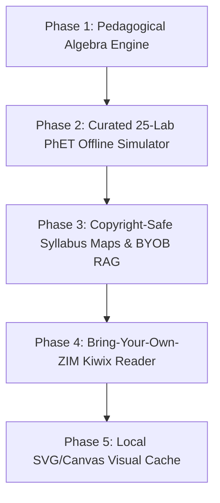

# Satchida Educational Improvement & Offline Assistant Architecture Plan

**Document Version:** 1.0  
**Target Platform:** Satchida Sovereign AI Harness / LibreChat Fork (Bare-Metal Windows 11 Edge Nodes)  
**Core Goal:** Deliver high-quality, in-depth, multi-modal educational and STEM tutoring with **zero cloud lock-in**, minimal disk footprint, zero legal liability, and tight native integration with LibreChat.

---

## 1. Executive Summary & Design Constraints

### What We Are Building
A **sovereign AI learning companion and concept tutor** embedded directly into LibreChat's chat, Artifacts, and tooling layer. 

### What We Are NOT Building
* **Not a bloated LMS:** We are not deploying a 100GB full-stack LMS or pre-downloading gigabytes of video streams and full Wikipedia mirrors that overwhelm client machines.
* **Not an unmaintainable external crawler:** We strictly respect Indian and international copyright laws (e.g. NCERT copyright guidelines, Cambridge mark schemes).
* **Not purely a chat box:** True pedagogy requires interactive visual feedback, step-by-step problem transformation, interactive physics/chemistry sandbox simulations, and offline-capable reference access.

---

## 2. Resource Feasibility & Deep Architectural Analysis

### 1. Pedagogical Step-by-Step Algebra Engine: `google/mathsteps`
* **License:** Apache-2.0
* **Repository:** `github.com/google/mathsteps`
* **Package Size:** ~2.1 MB total (zero binary dependencies; uses `mathjs` ASTs).
* **Feasibility:** **Extremely High (Native Integration)**.
* **Why it matters:** 
  - Standard LLMs frequently skip algebraic steps or hallucinate intermediate arithmetic. 
  - SymPy (Python) gives exact formal proofs and calculus solutions, but does *not* provide human-like step-by-step teaching annotations (e.g. *"Step 1: Subtract 4 from both sides"*, *"Step 2: Combine like terms"*, *"Step 3: Divide by coefficient"*).
  - `mathsteps` operates directly on Abstract Syntax Trees (ASTs). It outputs a structured JSON step array with `oldNode`, `changeType`, `newNode`, and `substeps`.
* **LibreChat Integration Architecture:**
  - Can run directly inside `packages/api` as a native internal service or as an exported utility invoked during student problem walkthroughs.
  - Generates verified KaTeX strings for each intermediate algebraic transition.
  - Zero external network dependency; runs in 2ms.

---

### 2. Offline Interactive STEM Labs: PhET HTML5 Simulations (`phetsims/*`)
* **License:** CC-BY 4.0 (for published HTML5 sims) / GPLv3 / MIT (core libraries).
* **Distribution Footprint:** Individual standalone HTML5 simulation files are **~3 MB to ~6 MB each**.
* **Feasibility:** **Extremely High (Zero-Footprint Native Integration)**.
* **Why it matters:**
  - Reading about Faraday's Law or the photoelectric effect is passive; dragging a magnet through a coil or varying wave frequency creates active intuition.
  - Pre-downloading 100+ simulations is unnecessary. Instead, curate **20–25 high-yield curriculum simulations** (Class 9–12 Physics, Chemistry, Biology, Math).
* **LibreChat Integration Architecture:**
  - Store selected `.html` bundles locally under `client/public/assets/study/sims/<sim_name>.html` (~80 MB total footprint for 25 complete interactive labs).
  - When a student asks about a concept (e.g., *"Show me how a pendulum swings"* or *"How does Ohm's Law work?"*), the assistant outputs an **interactive Artifact or modal iframe** that loads the local simulation seamlessly inside LibreChat.
  - Works 100% offline with zero cloud telemetry.

---

### 3. Standardized NCERT / Cambridge Curriculum & RAG (Copyright-Safe Architecture)
* **Legal Analysis & Copyright Guardrails:**
  - Under the **Indian Copyright Act (1957)** and explicit advisories from the **Publication Division of NCERT**, third-party software **CANNOT** redistribute, republish, or bundle copyrighted NCERT textbook PDFs or sell digital packages derived directly from them.
  - **Cambridge (IGCSE / IB)** similarly enforces strict copyright over proprietary past papers and mark schemes.
* **Feasibility:** **High (Via Zero-Liability Syllabus & Concept Metadata RAG)**.
* **Copyright-Safe Strategy:**
  1. **Do NOT bundle or redistribute copyrighted PDF files.**
  2. **Bundle Open Curriculum Frameworks & Knowledge Maps:**
     - Index chapter syllabi, learning outcomes, NCERT topic structures, Cambridge command-word definitions (*"State"*, *"Explain"*, *"Calculate"*, *"Deduce"*), and standard formula registries (which are mathematical facts and not subject to copyright).
  3. **Tenant Bring-Your-Own-Book (BYOB):**
     - Satchida already provides the **Satchida Knowledge Vault** (RAG via `rag-service` port 8010).
     - When a school or student uploads their legally downloaded textbook PDF into their private Vault, it is embedded into their isolated local MongoDB/vector collection.
     - The AI assistant acts as a private tutor over their locally uploaded book without Satchida distributing copyrighted content.

---

### 4. Offline Khan Academy / OER Engine: Kolibri (`learningequality/kolibri`)
* **License:** MIT
* **Size & Footprint Evaluation:**
  - Base Kolibri application: ~150 MB (Python/Django daemon + SQLite).
  - Media Channels (Videos & Exercises): **10 GB to 80+ GB per full subject channel**.
* **Feasibility Assessment:**
  - **Shipping a full Kolibri daemon + multi-GB video channels inside the edge installer is REJECTED** (it violates our lean bare-metal deployment directive and turns Satchida into an LMS maintenance burden).
* **Practical Hybrid Approach:**
  - Satchida does **not** package Kolibri channels into the edge installer.
  - Instead, if an educational tenant (such as a school server) already runs Kolibri locally on their LAN (e.g. `http://192.168.1.100:8080`), LibreChat can expose a lightweight connector/bridge tool (`query_local_kolibri`) to query available exercises and lesson summaries.

---

### 5. Offline Compressed Wikipedia & Reference: Kiwix (`libzim`)
* **License:** GPLv3 (libzim runtime) / Python package via `pip install libzim` (precompiled binary wheels available for Windows x64).
* **Size & Footprint Evaluation:**
  - Full Wikipedia with images: **~100 GB** (Impractical to bundle).
  - Wikipedia Simple / WikiMed / School Selection: **2 GB to 5 GB** (Viable as an optional add-on).
* **Feasibility:** **Approved via "Tenant Bring-Your-Own-ZIM" Pattern**.
* **Integration Strategy:**
  - Do **NOT** download or ship `.zim` files with the base installer.
  - Build the **native ZIM reader capability** into Satchida:
    - Install `libzim` in the Python environment.
    - Expose a tool in `satchida-stem-study` or `satchida-knowledge-vault`: `query_offline_zim(query, topic)`.
    - Point the tool to a configurable directory setting (e.g. `C:\LAN-AI-Infra\ZIM-Library\*.zim` or `librechat.yaml` config).
    - If a tenant has copied a Wikipedia or Wiktionary `.zim` file to that folder, Satchida instantly indexes and searches it offline with microsecond latency.
    - If no `.zim` file exists, it gracefully reports that local ZIM storage is unconfigured without breaking or throwing errors.

---

## 3. Phased Implementation Plan

### Phase 1: Pedagogical Step Solver (`mathsteps` Integration)
* **Action:**
  - Integrate `mathsteps` into `packages/api` or `skill/stem-study-server.py` (via Node IPC or micro-evaluator).
  - Expose `solve_pedagogical_math(expression: str)` alongside SymPy.
  - Provide human-annotated step-by-step guidance formatted strictly in KaTeX blocks.

### Phase 2: Offline STEM Interactive Labs (PhET Curation)
* **Action:**
  - Download and verify 20–25 core CC-BY HTML5 single-file simulations (Pendulum Lab, Circuit Construction Kit, Projectile Motion, Balancing Chemical Equations, Gene Expression).
  - Store under `client/public/assets/study/sims/`.
  - Add an assistant tool `load_stem_simulation(topic: str)` that launches the simulation as an inline responsive Artifact / modal.

### Phase 3: Copyright-Safe NCERT / Cambridge Curriculum Schema
* **Action:**
  - Build JSON curriculum taxonomies: Grade 6–12 Science, Math, Physics, Chemistry, Biology chapter outlines, learning competencies, and standard scientific formulas.
  - Configure the Knowledge Vault upload pipeline so school users can upload their own textbook PDFs with automated chapter chunking.

### Phase 4: Tenant "Bring-Your-Own-ZIM" Reader (`libzim`)
* **Action:**
  - Add `libzim` to the Python environment.
  - Implement `read_local_zim_article(topic: str, zim_dir: str)` in `satchida-stem-study`.
  - Ensure zero disk overhead if the tenant has not loaded `.zim` archives.

### Phase 5: High-Yield Local Educational Visual Cache
* **Action:**
  - Pre-package ~100 core curriculum animated GIFs and SVG schematics (mitosis, cardiac cycle, wave propagation, AC generator) directly inside `client/public/assets/study/media/`.
  - When offline, `fetch_learning_visuals` falls back to the local catalogue before attempting any network fetch.
