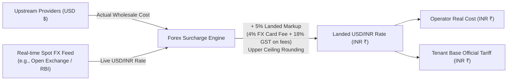
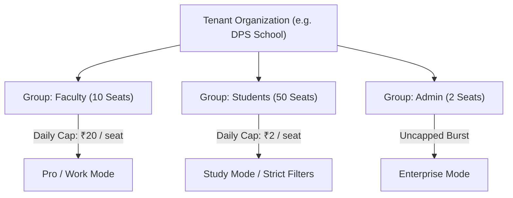
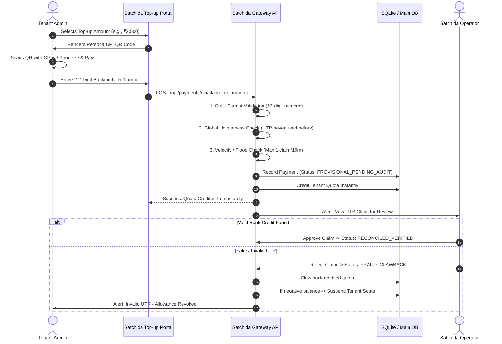

# Satchida Multi-Tenant Dashboard & Commercial Billing Specification

> **Version:** 2.1.0-PROD  
> **Status:** Approved for Implementation Planning  
> **Target Platform:** Satchida Multi-Tenant Gateway (`one-api` + `bifrost` + `librechat`) on Native Bare-Metal Windows / Cloudflare Zero Trust  

---

## 1. Executive Summary & Core Business Model

Satchida AI Harness provides sovereign, privacy-preserving AI infrastructure for educational institutions (schools, colleges) and SMBs/enterprises. Unlike raw API proxies or consumer wrappers, Satchida operates as a commercial managed service with strict unit economics:

1. **Target Gross Margin:** **≥ 80%** across all cloud-metered inference.
2. **Dual-Currency Reality:** Upstream compute/provider API commitments are purchased in **USD ($)**, while tenant contracts and bulk seat packages are billed in **INR (₹)**.
3. **Anonymized Sovereign Relay:** End-user identities (teachers, students, employees) are completely invisible to upstream providers; all telemetry, headers, and request bodies are cloaked and brokered through the Satchida Gateway.
4. **Hybrid Privacy Architecture:** Lightweight edge nodes run local small language models on available local hardware (typically ≤ 12GB VRAM GPUs), while high-capability reasoning/work queries route through high-margin discounted cloud channels.
5. **Zero-Cut Direct Payments:** Offline corporate billing supplemented by direct peer-to-peer / merchant UPI QR codes, eliminating payment gateway aggregator fees (Razorpay, Stripe).

---

## 2. Dual-Currency Engine & Real-Time FX Conversion



### 2.1. Landed Real-time FX Policy
Purchasing upstream USD credits via Indian corporate credit cards incurs real transaction surcharges:
* **Nominal Bank Gateway / Card Markup:** 3.5% – 4.0%
* **GST on Currency Markup & Processing Fees:** 18%
* **Observed Effective Landed Cost:** **At least +5.0% over nominal spot rate**.

$$\text{Landed FX Rate} = \left\lceil \text{Live Spot USD/INR} \times 1.05 \right\rceil$$

*(Example: If live spot USD/INR is ₹84.20, Landed FX Rate = $\lceil 84.20 \times 1.05 \rceil = \lceil 88.41 \rceil = \mathbf{₹89.00/\$}$. All upstream accounting and INR reporting computes against this true landed rate).*

### 2.2. Dual Dashboard Views: Operator Real-Cost vs. Tenant Quota View
The system enforces strict architectural separation between **Tenant-Facing Metering** and **Operator Commercial Intelligence**:
1. **Tenant Dashboard View:** Meters usage against **Standard Official Retail List Prices** in INR to reflect standard market value and enforce contract allowances.
2. **Operator Executive Dashboard View:** Surfaces the **Real Wholesale Cost** (discounted upstream rate $\times$ Landed FX Rate) side-by-side with the Billed Base Price, reporting exact gross profit and margins per tenant, per model, and per provider.

---

## 3. Option B: Official List Price Table & Contract-Lock Protection

### 3.1. Standard Reference Tariff Table
* Satchida maintains an internal **Official Reference Tariff Table** (`model_tariffs`) tracking the published list prices of major upstream models (e.g. OpenAI, Anthropic, Google, DeepSeek list prices for input/output/cached tokens).
* **Automated Price Sync:** A scheduled updater fetches current provider list pricing.

### 3.2. Mid-Contract Price Lock Protection
Upstream providers frequently adjust input/output pricing, but tenant contracts (monthly, quarterly, or yearly) cannot change mid-cycle:
* When a tenant signs or renews a contract, their subscription quota is bound to a **Tariff Snapshot** (Contract Lock Version).
* Upstream price cuts during the contract period automatically **increase Satchida's gross margin** beyond the 80% baseline.
* Upstream price increases do not disrupt the tenant's committed token allowance; they are absorbed within Satchida's 80% margin buffer until contract renewal.

### 3.3. Margin Health Dashboard Card (Operator View)
A dedicated Margin Health indicator on the operator view:
* **Total Billed Value:** ₹12,450.00
* **Upstream Provider Cost:** ₹1,820.50 ($20.68)
* **Realized Margin:** **85.38%** *(Status: Healthy / Above 80% Target)*
* **Low-Margin Alerts:** Automatic flagging if any specific model or channel drops below 75% margin.

---

## 4. Dynamic Group-Based Seat Subscription & Capacity Engine

Tenants do not purchase arbitrary token buckets; they subscribe to **Plans** based on **Seat Groups** (e.g., Faculty, Students, Admin, Developers).



### 4.1. Dynamic User Pool Scaling
* **Live Seat Aggregation:** The tenant summary reflects the live count of active users configured in each database group:
  $$\text{Contracted Seats} = \sum (\text{Configured Seats in Groups})$$
* **Dynamic Recalculation:** When an admin adds, imports, or deactivates users within a group, the Tenant Plan Summary updates immediately:
  * Provisioned Seats vs Active (Logged-in) Seats.
  * Committed Monthly Fee (Sum of base fee + group per-seat multipliers).
  * Aggregate Monthly Allowance pool.

---

## 5. Allowance / Quota Burn Rate & Runway Strategy

### 5.1. Best-Practice Runway Modeling
Given that tenants have contract commitments (monthly, quarterly, or yearly) with capped monthly allowances, the dashboard implements a **Velocity-Based Predictive Runway**:

1. **Daily Average Velocity ($V_7$):**
   $$V_7 = \frac{\sum_{i=1}^{7} \text{Tokens Used on Day } i}{7}$$
2. **Days of Runway Remaining ($R$):**
   $$R = \frac{\text{Remaining Monthly Quota (INR)}}{\text{Daily Average Cost (INR)}}$$
3. **Visual Runway Statuses:**
   * **Healthy (Green):** $R > \text{Days remaining in current billing period}$.
   * **Warning (Amber):** $R \le \text{Days remaining in cycle}$. *(Expected to exhaust quota before renewal).*
   * **Critical (Red):** $R \le 3 \text{ days}$. *(Immediate top-up or policy throttling suggested).*

---

## 6. Zero-Cut Direct Persona UPI Engine with Anti-Fraud Instant Crediting



### 6.1. Anti-Fraud UTR Guardrails
To support instant crediting while preventing fraud from randomized 12-digit numbers:
1. **NPCI Banking Structure Validation:**
   - Must be exactly 12 numeric digits (`^\d{12}$`).
   - NPCI Julian Date Rule: First digit represents the last digit of the year, digits 2–4 represent the day of the year (001–366). Strings failing this structure are rejected immediately.
2. **Global Cryptographic Uniqueness:**
   - Database enforces a `UNIQUE` index on `utr_number`. Any attempt to reuse a legitimate or previously entered UTR fails instantly.
3. **Tenant Velocity Limiter:**
   - A tenant is restricted to **1 unverified UTR claim at any given time**. A second top-up is blocked until the first is either verified or settled.
4. **Instant Credit with Provisional Hold:**
   - The quota is credited immediately (`status = 'provisional'`) so tenant operations are uninterrupted.
5. **Operator One-Click Clawback Engine:**
   - If the operator finds no matching credit in their bank statement, clicking **Reject / Clawback** immediately:
     * Deducts the provisional quota.
     * If the tenant already consumed the provisional quota, their balance goes negative and cloud routing is temporarily paused until settled.
     * Records a permanent audit strike on the tenant profile.

---

## 7. Hybrid Sovereign Privacy Architecture

### 7.1. Technical Reality of Local vs Cloud Privacy
It is essential that the UI and marketing copy are technically accurate:

1. **Hardware Reality:** Most client edge nodes operate without discrete high-end datacenter GPUs, typically possessing consumer GPUs with $\le$ 12GB VRAM (e.g., RTX 3060/4060) or CPU inference.
2. **Local Privacy Mode:**
   * Runs quantized compact models (e.g., Qwen-2.5-7B, Llama-3.2-3B, or DeepSeek-R1-Distill-7B via llama.cpp/Ollama).
   * **Guarantee:** Zero data leaves the local premises. 100% air-gapped sovereign execution.
3. **Gateway Anonymization Cloak (Cloud Privacy):**
   * When complex reasoning requires cloud inference (Chat, Work, Study modes), the **Satchida Zero-Knowledge Relay** scrubs all identifying metadata:
     - Strips `X-User-Id`, `X-User-Name`, tenant names, and IP addresses.
     - Upstream providers receive an anonymous aggregated stream from a single Satchida gateway IP.
     - **Business Copy:** *"Protected by Satchida Sovereign Shield: Local Edge Inference for confidential data, plus Cryptographic Identity Anonymization on all cloud relays."*

---

## 8. Dashboard Redesign & User Experience (UX)

### 8.1. Purge of Developer Relics
* **Remove:** The `$100,000,120.96` fake balance card and hacker avatar.
* **Replace With:** **Tenant Commercial Summary Header Card**:
  * **Tenant Name & Tier:** `Satchida HQ (Pro Enterprise)`
  * **Contract Term:** `Quarterly (Next Renewal: 2026-12-15)`
  * **Seat Allocation:** `24 Active / 30 Provisioned Seats`
  * **Billing Method:** `Direct Invoice (UPI / NEFT)`
  * **Gross Margin Status:** `84.2% (Healthy)`

### 8.2. Real Visual Policy Gauges (Replacing "Rule #11 / Rule #12")
Instead of cryptic raw table rows showing database rule IDs, the dashboard presents **Interactive Policy Progress Bars**:
* **Burst Protection (6-Hour Rolling Window):**
  * `₹24.80 / ₹200.00` consumed `[████░░░░░░░░░░░░░░░░] 12.4%`
  * Reset countdown: *Resets in 3h 12m*
* **Monthly Cloud Allowance:**
  * `₹1,450.00 / ₹5,000.00` consumed `[█████████░░░░░░░░░░░] 29.0%`
  * Runway: *38 days remaining at current usage*

### 8.3. Click-to-Filter Drill-Downs
* Clicking on any **Bar in the Daily Chart** automatically sets a time-filter for that specific day across all other widgets (Model Breakdown, Seat Breakdown, and Logs).
* Clicking on a **Seat Name** opens that specific user's complete audit trail, prompt token count, and model preferences.

---

## 9. Invoicing, Export & Audit Capabilities

### 9.1. Printable PDF Invoice & Statement of Usage
Each tenant dashboard includes a **"Print / Download Statement"** button formatted for corporate accounting and tax compliance:
* Formal Header with Satchida Corporate details & Tenant GSTIN / Address.
* Period covered (e.g., October 1, 2026 – October 31, 2026).
* Itemized Breakdown:
  1. Base Plan Subscription (Seats: 25 @ ₹150/seat = ₹3,750.00).
  2. Cloud Allowance Usage (₹820.50 utilized out of ₹1,000 allowance).
  3. Sovereign Shield Savings Summary (*14,200 local queries executed; estimated cloud savings: ₹4,260.00*).
  4. Amount Due / Status (`PAID` or `DUE ON NOV 15`).
  5. Embedded Direct UPI QR Code on the invoice footer for immediate settlement.

### 9.2. Comprehensive Excel / CSV Export
Exports full tab-separated or comma-separated log telemetry:
* `Timestamp`, `User Display Name`, `Seat ID`, `Group/Department`, `Model Used`, `Mode (Privacy/Chat/Work/Study)`, `Prompt Tokens`, `Completion Tokens`, `Official Billed Cost (INR)`, `Upstream Cost (USD)`, `Status`.

---

## 10. Implementation Phases & Architecture Mapping

```mermaid
flowchart TD
    subgraph Phase 1: Core Financial & UI Cleanup
        P1A["Purge Fake Developer Card"]
        P1B["Implement Real-time FX + 5% Landed Upper-Round Engine"]
        P1C["Replace Rule #11/12 with Visual Policy Gauges"]
    end
    
    subgraph Phase 2: Commercial Economics & Margin Tracking
        P2A["Implement Option B Official List Tariff & Contract Snapshot"]
        P2B["Dynamic Group-Based Seat Aggregator"]
        P2C["Velocity Burn Rate & Runway Predictor"]
        P2D["Operator Real-Cost vs Billed Tariff Reconciliation Dashboard"]
    end
    
    subgraph Phase 3: Invoicing, UPI & Interactivity
        P3A["Printable PDF Invoice Generator"]
        P3B["CSV/Excel Detailed Exporter"]
        P3C["Interactive Chart Click-to-Filter Drilldowns"]
        P3D["Anti-Fraud Instant UPI QR Crediting & Clawback Engine"]
    end
    
    subgraph Phase 4: Gateway Telemetry & Agentic Quota Governance
        P4A["Forward x-bf-dim-* Tenant Identity to Bifrost"]
        P4B["Agentic Tool-Call Window Calibration (500k burst / 2.5M daily)"]
        P4C["Cross-Gateway Unified Telemetry Reconciliation"]
    end
    
    Phase 1 --> Phase 2 --> Phase 3 --> Phase 4
```

---

## 11. Gateway Telemetry & Agentic Quota Architecture

### 11.1. Bifrost Virtual Key vs. Tenant Routing Model
* **The Layer Separation:** One-API acts as the multi-tenant sovereign layer (managing organizations, seats, and contract quotas). Bifrost acts as the high-throughput inference proxy and provider load-balancer.
* **Virtual Key Structure:** Bifrost uses channel-bound Bearer tokens (`sk-bf-...`), named:
  1. `Satchida-WorkStudy-route`: Paid high-throughput route (`pro`, `enterprise`).
  2. `Satchida-Chat-route`: Free-first with paid fallback (`basic`, `family`).
  3. `Satchida-Privacy-route`: ZDR-attested cloud route for privacy profiles.
  4. `librechat-tenant-owner`: Direct administrative harness route.
* **Tenant Telemetry Attribution:**
  To ensure Bifrost logs attribute requests to individual tenants without breaking data sovereignty, One-API injects dimension headers:
  * `x-bf-dim-customer_id: <tenant_id>`
  * `x-bf-dim-team_id: <tenant_id>`
  * `x-bf-dim-user_id: <anonymous_seat_alias>`
  This immediately unlocks Bifrost's native `Customer Rankings` and `Team Rankings` dashboards for per-tenant attribution.

### 11.2. Agentic Tool-Call Workloads & Quota Calibration
* **The Agentic Multiplier Effect:** In modern AI harnesses, asking a multi-step question (e.g. *"Summarize today's top tech & financial developments using live keyless search"*) does not trigger 1 LLM request. LibreChat executes an autonomous loop (up to 8+ sequential tool calls in under 60 seconds). Because LLM context is cumulative, prompt tokens grow exponentially (e.g., 8.8k → 14.1k → 19.1k → 23.6k → 26.2k → 31.7k → 25.4k → 21.2k), totaling **175,348 tokens** on a single user turn.
* **Calibration Policy:**
  * **Legacy Mistake:** A 50k token rolling limit assumes single-turn conversational text (~500 tokens/turn). Under agentic search or code interpretation, 1 prompt consumes 150k–250k tokens, falsely tripping `Burst Exceeded` at 351%.
  * **Calibrated Production Limits:**
    * **HQ Master / Enterprise:** 500,000 token 3-hour burst limit; 2,500,000 token 24-hour daily quota.
    * **Pro Tier:** 300,000 token 3-hour burst limit; 1,000,000 token 24-hour daily quota.
    * **Family / Basic Tier:** 150,000 token 3-hour burst limit; 500,000 token 24-hour daily quota.

