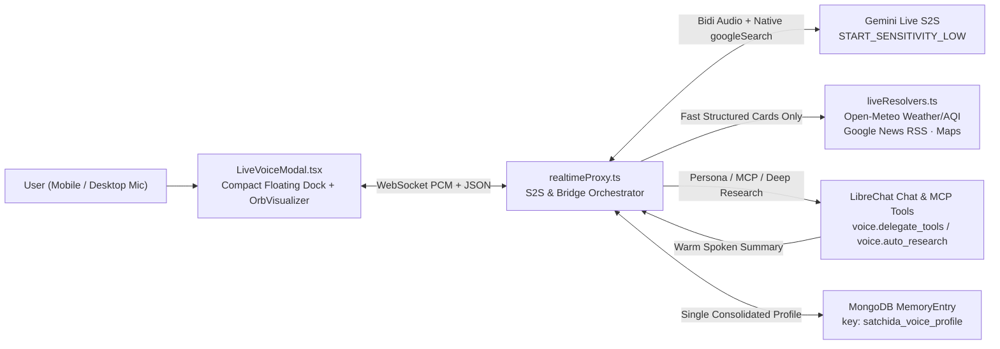

# Satchida Live Voice — Complete Requirements, Architecture & Review Document

> **Document Path**: `d:\LAN-AI-Infra\LibreChat\docs\internal\operations\VOICE_AGENT.md`
> **Last Updated**: 2026-11-26

---

## 1. Executive Summary
Satchida Live Voice is a real-time, bidirectional speech-to-speech voice companion powered by Satchida Intelligence (`packages/api/src/voice/realtimeProxy.ts`, `packages/api/src/voice/voiceProfile.ts`, `packages/api/src/voice/voiceIntelligence.ts`, `packages/api/src/voice/liveResolvers.ts`, and `client/src/components/Chat/Input/LiveVoiceModal.tsx`).

### High-Level Architecture

---

## 2. Complete Functional Requirements & Implementation Status

### Requirement 1 — Time-of-Day Greeting & Language Onboarding
- **Requirement**: On first session, greet the user warmly like a human (never a robotic call-center greeting) based on their local time of day, ask which language they prefer and what to call them, and persist the chosen language to that user's account memory.
- **Implementation**:
  - Client passes `localHour` (`0–23`) in the WebSocket URL (`/api/voice/realtime?localHour=...`) from `LiveVoiceModal.tsx`.
  - On initial `setupComplete` (`!switchNotice`), server sends an explicit, time-of-day opening directive via `getTimeOfDayGreeting(localHour)` tailored to `voiceProfile` state, and sets a `1800ms` mic-forward guard (`pauseMicForwardUntil`) so ambient mic noise at `t=0` does not interrupt the opening greeting.
  - Client **only** sends the legacy `Say only:` `voice.turn` fallback in `bifrost_bridge` mode — never in `gemini_live_s2s` mode (preventing double-greeting collisions).
  - Server extracts language preferences in `extractAndPersistProfileFromUtterance` (supporting English and Hindi/Hinglish word order such as `"Switch to Hindi"`, `"Aap pehle to English mein switch kijiye"`, or short replies when unset) and persists `preferred_language` to `satchida_voice_profile`.

### Requirement 2 — Name Onboarding & Returning User Recognition
- **Requirement**: Capture the user's name accurately in English, Hindi, or Hinglish without false positives from ambient noise or negations. On returning sessions, greet the user warmly by name in their preferred language without re-asking.
- **Implementation**:
  - `buildVoiceMemorySystemBlock` and the S2S opening directive switch automatically across 4 states: (a) neither language nor name known, (b) language known / no name, (c) name known / no language, (d) returning user (greet by name in preferred language).
  - Server-side extraction supports explicit English (`"my name is ..."`, `"call me ..."`, `"I am ..."`) and Hindi/Hinglish (`"मेरा नाम ..."`, `"mera naam ..."`, `"आप मुझे <Name> के नाम से बुला सकते हैं"`, `"mujhe <Name> bula..."`, with full Devanagari combining-mark `\p{M}` support).
  - **Safety guards**: Never blindly captures stray 1–2 word noise (e.g., `"tú"`) as a name, and explicitly rejects negations (`"नहीं"`, `"nahi"`, `"not my name"`) and pronouns (`"tu"`, `"tú"`, `"you"`).

### Requirement 3 — Long-Term Memory Architecture (Integrated LibreChat Memory)
- **Requirement**: Use LibreChat's integrated **Memories** feature (left navigation) using **one single consolidated memory record** per user account rather than fragmented entries.
- **Implementation**:
  - Uses LibreChat's existing MongoDB `MemoryEntry` collection (`packages/data-schemas/src/methods/memory.ts`) under one fixed key: **`satchida_voice_profile`** (`agentId: null`).
  - Wired via dependency injection (`getVoiceProfileMemory` / `setVoiceProfileMemory` in `api/server/index.js` → `RealtimeProxyDeps`).
  - Users can view and edit their voice profile directly in the left-panel **Memories** UI.
  - Every Live Voice session loads `satchida_voice_profile` before sending the initial setup frame, and both S2S and Bridge/Privacy modes inject `buildVoiceMemorySystemBlock`.

### Requirement 4 — Strict GPS Location Integrity & Optional Follow-Up Preferences
- **Requirement**: Naturally gather optional preferences (home city, dietary preference, daily morning brief + topics) into `satchida_voice_profile` without ever corrupting the user's real device GPS location when they ask about another city.
- **Implementation**:
  - `mergeVoiceProfile(existing, patch)` performs a non-destructive deep merge (preserving all existing fields and deduplicating `morning_brief.topics` and `known_speakers[]`).
  - `voice.location` reverse-geocodes GPS `lat`/`lng` via Nominatim with an automatic **BigDataCloud fallback** so Indian GPS coordinates reliably resolve to a city/locality (e.g. `South Dumdum, West Bengal`).
  - `extractSelfLocationCity()` strictly separates explicit self-location declarations (`"I live in Kolkata"`, `"My location is Pune"`) from query-target cities (`"What's the AQI of Mumbai?"`) and challenges (`"Why did you assume my current location is Mumbai?"`).
  - `applySpokenLocationMemory()` **never** overwrites an existing GPS location with a query-target city.
  - Follow-up comparisons (`"How does that compare to my location?"`) inherit `lastLiveLookupKind` (`'weather'`) so Open-Meteo fetches live weather/AQI for the user's actual GPS coordinates.

### Requirement 5 — Human-Like Conversation, Pacing & 24/7 Ambient / Car Maturity
- **Requirement**: Live Voice must sound like a calm, natural human companion suitable for 24/7 hands-free use (including while driving with family/friends in the car or a TV playing in the room) — never robotic, never rushing, never repeating customer-service sign-offs, and never interrupting side conversations.
- **Implementation**:
  - **Acoustic VAD Tuning**: `realtimeInputConfig.automaticActivityDetection` uses `startOfSpeechSensitivity: 'START_SENSITIVITY_LOW'`, `endOfSpeechSensitivity: 'END_SENSITIVITY_LOW'`, `prefixPaddingMs: 200`, and `silenceDurationMs: 600` (`1200` in Translator Mode) to filter soft background noise, TV audio, and stray syllables without cutting off mid-sentence pauses.
  - **Conversational Meta-Question Gating**: `detectRealtimeSearchIntent()` skips conversational meta-questions, complaints, capability checks, and recaps (*"Why did you skip this news?"*, *"Do you have access to real current event information?"*, *"Summarize that"*, *"Check again"*) so Gemini Live handles real human discussion uninterrupted.
  - **Natural Delivery Rules**: System instructions enforce unhurried human pacing with micro-pauses, respectful Hindi address (`"आप"`, never `"तू"`), **zero robotic sign-offs in any language** (no *"How can I help you?"* / *"मैं आपकी क्या सहायता कर सकती हूँ?"* after answers), and explicit **Car / Family / TV ambient restraint** (stay silent during background TV or side conversations between other people).

### Requirement 6 — Zero-SearXNG Fast Live Data & LibreChat Persona / MCP Tool Delegation
- **Requirement**: Eliminate slow SearXNG latency from the live voice hot path, use fast structured resolvers for rich cards, let Gemini Live's native `googleSearch` handle general live facts at S2S speed, and delegate complex tasks to LibreChat's active persona and MCP toolset.
- **Implementation**:
  - **Zero SearXNG in Live Voice**: Removed SearXNG (`SEARXNG_INSTANCE_URL` / `:8880`) from both `fetchStructuredNews()` and the S2S hot path.
  - **Fast Structured Resolvers Only**: Server-side interruption runs **only** for Weather/AQI (Open-Meteo), Live News (Google News RSS with India/regional timezone awareness and 72h freshness filter), Maps/Places, and GPS location checks. General live queries (gold/silver prices, stocks, sports, facts) flow directly through Gemini Live's native `tools: [{ googleSearch: {} }]`.
  - **Hindi Search Normalization**: `stripVoiceStopwords()` maps Devanagari market/news/weather terms (`गोल्ड/सोना`, `सिल्वर/चांदी`, `पेट्रोल`, `डीजल`, `प्राइस/भाव`, `आज`) to clean English keywords when needed.
  - **LibreChat Persona & MCP Tool Delegation**: `detectToolOrTutorIntent()` routes requests for creating/generating documents, presentations/PPTs, spreadsheets, charts, diagrams, floorplans, images, videos, code, apps, deep research, visual tutoring (`Study` mode), or searching the user's vault/files/notes to LibreChat (`voice.delegate_tools`), then speaks the result back warmly via `voice.tutor_explain`.

### Requirement 7 — Multi-Speaker / Room-Guest Pitch & AI-to-AI Detection
- **Requirement**: Detect voice pitch changes when another person in the room speaks, and detect when another AI voice agent is speaking to avoid greeting loops.
- **Implementation**:
  - **Client (`client/src/utils/voicePitch.ts`)**: Zero-dependency autocorrelation F0 pitch estimator (`70–360 Hz`, RMS-gated `>= 0.015`) emitting `{ type: 'voice.acoustic_meta', avgPitchHz, pitchStdHz }`.
  - **Server (`packages/api/src/voice/voiceIntelligence.ts` + `realtimeProxy.ts`)**: Calibrates `primary_voiceprint`, tracks speaker transitions via `activeSpeakerKey`, matches `known_speakers[]` within `±30 Hz`, and detects AI voice agents via `detectAiVoiceAgent()`.

### Requirement 8 — Multi-Voice, Strict Grammatical Gender & Non-Blocking Mobile UI
- **Requirement**: Support all 6 voices (`IN / US / UK` × `Female / Male`) with strict masculine/feminine grammatical gender in all gendered languages, and keep the Live Voice UI as a compact, non-blocking floating dock on both mobile phones and desktop.
- **Implementation**:
  - `HeaderAudioSpeaker.tsx` cycles through all 6 voices (`IN F/M`, `US F/M`, `UK F/M`) synced with `localStorage`.
  - `realtimeProxy.ts` enforces symmetric `STRICT FEMININE GRAMMAR RULE` / `STRICT MASCULINE GRAMMAR RULE` in the system prompt **and** reinforces active persona gender inside every `[CONTEXT: ...]` live-data injection so female voices never drift to masculine Hindi verbs (`"कर सकता हूँ"`).
  - `LiveVoiceModal.tsx` renders as a compact, non-blocking floating dock at the top of the viewport (`fixed left-2 right-2 top-14 ... sm:w-[320px]`) on both mobile and desktop, with `OrbVisualizer`, scrollable transcript drawer, inline action cards, and localized `useLocalize()` copy (`com_ui_live_voice*`).

---

## 3. Critical S2S Protocol & Architecture Invariants (Never Violate)
1. **Never send `clientContent` with `turnComplete: false`** into an active Gemini Live S2S audio stream — incomplete text turns stall Gemini's audio VAD turn-taking (28–38s delays).
2. **Keep Gemini Live S2S `tools` pure (`[{ googleSearch: {} }]`)** — do not mix custom `functionDeclarations` into the same `tools` array as `googleSearch`, as it degrades native search grounding. Perform memory extraction server-side with zero latency impact.
3. **Never overwrite GPS coordinates/city** with query-target cities (`"AQI of Mumbai"`) or non-city phrases (`"my location"`, `"here"`, `"nearby"`).
4. **Never call SearXNG in the live voice S2S hot path** — use Open-Meteo (Weather/AQI), Google News RSS (News), and Gemini Live's native `googleSearch` grounding.
5. **Never send duplicate client `Say only:` greetings in S2S mode** — the server owns the personalized opening greeting on `setupComplete`.
6. **Never use full-screen `fixed inset-0` takeover on mobile** — keep `LiveVoiceModal` a compact non-blocking floating dock so chat remains visible and interactive.

---

## 4. Key Files & Capabilities
- `packages/api/src/voice/voiceProfile.ts` (+ `voiceProfile.spec.ts`)
- `packages/api/src/voice/voiceIntelligence.ts` (+ `voiceIntelligence.spec.ts`)
- `packages/api/src/voice/realtimeProxy.ts` (+ `realtimeProxy.spec.ts`)
- `packages/api/src/voice/liveResolvers.ts` (+ `liveResolvers.spec.ts`)
- `api/server/index.js` (`getVoiceProfileMemory`, `setVoiceProfileMemory`, `recordVoiceUsage`)
- `client/src/utils/voicePitch.ts`
- `client/src/components/Chat/Input/LiveVoiceModal.tsx` (+ `OrbVisualizer.tsx`)
- `client/src/components/Chat/HeaderAudioSpeaker.tsx`
- `client/src/locales/en/translation.json` (`com_ui_live_voice*`)
