<h1 align="center">Satchida Procedural Art</h1>

<p align="center">
  <b>Painting with code — no image model.</b><br>
  Eighty-three built-in styles, every stroke computed: numpy + Pillow on a CPU.
</p>

<p align="center">
  <a href="#styles">83 styles</a> &nbsp;·&nbsp;
  <a href="#install">Install</a> &nbsp;·&nbsp;
  <a href="#quick-start">Quick start</a> &nbsp;·&nbsp;
  <a href="docs/GIFS.md">Draw-on GIFs</a> &nbsp;·&nbsp;
  <a href="SKILL.md">SKILL.md</a>
</p>

<p align="center">
  <a href="#styles">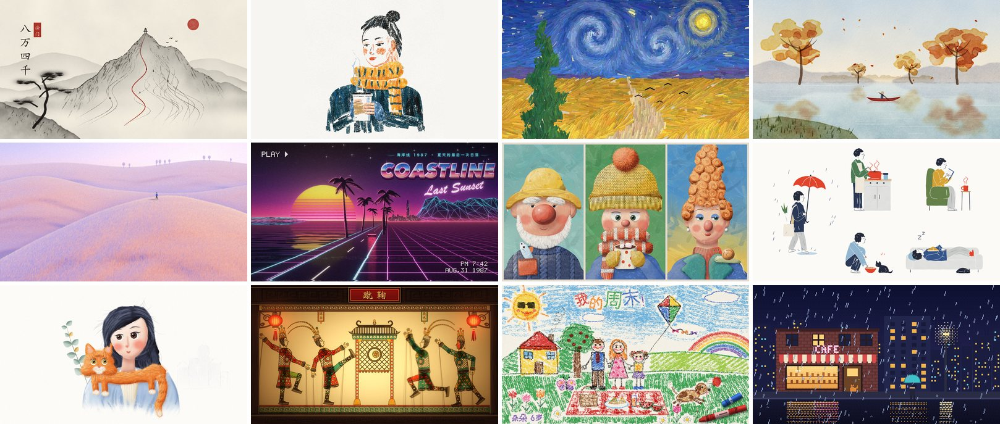</a>
</p>

**What it is** — A procedural-painting skill plus a small painting library: eighty-three styles, from ink wash and impasto oil to stained glass, a ray-traced ball pit and a VHS tape, all plain Python with **numpy + Pillow** on a CPU.

**Why code** — Composition is directed, not sampled; the same seed gives the same picture; it runs offline with no GPU, key or quota; and every stage can be saved, so you can watch the picture being made.

**How it paints** — It plans the composition, writes a short scene script, then renders, looks and fixes against a per-style checklist of real failure modes, usually over 2–4 rounds. The whole playbook is in [SKILL.md](SKILL.md).

<p align="center">
  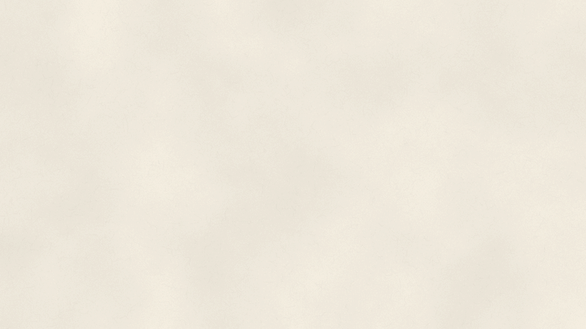<br>
  <sub><b>Ink wash</b> — every style is painted stage by stage like this · <a href="docs/GIFS.md">all 91 GIFs</a></sub>
</p>

## Origin

Satchida Procedural Art is a rebrand and full English translation of the MIT-licensed
[claude-drawing-skill](https://github.com/cloveric/claude-drawing-skill) by cloveric. Rendering code,
styles and examples are functionally unchanged; see [PROVENANCE.md](PROVENANCE.md).

## Install

```bash
# the skill ships inside this repository at skill/satchida-procedural-art;
# point a skill loader at that folder, then install the two dependencies:
pip install -r skill/satchida-procedural-art/requirements.txt   # numpy, Pillow
```

Titles need a CJK font; system ones are found automatically, or set `INKPAINT_FONT=/path/to/font` ([more](docs/USAGE.md)).

## Quick start

Ask the assistant to *"draw it yourself"* or *"paint this with code"*, and name a style if you like.

Or run any example yourself:

```bash
cd skill/satchida-procedural-art
python3 examples/moon_river.py out.png --stages stages/   # ink wash + every stage
python3 examples/<name>.py out.png                        # one per style
```

→ [Every example command and the Python API in a few lines](docs/USAGE.md)

## Styles

Eighty-three styles in eight families — click any picture for the full-size image. Notes on every style: [docs/STYLES.md](docs/STYLES.md)

### Ink & paint

<table>
<tr><td align="center" colspan="2"><a href="examples/bawansiqian.jpg">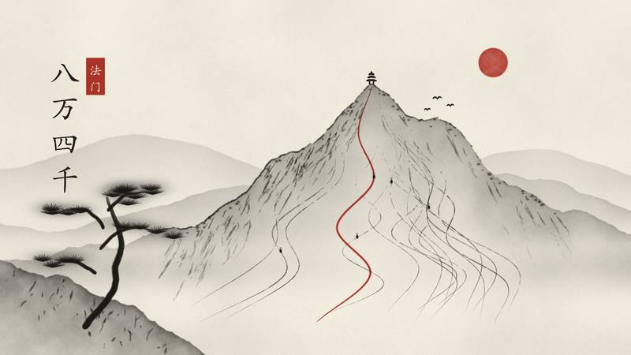</a><br><sub><b>Ink wash</b></sub></td><td align="center" colspan="2"><a href="examples/watercolor_autumn.jpg">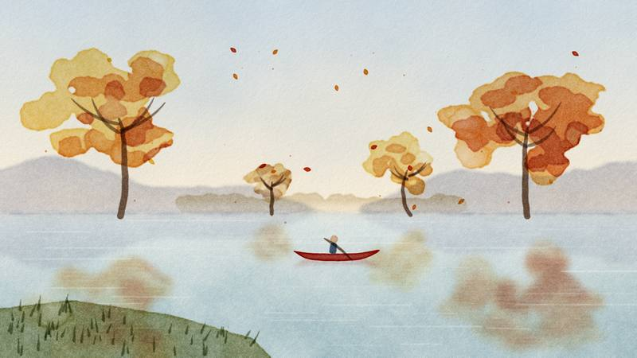</a><br><sub><b>Watercolour</b></sub></td></tr>
<tr><td align="center" colspan="2"><a href="examples/oil_wheatfield.jpg">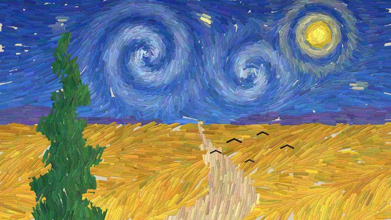</a><br><sub><b>Impasto oil</b></sub></td><td align="center"><a href="examples/gouache_rainy_day.jpg">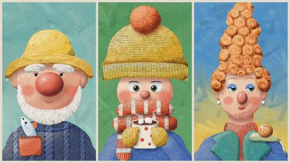</a><br><sub><b>Retro gouache</b></sub></td><td align="center"><a href="examples/penwash_neighbours.jpg">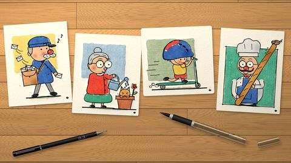</a><br><sub><b>Pen & wash</b></sub></td></tr>
<tr><td align="center"><a href="examples/jiangnan_spring_water.jpg">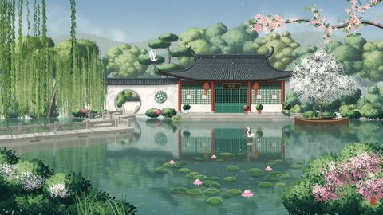</a><br><sub><b>Jiangnan garden</b></sub></td><td align="center"><a href="examples/drybrush_noodle_counter.jpg"></a><br><sub><b>Dry-brush blocks</b></sub></td><td align="center"><a href="examples/oilpastel_warm_cup.jpg"></a><br><sub><b>Oil-pastel portrait</b></sub></td><td align="center"><a href="examples/sunlitgreen_window_seat.jpg">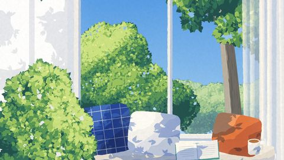</a><br><sub><b>Sunlit greenery</b></sub></td></tr>
</table>

### Pencil, pen & pastel

<table>
<tr><td align="center"><a href="examples/colorpencil_dessert.jpg">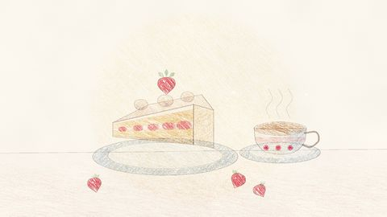</a><br><sub><b>Coloured pencil</b></sub></td><td align="center"><a href="examples/graphite_bicycle.jpg">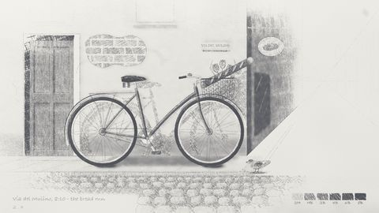</a><br><sub><b>Graphite pencil</b></sub></td><td align="center"><a href="examples/crayon_picnic.jpg">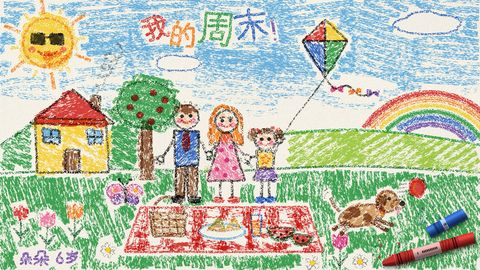</a><br><sub><b>Children's crayon</b></sub></td><td align="center"><a href="examples/ballpoint_board_game.jpg">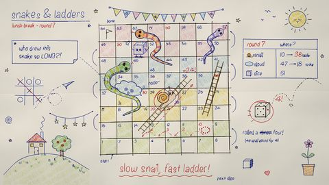</a><br><sub><b>Ballpoint doodle</b></sub></td></tr>
<tr><td align="center"><a href="examples/lineart_paper_plane.jpg">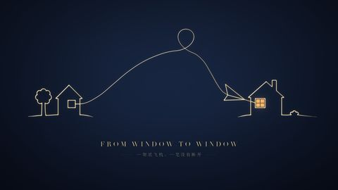</a><br><sub><b>Continuous line art</b></sub></td><td align="center"><a href="examples/sketchbook_reading_hour.jpg">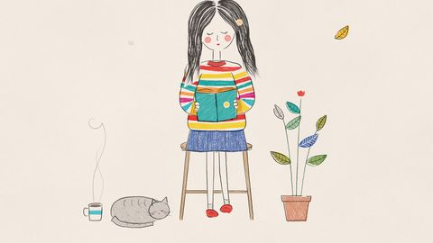</a><br><sub><b>Sketchbook doodle</b></sub></td><td align="center"><a href="examples/pastelvignette_marmalade_scarf.jpg"></a><br><sub><b>Pastel vignette</b></sub></td><td align="center"><a href="examples/nocturne_lava_sea.jpg">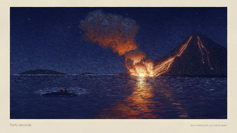</a><br><sub><b>Hatched nocturne</b></sub></td></tr>
</table>

### Picture books & illustration

<table>
<tr><td align="center"><a href="examples/anime_summer.jpg">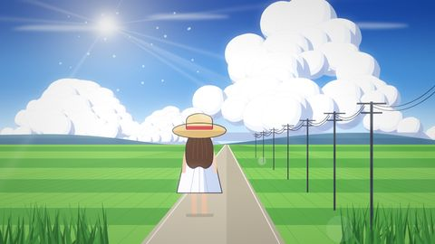</a><br><sub><b>Anime</b></sub></td><td align="center"><a href="examples/cartoon_toaster.jpg">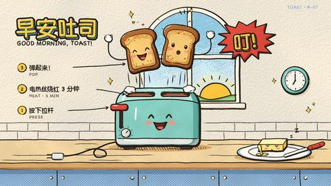</a><br><sub><b>Hand-drawn cartoon</b></sub></td><td align="center"><a href="examples/flatvector_night_camp.jpg">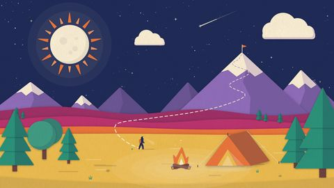</a><br><sub><b>Flat vector</b></sub></td><td align="center"><a href="examples/storybook_acorn.jpg">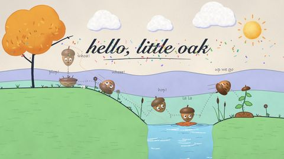</a><br><sub><b>Storybook animation</b></sub></td></tr>
<tr><td align="center"><a href="examples/bluebook_shared_umbrella.jpg">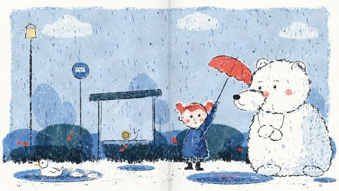</a><br><sub><b>Blue picture book</b></sub></td><td align="center"><a href="examples/twilight_paper_kite.jpg">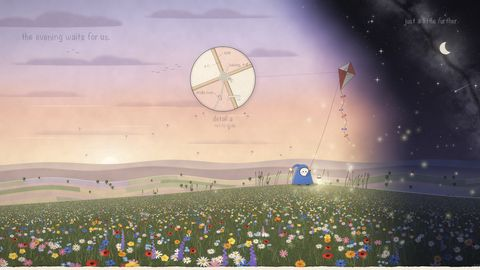</a><br><sub><b>Twilight storybook</b></sub></td><td align="center"><a href="examples/pencilbook_tortoise_crossing.jpg">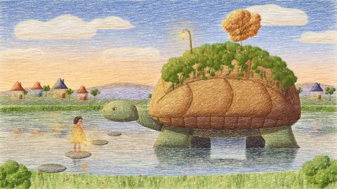</a><br><sub><b>Warm pencil storybook</b></sub></td><td align="center"><a href="examples/colortown_festival_steps.jpg">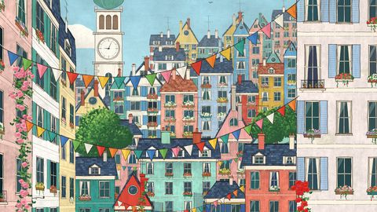</a><br><sub><b>Colour town</b></sub></td></tr>
<tr><td align="center"><a href="examples/poetichalloween_ghost_jar.jpg">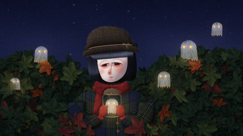</a><br><sub><b>Poetic Halloween</b></sub></td><td align="center"><a href="examples/spotillo_rainy_saturday_wide.jpg">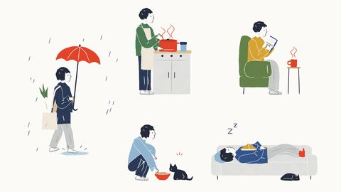</a><br><sub><b>Flat spot illustration</b></sub></td><td align="center"><a href="examples/grainbook_snow_walk.jpg">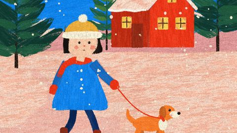</a><br><sub><b>Grainy picture book</b></sub></td><td align="center"><a href="examples/dreamhills_long_walk.jpg">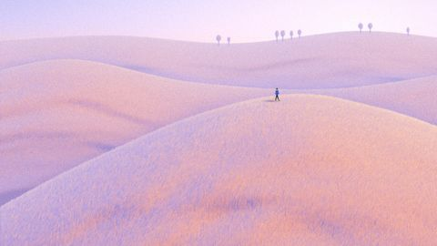</a><br><sub><b>Dreamy hills</b></sub></td></tr>
</table>

### Print & poster

<table>
<tr><td align="center"><a href="examples/ukiyoe_fuji.jpg">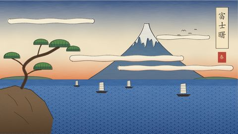</a><br><sub><b>Ukiyo-e woodblock</b></sub></td><td align="center"><a href="examples/linocut_snowy_village.jpg">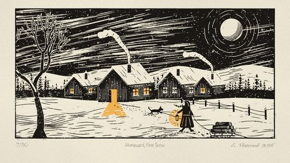</a><br><sub><b>Linocut</b></sub></td><td align="center"><a href="examples/cyanotype_botanicals.jpg">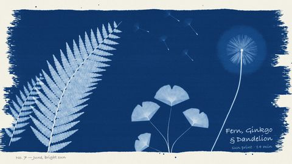</a><br><sub><b>Cyanotype</b></sub></td><td align="center"><a href="examples/letterpress_circus.jpg">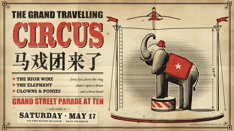</a><br><sub><b>Letterpress poster</b></sub></td></tr>
<tr><td align="center"><a href="examples/constructivism_radio.jpg">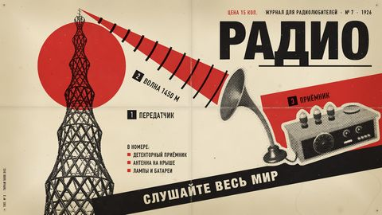</a><br><sub><b>Soviet constructivism</b></sub></td><td align="center"><a href="examples/bauhaus_form_colour.jpg">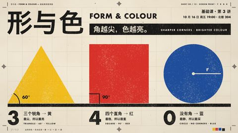</a><br><sub><b>Bauhaus geometric</b></sub></td><td align="center"><a href="examples/artdeco_express.jpg">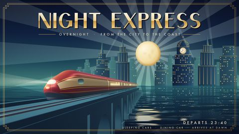</a><br><sub><b>Art Deco</b></sub></td><td align="center"><a href="examples/popart_cat_moods.jpg">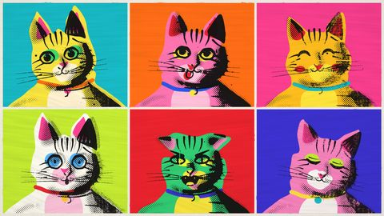</a><br><sub><b>Pop silkscreen</b></sub></td></tr>
<tr><td align="center"><a href="examples/comic_rocket.jpg">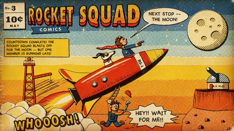</a><br><sub><b>Golden-age comic</b></sub></td><td align="center"><a href="examples/editorial_ideas.jpg"></a><br><sub><b>Editorial (risograph)</b></sub></td><td align="center"><a href="examples/stencil_kite.jpg">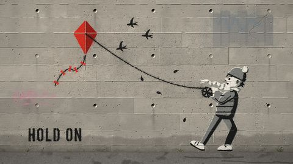</a><br><sub><b>Stencil graffiti</b></sub></td><td align="center"><a href="examples/blueprint_lighthouse.jpg">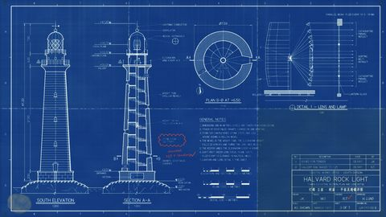</a><br><sub><b>Blueprint</b></sub></td></tr>
</table>

### Paper, thread & clay

<table>
<tr><td align="center"><a href="examples/papercut_balloons.jpg">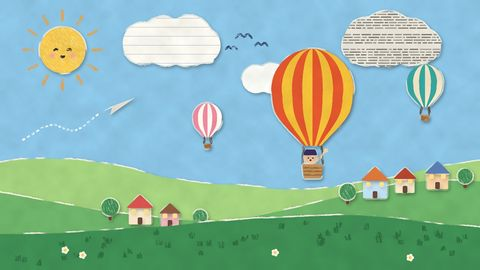</a><br><sub><b>Paper collage</b></sub></td><td align="center"><a href="examples/newscollage_curiosity.jpg">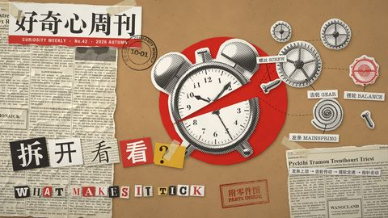</a><br><sub><b>Newspaper collage</b></sub></td><td align="center"><a href="examples/sticker_market.jpg">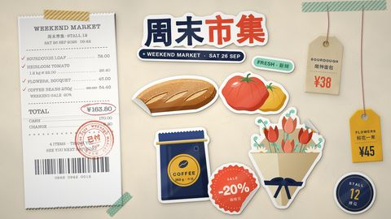</a><br><sub><b>Sticker collage × receipt</b></sub></td><td align="center"><a href="examples/silhouette_family.jpg">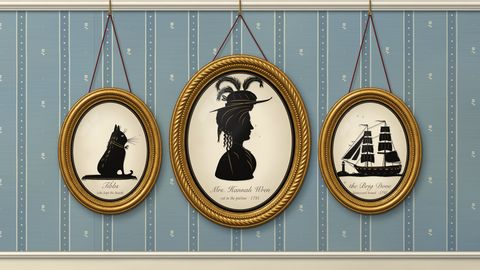</a><br><sub><b>Silhouette</b></sub></td></tr>
<tr><td align="center"><a href="examples/clay_lighthouse.jpg">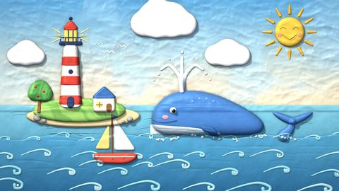</a><br><sub><b>Stop-motion clay</b></sub></td><td align="center"><a href="examples/stitch_sampler.jpg">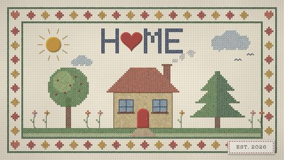</a><br><sub><b>Cross-stitch</b></sub></td><td align="center"><a href="examples/patch_camping.jpg">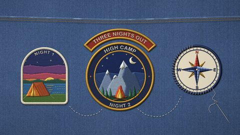</a><br><sub><b>Embroidered patches</b></sub></td><td align="center"><a href="examples/perler_strawberry_coaster.jpg">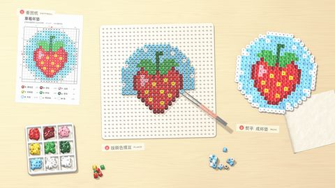</a><br><sub><b>Perler beads</b></sub></td></tr>
</table>

### Ancient & historic

<table>
<tr><td align="center" colspan="2"><a href="examples/tomb_harvest.jpg">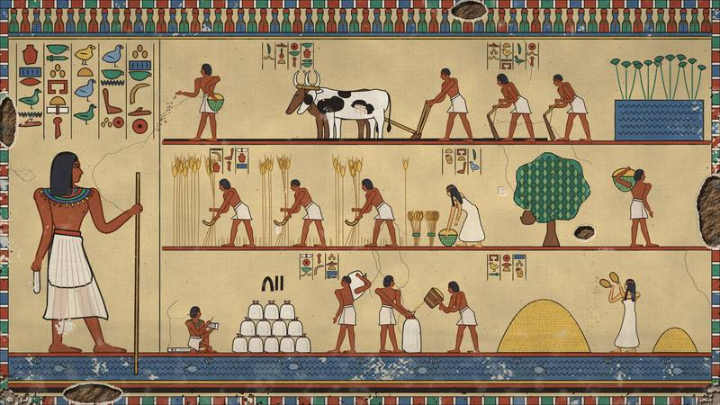</a><br><sub><b>Egyptian tomb painting</b></sub></td><td align="center" colspan="2"><a href="examples/shadowpuppet_cuju.jpg">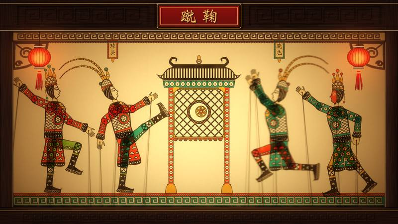</a><br><sub><b>Shadow puppetry</b></sub></td></tr>
<tr><td align="center"><a href="examples/cave_hunt.jpg">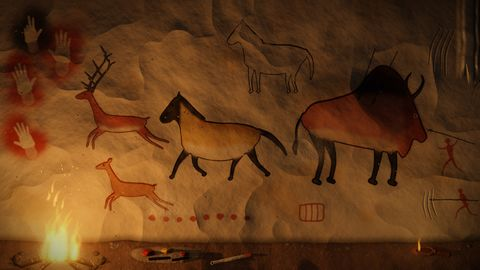</a><br><sub><b>Cave painting</b></sub></td><td align="center"><a href="examples/petroglyph_migration.jpg"></a><br><sub><b>Petroglyph</b></sub></td><td align="center"><a href="examples/blackfigure_games.jpg"></a><br><sub><b>Greek black-figure vase</b></sub></td><td align="center"><a href="examples/mosaic_harbor.jpg"></a><br><sub><b>Roman mosaic</b></sub></td></tr>
<tr><td align="center"><a href="examples/stainedglass_seasons.jpg"></a><br><sub><b>Stained glass</b></sub></td><td align="center"><a href="examples/illuminated_starchart.jpg"></a><br><sub><b>Illuminated manuscript</b></sub></td><td align="center"><a href="examples/codex_ornithopter.jpg"></a><br><sub><b>Leonardo codex</b></sub></td><td align="center"><a href="examples/delft_canal.jpg"></a><br><sub><b>Delft tiles</b></sub></td></tr>
</table>

### Retro tech & screens

<table>
<tr><td align="center"><a href="examples/pixel_rainy_cafe.png"></a><br><sub><b>Pixel art</b></sub></td><td align="center"><a href="examples/macpaint_garden.jpg"></a><br><sub><b>1-bit paint program</b></sub></td><td align="center"><a href="examples/crt_weather.jpg"></a><br><sub><b>Green-screen CRT</b></sub></td><td align="center"><a href="examples/lineprinter_launch.jpg"></a><br><sub><b>ASCII art (line printer)</b></sub></td></tr>
<tr><td align="center"><a href="examples/lowpoly_canyon.jpg"></a><br><sub><b>Low poly</b></sub></td><td align="center"><a href="examples/synthwave_coastline.jpg"></a><br><sub><b>Retro synthwave</b></sub></td><td align="center"><a href="examples/vhs_birthday.jpg"></a><br><sub><b>VHS home video</b></sub></td><td align="center"><a href="examples/cyberpunk_neon_street.jpg"></a><br><sub><b>Cyberpunk</b></sub></td></tr>
<tr><td align="center"><a href="examples/rubberhose_morning.jpg"></a><br><sub><b>1930s rubber hose</b></sub></td><td align="center"><a href="examples/panel_radio.jpg"></a><br><sub><b>Vintage instrument panel</b></sub></td><td align="center"><a href="examples/thermal_kitchen.jpg"></a><br><sub><b>Thermal camera</b></sub></td><td align="center"><a href="examples/xray_luggage.jpg"></a><br><sub><b>X-ray</b></sub></td></tr>
</table>

### 3D, UI & diagrams

<table>
<tr><td align="center"><a href="examples/soft3d_rise.jpg"></a><br><sub><b>Soft 3D</b></sub></td><td align="center"><a href="examples/isometric_weather_island.jpg"></a><br><sub><b>Isometric 2.5D</b></sub></td><td align="center"><a href="examples/aurora_morning.jpg"></a><br><sub><b>Aurora glass</b></sub></td><td align="center"><a href="examples/morph_water_cycle.jpg"></a><br><sub><b>Shape morph</b></sub></td></tr>
<tr><td align="center"><a href="examples/pastelui_packing.jpg"></a><br><sub><b>Pastel UI</b></sub></td><td align="center"><a href="examples/obsidianui_reading_notes.jpg"></a><br><sub><b>Obsidian UI</b></sub></td><td align="center"><a href="examples/canvasboard_moving_plan.jpg"></a><br><sub><b>Canvas board</b></sub></td><td align="center"><a href="examples/flexoki_pour_over.jpg"></a><br><sub><b>Flexoki paper</b></sub></td></tr>
<tr><td align="center"><a href="examples/notebook_brewing.jpg"></a><br><sub><b>Lab notebook × stickers</b></sub></td><td align="center"><a href="examples/grading_math_quiz.jpg"></a><br><sub><b>Exam grading</b></sub></td><td align="center"><a href="examples/overlay_city_map.jpg"></a><br><sub><b>Overlay sheets</b></sub></td><td align="center"><a href="examples/chalk_lesson.jpg"></a><br><sub><b>Chalkboard</b></sub></td></tr>
</table>

## More

| Page | What's in it |
|---|---|
| [Styles](docs/STYLES.md) | What makes each style read as the real medium, and its module |
| [Principles](docs/PRINCIPLES.md) | The checklist the assistant goes through before handing over a picture |
| [Usage](docs/USAGE.md) | Install notes, fonts, Python snippets, every example command |
| [Gallery](docs/GALLERY.md) | Every example at full size, with its title (≈ 57 MB) |
| [Draw-on GIFs](docs/GIFS.md) | 91 GIFs of pictures being painted (≈ 104 MB) |
| [SKILL.md](SKILL.md) | The full skill: workflow, API reference, failure-mode lists, animation |

## Roadmap

- Per-stroke layer export, for stroke-by-stroke animation in Motion Canvas or Remotion.

---

MIT License · Original by Claude (Opus 5.5) with [@cloveric](https://github.com/cloveric) · Satchida rebrand and translation 2026

### Community link

This open-source project is linked to and endorsed by the LINUX DO community. https://linux.do/
